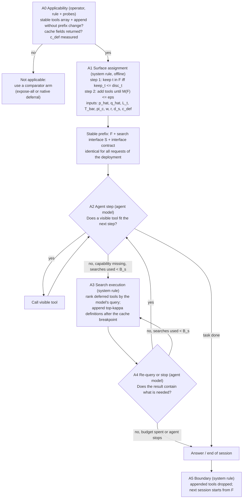

# 01. The provisional policy candidate C-A

Status: provisional hypothesis about a decision rule, **not** validated, not selected as the thesis contribution, not claimed novel. Source: `design/proposals/DPR-0004.md` (design-proposer), as changed by challenges CH-0020..0034 and checked in RV-0003. Symbols are unset parameters; none has a value here.

## 1. Family vs policy (correction 1)
The AUTH-004 template (N0-N4) was a **family** with open slots. C-A is a **policy**: for every node it states the decision question, the actor, the inputs with their signal class, the rule form, the transitions, the cost, what happens if its assumption fails, and a test. Slots that remain open are listed in section 7 as human decisions, not as design freedom.

## 2. What C-A is, in plain words
1. **Offline, once per deployment (A0, A1).** Check that the provider supports the stable-prefix-plus-append pattern and measure what a deferred definition costs per turn. Then compute, tool by tool, whether it is cheaper to keep its full definition in a cached prefix or to leave it deferred, using estimated usage frequency, definition length, cache prices, expected session length and cold-cache probability; then add tools to the surface until the estimated chance of a *needed-but-unreached* tool is within a tolerance. The result is a surface `F`. If every tool qualifies, `F` is the whole catalogue and the policy **is** expose-all.
2. **Per session (prefix).** The prefix holds `F`, a search interface `S`, and an interface contract (the visible tools are a subset; a short metadata-derived scope statement of what is deferred; instruction to search before answering without tools; the search budget). The prefix is identical for every request of the deployment.
3. **During the run (A2-A4).** The agent model calls a visible tool if one fits; if a capability seems missing it calls `S`; the system ranks the deferred tools against the model's query and **appends** the top results after the cache breakpoint; the model re-queries or stops, within a search budget.
4. **At the end (A5).** Appended tools are dropped; the next conversation starts from `F`. No removal inside a session, no per-task adaptivity, no system-side trigger.

## 3. Graph

## 4. Decision table
| Node | Decision question | Actor | Inputs (class) | Rule form | Transitions | If its assumption fails | Test |
|---|---|---|---|---|---|---|---|
| A0 | Can the pattern be used here, and what does a deferred definition cost per turn? | operator applying a predicate and probes | provider documentation (R); probe usage/cache fields (R) | conjunction of booleans (append without prefix change documented; second identical request reports a cache read; prefix cacheable) plus a measurement of `c_def` | all true -> A1; else comparator arm | docs differ from behaviour; deferred definitions billed in full (then A1 returns `F = K`) | probe on the real endpoint |
| A1 | Is it cheaper and safe enough to keep `t` in the prefix than to defer it? | system rule, offline | `L_t`, `n` (R); `p_t`, `q_t` (D, disjoint dev data); `T_bar`, `pi_c` (declared or from dev traffic); `w`, `r`, `d_s`, `c_def` (R, measured); `eps` (human, mapped from `delta`) | step 1: `keep_t = (L_t - c_def)[pi_c w + r (T_bar - pi_c)]`, `disc_t = p_t [d_s + (w + r T_rem)(L_t + (kappa-1) L_D)]`; `t in F` iff `keep_t <= disc_t`. Step 2: while `M(F) = sum over deferred p_t q_t > eps`, move to `F` the tool with the largest `p_t q_t / keep_t` | `F` fixed, prefix fixed | `p`, `q` unstable or biased; `q` depends on `F` (assumed not) | held-out coverage vs size-matched controls (HYP-0014); predicted vs observed unreached needs; A1 vs an empirical sweep |
| A2 | Does a visible tool fit the next step; if not, is a capability missing? | agent model (we control only the interface contract) | request, transcript, tool results, surface (R) | none for the model: its behaviour is the measured variable (HYP-0010); the contract content is fixed on dev data | fits -> call; missing -> A3 | the model does not search | initiation rate with the tool deferred, prompted vs unprompted |
| A3 | Which deferred definitions best match the model's query? | system rule | the model's query (R); metadata of deferred tools (R); ranker tuned on dev (D) | rank by lexical/embedding/both over name, description and argument names; return top-`kappa` | append; -> A4 | miss; noise appended | recall@`kappa` on scripted queries |
| A4 | Does the result contain what is needed? | agent model | transcript, empty-result messages, search count (R) | none for the model; system caps searches at `B_s` | yes -> A2; no and budget left -> A3; no and spent -> end | gives up early | re-query and give-up rates |
| A5 | When is the surface reset? | system rule | conversation-end event (R) | drop appended definitions | -> start from `F` | accumulated appended tools cost more than expected | add-only vs other surface-change arms (HYP-0009) |
`p_t` = share of dev sessions in which `t` is **needed**; need is operational: `t` is called by the agent in a **successful** dev run of the reference policy (never the annotated required set). `q_t` = among those sessions, the share in which a pilot of the search path does not reach `t`. Call frequency is a proxy for need, not need itself; survivorship bias from conditioning on success under-counts tools of tasks the reference policy fails; where the reference policy cannot run (the flat catalogue exceeds context) `p_t` is censored and **no claim is made there**. `eps := delta` is a sufficient, conservative mapping (expected success loss from deferral is at most `M(F)` times the success loss when a needed tool is missing, at most 1), conservative only if `p`, `q` are unbiased.

## 4a. How a tool's grade is chosen and how the surface changes in session (correction 3)
- **Grades.** Two: *full* (in the prefix surface `F`) and *deferred* (not listed). The grade of each tool is the output of rule A1; there is **no per-task grade**. A *listed* grade (name and description visible, schema deferred, the OpenAI default) is not in C-A; it is the comparator P4, because a listing costs tokens every turn for every deferred tool and grows with the catalogue.
- **In-session change.** Only by A3: append the top-`kappa` definitions for a model query after the cache breakpoint; never reorder or remove inside a session. At A5 the appended set is discarded. Mid-session removal is excluded from the candidate and tested as an arm (section 6).

## 5. What N0 is (correction 2)
Not a node. Its two parts: (i) *which arms are evaluated* is evaluation design (outside the policy); (ii) *whether to restrict at all* is decided inside the policy by A1 (an explicit rule with named inputs available before deployment); when it returns `F = K` the candidate is expose-all. No learned selection rule is proposed. **No adaptivity is claimed** beyond the model's own search; a rule re-estimated from deployment logs at conversation boundaries is a possible extension, not specified here.

## 6. Add-only is a hypothesis (correction 4)
Add-only is the candidate's default for three reasons, each of which can be wrong: appended discovery is documented as cache-preserving by two vendors (claims, not measurements); a mid-session rewrite re-writes the whole conversation prefix, which pays only for long remaining horizons; persisting false-positive appends are bounded by `B_s x kappa x L x (w + r T_rem)` per session. It is **tested against** by-reference withdrawal (one provider's beta; whether withheld definitions are billed is unknown), boundary rewrite (free when the entry has lapsed), a free-rewrite window, a stable meta-tool, and a per-request varying set (cache-hostile unless the loop is long enough). Details and cost expressions: `03-evaluation-outline.md` and `DPR-0005` section 4. What would overturn adoption: a measured billed saving from withdrawal that exceeds the accumulated append cost; evidence that persisting appended tools lowers success; a provider without append support (A0 fails).

## 7. Runtime-information test, every decision (correction 7)
Class R = available by construction, D = from separate offline data, X = exists only after execution, P = prohibited at runtime. The challenger audited every row; **no row uses gold tools, reference trajectories or benchmark annotations at runtime as written**.
| Decision | Inputs | Class | Exists when the actor acts? | Leakage route | Test |
|---|---|---|---|---|---|
| A0 | provider docs, probe fields | R (config) | yes, before deployment | docs differ from behaviour | probe returns cache-read tokens on the second call |
| A1 lengths, prices, `d_s`, `c_def`, `pi_c` | catalogue metadata, price table, measured round trips, cadence | R / config | yes | benchmark stub schemas make `L_t` unrepresentative; `r` taken from the vendor page instead of the tested provider; cadence taken from the replay | state source of `L_t`; estimate `r`, `c_def` from the tested endpoint; sweep `pi_c` |
| A1 `p_t` | the agent's calls in successful dev runs of the reference policy | D | yes, if dev runs precede deployment | dev tasks overlap evaluation tasks; computed from annotated required tools (P); censoring and survivorship bias | split recorded; permute annotation fields and check `F` unchanged; recompute from all sessions and compare |
| A1 `q_t` | pilot of the search path on dev | D | yes | pilot on evaluation tasks; tool names in task text make search trivial | strip names; split audit |
| A1 `T_bar`, `T_rem` | dev sessions or a declared regime value | D / config | yes | taking the benchmark's horizon as the deployment's | report as a regime variable; sweep |
| A1 `eps`, `N_dep`, `delta` | human decisions | config | yes | tuned after seeing results | pre-registration |
| A2 | request, transcript, surface, contract | R | yes | vehicle error messages that list the exposed surface and steer toward the reference route; tool names in task text | run with names removed; compare |
| A2 scope statement | catalogue metadata only | R | yes | written with knowledge of evaluation tasks or gold tools | write from metadata; audit; count its tokens as exposure |
| A3 | the model's query, metadata of deferred tools, ranker | R + D | yes | ranker tuned or indexed on evaluation tasks; richer stub schema as a cue | tune on dev only; ablate schema fields |
| A4 | transcript, empty-result messages, search count | R | yes | vehicle empty-result messages steering toward the reference | message audit |
| A5 | conversation-end event | R | yes | none | none |
Not used at runtime: gold tool lists, reference trajectories, benchmark annotations, task category labels, definitions U1-U3, final success.

## 8. Objective, outcomes, strata, diagnostics (correction 6)
- **Primary research objective (needs justification; the formulation is a scientific choice).** The AUTH-004 sentence read as a **non-inferiority-constrained cost comparison on the task population** (formulation F1, reading **O1**): among policies whose population success is not below the reference by more than `delta`, prefer the lower population cost counting deciding, discovering and using (all categories). Reason: the sentence states performance preservation as a constraint and cost accounting as the quantity reduced; F1 needs only `delta` and a reference, whereas a scalarised form needs an exchange rate with no anchor and a budget form needs a deployment. Weakness: `delta` is unjustified here and is a human decision; where no reference policy runs, F1 is undefined.
- **A second reading, O2:** minimise exposure (count or visible tokens) subject to success non-inferiority and a total-cost bound `gamma`. At a low cache-read price the two can give opposite headlines. **Rule A1 as written is the O1 form; under O2 it must be replaced** (the program becomes "minimise exposure subject to cost and miss constraints", a different surface). Which reading governs is a human decision; the evaluation records both for every arm.
- **Measured outcomes (optimisation criteria):** population success; population cost under a named convention (billed, cumulative tokens by category); exposure (`c_tools`, visible tokens). **Reporting requirements (not optimised):** the full vector for every arm, stratified by catalogue size and provider/cache regime, model, a reference-partition stratum defined before the run, horizon; cache fields, initiation rate, search recall, decision overhead, turns. **Offline cost** of the policy (dev runs, pilot, tuning) is reported and amortised over a declared number of deployed sessions `N_dep`.
- **Optional diagnostics:** definitions U1-U3 of "unnecessary exposure" (scorer-side only; never an optimisation target, never a runtime input).
- **Q1 (count vs tokens) stays open.** Under the cost reading A1 uses lengths and cache terms. Under the count reading the length term becomes a per-tool constant, A1's step 1 reduces to a threshold on usage frequency, and `F` is ranked by frequency rather than frequency per token: a different surface in general. The criterion is fixed before the run, never chosen after seeing data.

## 9. Open human decisions that keep C-A from being run
`delta` (and whether `eps` may be tighter than `delta`); O1 vs O2 and `gamma`; `N_dep`; the cost convention and tokenizer; the reference policy or its substitute where expose-all does not fit; Q1; the interface-contract wording and ranker type (fixed on dev data); which of U1-U3, if any, are reported.
