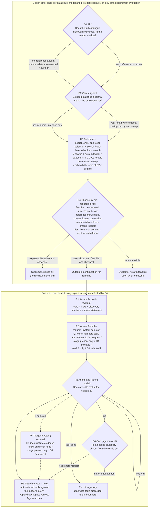

# 02. Provisional supervisor-facing decision graph G

**Status: a conceptual hypothesis, not an empirically supported policy.** Not validated, not final, not selected as the thesis contribution, no novelty claim. Written by the lead for AUTH-006 from the AUTH-004/005 records and the independently verified source passages (claim-to-source labels in `design/package-v2/04-claim-to-source-register.md`). No threshold, stage count or empirical benefit is asserted. Symbols (`delta`, `kappa`, `B_s`) are unset.

## 1. What the supervisor asked for, and how G answers it
The supervisor's requirement (REQ-S2, REQ-O14-08/09/12/13/15; excerpts are requirements and examples, not findings): a **policy, not a fixed top-N cut-off**, that **depends on context and scenario**, finds its **questions and stages**, and can **go back and add** a capability that an earlier step left out. Whether the staged question-per-step form is binding is open (REGISTER G.3 Q2); the stage count and "10,000" are the supervisor's illustration and are not used.
G reads these as: *context* = the request (known before the first turn) and the trajectory (known only after it starts); *staged narrowing* = ordered **optional** stages, each present only if a stated reason holds and each skippable by a stated condition; *reintroduction* = a path that adds a deferred capability during the run. The number of stages is an **output** of a testable rule (node D4), not an input; it may be zero (expose-all), one, two, or more only where a measured cost condition holds.

## 2. Why this is a graph with a conditional decision, not a selected mechanism
The record does not discriminate between two ways of deciding what to show a model beyond a stable core: **let the model ask** (model-emitted discovery) and **let the system pre-select from the request** (query-conditioned narrowing, the supervisor-shaped stage). Evidence on each is thin and mixed: retrieval lowered success in several settings; an unreached tool is almost a certain failure in the one benchmark that measured it; a two-stage router matched single-stage retrieval in success with no token data; whether models initiate discovery when a needed tool is absent is unmeasured. G therefore **does not select**; node D4 selects by a pre-registered dev comparison, and records why.

## 3. The graph

## 4. Node table: questions, information, actors, actions, transitions, recovery assumptions
Signal classes: **R** available by construction at the moment of decision; **D** derived from separate offline data (disjoint from evaluation; split recorded); **X** exists only after execution; **P** prohibited at runtime (gold tool lists, reference trajectories, benchmark annotations).
| Node | Question | Actor | Information (class) | Action | Transitions | Included when / skipped when | Recovery assumption | Evidence status |
|---|---|---|---|---|---|---|---|---|
| D1 | Does the catalogue plus working context fit the model window? | operator | catalogue size and token length, model window (R) | label the regime; if not fit, name the substitute reference | -> D2 | always | none | fact check |
| D2 | Do need statistics exist that are not the evaluation set? | operator | dev runs of a feasible reference, or logs of a deployed policy with exploration (D) | if yes, rank tools by incremental token saving per unit of estimated miss mass; cut the core by an **end-to-end dev sweep** (correction 2-3 of the errata); if no, **skip the core** | -> D3 | skipped at large catalogue sizes where no reference ran and no logs exist (the typical original problem) | none | heuristic ordering only; no optimality or safety property |
| D3 | Which arms are tested? | operator | the arm list (config) | build the arms listed in the graph, each with and without the core | -> D4 | always | none | design |
| D4 | Which arm satisfies noninferiority at the lowest tokens? | operator applying a pre-registered rule | dev outcomes: end-to-end success and cumulative model-visible tokens per arm with intervals (D, scorer-side) | choose among feasible arms the lowest token cost; ties to fewer components; confirm on held-out; record why each rejected arm was rejected | OUT0 / OUT1 / OUT2 | always | tests recovery assumptions end to end | the **conditional decision**; margin `delta` undecided |
| R1 | none (assembly) | system rule | configuration from D4 (R) | place core, discovery interface and a metadata-only scope statement in the stable prefix | -> R2 | always (core part skipped if D2 = no) | none | engineering |
| R2 | Which non-core tools are relevant to **this request**? | system selector (rule, embedding model, or LLM: unset; its tokens counted) | request text; catalogue metadata (R); scorer calibrated on dev (D) | add the selected definitions before turn 1, after the stable prefix | -> R3 | **present only if D4 selected it.** Skipped when search-only is noninferior and cheaper, or when no selector reaches noninferiority. Second level present only if D4 selected it, and a measured cost condition holds: `b_1 + a_1 n_0 < a_2 (n_0 - n_1)` (tokens) | a tool cut here is reachable only through R4-R5 | hier ~ single-stage in success (EXT-0053, no token data); retrieval lowered success in several settings; reachability gate (EXT-0053, EXT-0045) |
| R3 | Does a visible tool fit the next step? | agent model | request, transcript, tool results, visible set (R) | call a visible tool, or answer | call -> R3; none fits -> R4; done -> End | always | none | model behaviour |
| R4 | Is a needed capability absent from the visible set? | agent model | same as R3 plus the scope statement (R) | emit a search or describe request with a query written from its context | yes -> R5; no or budget spent -> End | present whenever anything is deferred (always unless D4 chose expose-all) | **RA1: the model emits the request when a needed tool is absent** | untested (HYP-0010); FitText prescribes the protocol by prompt with no other tool visible (EXT-0065) |
| R5 | Which deferred definitions best match the query? | system rule (ranker over name, description, argument names) | the model's query; metadata of deferred tools (R); ranker tuned on dev (D) | append top-`kappa` definitions to the context (add-only default); count one search | -> R3 | present with R4 | **RA2: the needed tool is within `kappa` results; RA3: appended results do not degrade later steps; RA4: the trajectory has enough turns** | ranker recall measured on scripted queries |
| R6 | Does runtime evidence show an unmet need? | system classifier over runtime text, failures, termination (class R if zero-shot, D if tuned) | transcript signals (R) | re-rank with the evolving context and append | -> R5 | **skipped by default; present only if D4 selected an arm with it** | RA5: the trigger's precision and recall suffice; false positives persist for the trajectory | no stored evidence for a system-side trigger; oracle-triggered extra turns gave under five points in a planning benchmark (EXT-0063/0064, bounds only) |
| End | boundary | system | end-of-trajectory event (R) | discard appended definitions | next trajectory starts from R1 | always | none | engineering |
**Add-only is a default of simplicity, not of caching.** Under the token objective, cache invalidation does not enter the criterion (it enters the billed-cost report). Appended definitions stay in context and are re-read each later turn, so unused false-positive appends cost tokens until the boundary; they are bounded per trajectory by `B_s x (d_s + kappa L_D) x tau`. Withdrawal inside a trajectory is excluded because no stored evidence supplies a rule for when a tool is no longer needed (any such rule needs a signal and a parameter); removal by reference or at a boundary is a tested arm. The default may be wrong in token terms and is a hypothesis.

## 5. Stages that are deliberately absent, and why
| Stage | Absent because | Would be included if |
|---|---|---|
| Graded listing of every deferred tool (name and description visible) | a listing costs tokens every turn and grows with the catalogue; no evidence supports it at large `n` | a dev arm with it is feasible and cheaper than search-only |
| Repeated per-stage "is this still relevant?" filtering with a fixed stage count | the supervisor's illustration; no evidence that a second filtering stage pays; the stage count is an output of D4, not a parameter | the measured cascade condition holds and D4 selects it |
| A learned selector trained on labelled need | no legitimate labelled-need source exists at large scale in the record | such a source is obtained and kept disjoint from evaluation |
| In-trajectory removal | no stored evidence for a removal rule | a dev arm shows a token saving at noninferior success |
| System-side reintroduction trigger | no evidence for its precision or recall | model emission is shown inadequate on dev and a trigger arm is feasible and cheaper |

## 6. The testable conditional decision (D4), in words
For the catalogue, model and provider at hand: run the arms of D3 on dev tasks under one scorer. An arm is **feasible** if the lower bound of its end-to-end success difference from the reference is not below minus `delta` (`delta` undecided; the reference is expose-all where D1 says it fits, otherwise a named substitute and the claim is then weaker). Among feasible arms choose the lowest estimated cumulative model-visible input tokens, including all decider, search and recovery overhead; break ties toward fewer components. Confirm on held-out tasks. The decision is **repeated for each catalogue size**: the output is a function of size, not a single architecture. If expose-all is feasible and cheapest at small size, G says expose all there. Everything the evidence cannot settle (initiation, selector recall, second-stage value, trigger value) is thereby a measured input to D4, not an assumption of the policy.

## 7. What G is not
Not a validated policy; not an optimal one; not novel; not a claim that any narrowing stage helps; not a claim that the supervisor's staged form is right or wrong. Not a family with open slots either: each included stage has a question, actor, information, action and transition, and the only open choice (which arm) has an explicit rule.
