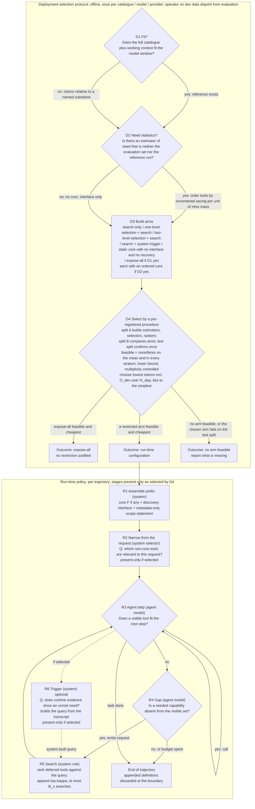

# 02. Provisional supervisor-facing decision graph G

**Status: a conceptual hypothesis, not an empirically supported policy.** Not validated, not final, not selected as the thesis contribution, no novelty claim. First drafted by the lead, then attacked by the design-challenger (CH-0035..0044, RV-0004); this is the revised text, and the changes and remaining disagreements are in `04`. No threshold, stage count or empirical benefit is asserted. Symbols (`delta`, `alpha`, `kappa`, `B_s`, `N_dep`) are unset. Evidence labels as in `design/package-v2/04-claim-to-source-register.md`.

## 1. What G is, plainly
G has **two layers and should not be read as one policy**:
- **Run-time policy (R1-R6):** what the agent and the system do for each trajectory, with optional stages.
- **Deployment selection protocol (D1-D4):** an offline procedure that decides, for a given catalogue, model and provider, **which optional stages the run-time policy contains**. D4 is *experimental arm selection* on labelled dev tasks (model selection over a small set of configurations). It is a legitimate part of a deployment procedure and a testable conditional decision, but it is **not** a run-time decision node and **not** a learned rule across settings unless that is tested (see `04`, experiment E6). The thesis claim, if any, concerns the arms and the evidence for them, not the tournament.
What the supervisor asked for (REQ-S2, REQ-O14-08/09/12/13/15; excerpts are requirements and examples, not findings): a policy that is **not a fixed top-N cut-off**, **depends on context and scenario**, finds its **questions and stages**, and can **go back and add** a capability an earlier step left out. The binding force of the staged question-per-step form is open (REGISTER G.3 Q2). The stage count and "10,000" are illustrations and are not used.

## 2. How far G answers the three needs, stated without flattery
- **Context.** Request-level context enters only through R2 (per-request narrowing), which exists only if D4 selects it. Trajectory-level context enters through the model's own requests (R4) and, if selected, a trigger (R6). If D4 selects neither R2 nor R6, the realised policy is *search-only*, i.e. vendor-style deferral without a hand-picked core, and context enters only through the model's queries.
- **Staged narrowing.** Stages are optional and ordered: core (D2), per-request narrowing (R2, level 2 optional), in-run discovery (R5). The number of stages is an **output** of D4 and may be zero, one or two. Defining a stage as "present only if a stated reason holds" makes the requirement satisfiable by any design, including expose-all; G's content is that each stage has a stated reason, a skip condition and a test, **not** that stages appear.
- **Reintroduction.** R4-R5 is the model's search for a capability missing from the visible set. It re-adds something an *earlier stage removed* only when R2 is present; otherwise it adds something that was never shown.
So G answers the supervisor's requirement **conditionally on arms for which the record has no evidence**; it preserves, rather than resolves, that uncertainty.

## 3. The graph

## 4. Node table: questions, information, actors, actions, transitions, recovery assumptions
Signal classes: **R** available by construction when the actor must act; **D** derived from separate offline data (disjoint from evaluation; split recorded); **X** exists only after execution; **P** prohibited at runtime (gold tool lists, reference trajectories, benchmark annotations).
| Node | Question | Actor | Information (class) | Action | Transitions | Included when / skipped when | Evidence status |
|---|---|---|---|---|---|---|---|
| D1 | Does the catalogue plus working context fit the model window? | operator | catalogue size and token length, model window (R) | label the regime; if not fit, name the substitute reference (claims are then weaker) | -> D2 | always | fact check |
| D2 | Is there an estimator of need that is not the evaluation set and not the reference run? | operator | reference dev runs, labelled need on a disjoint split, group-level need, unseen-mass estimates, or logs with exploration (D; see errata 4) | if yes, order tools by incremental token saving per unit of miss mass (errata 3, token form, including the defer-at-all test); the cut is made by the end-to-end sweep in D4; if no, **no core** | -> D3 | skipped when no such estimator exists (typical at large catalogue sizes) | heuristic ordering; no optimality or safety property |
| D3 | Which arms are compared? | operator | arm list (config) | build: search-only; one-level selection + search; two-level selection + search (built whenever group structure exists); search + system trigger; static core with **no interface and no recovery**; expose-all when D1 = yes; each with the ordered core when D2 = yes | -> D4 | always | design |
| D4 | Which arm is feasible and cheapest? | operator applying a pre-registered procedure | end-to-end success and `C_tok` per arm (D, scorer-side), with intervals | **Procedure (specified after review).** Three disjoint task splits: A builds estimators, selectors and rankers; B compares arms (each split used once for one purpose); a test split confirms the chosen arm once and its estimates are the reported ones (the dev estimate of the winner is biased by selection). Feasible = lower confidence bound of the success difference to the reference is not below minus `delta` on the mean **and** in every pre-registered stratum, with family-wise error `alpha` controlled over the number of arms. Cost = `C_tok` including `O_dev / N_dep`. Choose the lowest estimated cost among feasible arms; **ties** = arms whose *paired* cost difference to the cheapest feasible arm has an interval containing zero: choose the one with the fewest components (the common tournament cost `O_dev / N_dep` does not change the ranking among arms and is added only for the comparison with a fixed alternative). Record why each rejected arm was rejected. **(a) Arm space.** The arm list is fixed *before* any split is run, as an explicit finite table (selector type, ranker, `kappa`, `B_s`, scope-statement wording, core-size sweep points); `alpha` is controlled over that count, so the table and its size are a human decision, and a larger table lowers power. Nothing here fixes the table. **(b) Test-split failure.** If the chosen arm is not feasible on the test split, the procedure does not fall back to the runner-up on the same split (that would reuse it); it reports OUT2 for that setting and records the dev-versus-test gap as evidence of selection bias. A further search needs new tasks. **(c) Power.** With the mean-and-every-stratum rule, a thin stratum gives a wide lower bound that can make every restricted arm infeasible; with ties to the fewest components D4 then returns expose-all (OUT0) **for lack of power, not because expose-all is cheaper**. A minimum stratum size is a human decision; a stratum below it is reported as *not assessed* rather than silently dropped, and OUT0 from an under-powered stratum must be labelled as such, not read as a finding. **(d) Substitute reference.** Where the reference cannot run (D1 = no), the substitute is named *before* D4 from a rule that does not use the arms' results: the largest configuration that fits the window that is not itself one of the compared restricted arms, or a human-named alternative; it is never chosen after seeing which arm it favours. Claims are then relative to it, and it cannot be shown to be noninferior to the true reference | OUT0 / OUT1 / OUT2 | always; needs labelled tasks and a scorer (a deployment without them cannot run D4, and G then offers no evidence-based selection) | the **conditional decision**; margin `delta` undecided; error rates of the procedure unknown (simulation, `04` E6) |
| R1 | none (assembly) | system rule | configuration from D4 (R) | place core (if any), discovery interface and a metadata-only scope statement in the stable prefix | -> R2 | always | engineering |
| R2 | Which non-core tools are relevant to **this request**? | system selector (rule, embedding model, or LLM: unset; LLM tokens counted) | request text; catalogue metadata (R); scorer calibrated on split A (D) | add the selected definitions before the first call, after the stable prefix | -> R3 | **present only if D4 selected it.** Level 2 reads only the metadata of tools in groups surviving level 1. *Reading-cost saving (necessary, not sufficient):* with `b_j` the fixed tokens per invocation of level `j` (including the prompt read if an LLM), `a_j` the tokens read per candidate, `n_0` candidates entering level 1 and `n_1` surviving, level 2 can reduce reading cost only if `b_1 + a_1 n_0 < a_2 (n_0 - n_1)`; whether it helps end to end (recall of level 1, downstream tokens, success) is decided by D4, not by this inequality | hier ~ single-stage in success (EXT-0053, no token data); retrieval conditions below a curated pool (EXT-0053) and below full exposure in ComplexMCP and ToolMenuBench (EXT-0026, EXT-0028; MAP/RP) |
| R3 | Does a visible tool fit the next step? | agent model | request, transcript, tool results, visible set (R) | call a visible tool or answer | call -> R3; none fits -> R4; done -> End | always | model behaviour |
| R4 | Is a needed capability absent from the visible set? | agent model | as R3 plus the scope statement (R) | emit a search or describe request with a query written from its context | yes -> R5; no or budget spent -> End | present whenever anything is deferred | untested (HYP-0010); FitText prescribes the protocol by prompt with no other tool visible (EXT-0065) |
| R5 | Which deferred definitions best match the query? | system rule (ranker over name, description, argument names) | the query (from the model at R4, or built by the system at R6) and metadata of deferred tools (R); ranker tuned on split A (D) | append top-`kappa` definitions (add-only default); count one search | -> R3 | present with R4 | ranker recall on scripted queries |
| R6 | Does runtime evidence show an unmet need? | system classifier over runtime text, failures, termination (class R if zero-shot, D if tuned) | transcript signals (R) | decide to fire; a re-ranker builds the query from the transcript | -> R5 | **skipped by default; present only if D4 selected an arm containing it** | no stored evidence for a system-side trigger; the only trigger-like result (EXT-0063/0064: an extra turn inserted after an *incorrect* termination in a planning benchmark, under five points for most models) concerns extra turns, does not restore a missing capability and says nothing about whether a runtime trigger can tell when one is needed |
| End | boundary | system | end-of-trajectory event (R) | discard appended definitions | next trajectory from R1 | always | engineering |
**Recovery assumptions made explicit** (every one is an end-to-end risk that the success constraint in D4 tests, none is assumed true): RA1 the model emits a request when a needed tool is absent; RA2 the needed tool is within `kappa` results; RA3 appended results do not degrade later steps; RA4 the trajectory and search budgets allow the extra calls; RA5 (R6 only) the trigger's precision and recall suffice and false positives persist for the trajectory; RA6 the scope statement tells the model enough to search without leaking gold information; RA7 the model understands the interface schema; RA8 the search budget `B_s` is adequate; RA9 appended definitions remain visible for the rest of the trajectory; RA10 tool names and arguments obtained by search are valid at call time; RA11 the extra-call cost of each discovery (a full prompt re-read) does not exceed the tokens saved by deferral (errata 3); RA12 changing the visible tool set mid-trajectory does not invalidate the model's earlier plan or the cached prefix beyond what is counted; RA13 the model's query vocabulary and the tool descriptions match well enough for the search to surface the tool (a vocabulary mismatch is a recall failure, counted in `q`). Failure of RA1-RA4 is a lost task, not a degraded one. If the R6 trigger is selected, its timing (before or after the failing step) and the provenance of any scripted query (derived only from R-class information) are part of the arm's specification and are not fixed here.
**Add-only is a default of simplicity, not of caching.** Under the token objective cache invalidation does not enter the criterion. Appended definitions stay in context and are re-read by each later call, so unused false-positive appends cost tokens until the boundary. Withdrawal inside a trajectory is excluded because no stored evidence supplies a rule for when a tool is no longer needed (any rule needs a signal and a parameter); removal by reference or at a boundary is a tested arm. The default may be wrong in token terms and is a hypothesis.

## 5. Stages deliberately absent, and why
| Stage | Absent because | Would be included if |
|---|---|---|
| Graded listing of every deferred tool (name and description visible) | a listing costs tokens in every call and grows with the catalogue; no evidence supports it at large `n` | a dev arm with it is feasible and cheaper than search-only |
| Repeated per-stage "is this still relevant?" filtering with a fixed stage count | the supervisor's illustration; no evidence that a second filtering stage pays; the stage count is an output of D4 | D3 builds the two-level arm and D4 selects it |
| A learned selector trained on labelled need | no legitimate labelled-need source in the record at large scale | such a source is obtained and kept disjoint from evaluation (D2 option (a)) |
| In-trajectory removal | no stored evidence for a removal rule | a dev arm shows a token saving at noninferior success |
| System-side reintroduction trigger | no evidence for its precision or recall | model emission is shown inadequate on dev and a trigger arm is feasible and cheaper |

## 6. The conditional decision, in words
For the catalogue, model and provider at hand: run the arms of D3 on split B under one scorer. An arm is **feasible** if the lower confidence bound of its success difference from the reference is not below minus `delta` on the mean and in every pre-registered stratum (strata fixed beforehand; the tail-dilution guard is the stratum condition). Among feasible arms choose the lowest estimated cumulative model-visible input tokens, including all decider, search, recovery and amortised design-time overhead; arms within the confidence interval of the minimum are tied and the simplest wins. Confirm once on the test split. The decision is **repeated per catalogue size**; if expose-all is feasible and cheapest at a small size, G says expose all there. The factual conditions (D1, D2) are checkable without data; the empirical condition (D4) is a stated procedure whose error rates are unknown and are the subject of experiment E6.

## 7. What G is not
Not a validated policy; not an optimal one; not novel; not a claim that any narrowing stage helps; not a claim that the supervisor's staged form is right or wrong; not a policy family without a rule (the only open choice, which arm, has an explicit procedure); and **not one policy**: R1-R6 is the policy family, D1-D4 the selection protocol that fixes its stages. If a human prefers a single run-time policy, the candidate for one catalogue regime is the configuration D4 returns there; the record cannot name it in advance.
