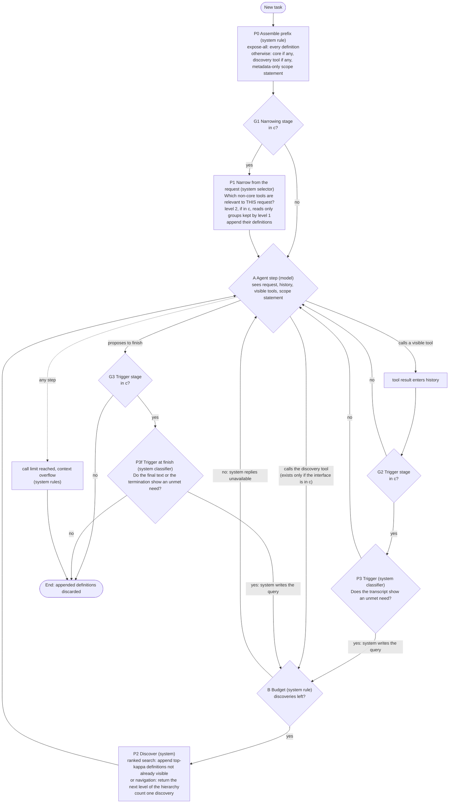

# A tool-exposure policy for LLM agents: conceptual proposal for the 21 October 2026 meeting

Written for: the student's supervisor (A.F.M. Mohimenul Joaa), as read-ahead and talking points for a 10-15 minute discussion. Prepared 2026-10-19 under AUTH-010; versioned correction of `design/package-v3/`; second draft after an independent critical review (`reviews/RV-0005.md`).
**Status: conceptual proposal. Nothing has been implemented or run. Every statement about how well the policy would work is a hypothesis.** Technical specification: `02-policy-graph-and-protocol.md`; what changed since the last review and why: `03-review-adjudication.md`. Evidence labels: **read** = a source passage was read by us; **vendor** = a vendor's own claim; **derived** = our arithmetic from stated inputs; **untested** = a hypothesis with a falsifier.

## 1. The problem, with numbers
An agent connected to a large tool catalogue pays for every tool definition on **every model call**, and can only call tools it can see. Two quantities follow, and neither is the number of tools: the **tokens** the model reads over a whole trajectory (definitions are re-read at each call, and every search adds a call) and **success** (a tool that is never shown can never be called).
- Scale (**derived**, three sources of different quality): about 100 tokens per tool or less (ComplexMCP's authors: about 30,000 tokens for 300+ tools); about 250 (the closest benchmark repository's development document: about 292k tokens for 1,168 tools, second-hand, and our digests say it is unverified (S4F) and "not clean" (S4G) because distractor tools carry placeholder schemas); about 1,000 (a vendor: 405,100 tokens for 400 real MCP tools, **vendor**, EXT-0023). At 10,000 tools that is roughly **1 to 10 million tokens per call**, at or above the 0.2-1 million windows named in our digests. Showing everything is then infeasible in practice, and the question becomes how to stay feasible without losing success.
- At small catalogues "show everything" may well win. The vendor's table at 40 tools is mixed: a simple task cost more with progressive disclosure ($0.072) than with all tools loaded ($0.045), a complex task favoured progressive ($0.051 against $0.146); the vendor calls its results "preliminary ... a handful of test runs" (**vendor**, EXT-0023, unreplicated).
- So we read the research question as having a regime structure: which exposure configuration is feasible and cheapest, **as a function of catalogue size, definition length, trajectory length and model behaviour**. We offer this as our reading of your "which one works at which time"; the excerpt does not define "which one" or "time", so please correct it.

**Working criterion** (an instruction to us for this task, not your wording; margin undecided): minimise cumulative model-visible input tokens over complete trajectories, all decision and discovery overhead included, subject to end-to-end success not below a reference by a margin `delta`, on the mean and within strata. Tool count, token categories, billed cost and cache behaviour are recorded separately, never merged.

## 2. The proposal in five sentences
1. Start every task with a **small stable prefix**: an optional small core of tools, a discovery interface over the rest, and a short metadata-only statement of what exists behind it.
2. Optionally, a **system selector** first adds the tools it judges relevant to this request (one or two levels).
3. The **agent works**; when it finds a needed capability is not visible it asks through the discovery tool; the system (or a navigated hierarchy) returns matches, which are appended and stay until the task ends. Optionally, a **system trigger** fires such a search when the transcript, after a tool result or when the agent proposes to finish, shows an unmet need.
4. Which of these optional stages a deployment contains is **not fixed in advance**: it is decided per catalogue, model and provider by the measurement protocol below, and a component is kept only in the configuration that rule finally chooses (`02` sections 5-6); if the data cannot separate the feasible configurations, we report the set, keep no component by default, and say so.
5. **If no stage is shown to pay, we report that.** At realistic sample sizes the outcome may be "not established" rather than "no stage pays"; these are different findings (`02` section 7), and we will not turn the first into the second.

`c` is the configuration chosen offline; gates G1-G3 read `c`, not the world. With all gates "no" this is vendor-style deferral; with no discovery tool it is a static core without recovery; with expose-all, P0 loads everything. The call limit counts every model call, including discovery and denied requests.

**Measurement protocol** (`02` Figure 2; a research design, not a run-time rule): check by measurement whether the whole catalogue fits the window; fix the list of configurations before any run; run all on one scorer with paired intervals, tokens including every overhead, overall and per stratum. Where expose-all fits, require noninferiority to it. Where it does not, report the (tokens, success) frontier and its gap to a pool reference built from the needed tools plus distractors (calibrated against expose-all at the sizes where both exist); choosing a policy from that frontier needs a margin or token budget from you. Confirm the choice once on held-out tasks. Repeated across catalogue sizes, this yields a map of which configuration wins where.

## 3. How it answers your requirements, and where it does not
| You said (14 Oct excerpts; our record of 2 Oct) | How the proposal answers | Where it falls short |
|---|---|---|
| Not a top-N cut-off; "based on the context and based on the scenario" (excerpt E5; both words undefined in it) | No fixed N; stages gated by measured conditions | Context enters only through the model's own requests and, if selected, P1 (request level) and P3 (trajectory level). Adaptation to *scenario* is at deployment level (catalogue, model, provider), not per task. We do not know which meaning of "context" you intend. |
| "At each step you have to ask yourself one question ... stage one, stage two ... you have to find find [sic, transcript] those questions and the stages" (E7; we cannot tell whether the staged form is binding or an illustration) | Every stage has a stated question and answerer (figure and `02` note 8) and a stated test for keeping it | The stage count is an *output* (zero, one or two narrowing levels plus discovery). The model (navigated hierarchy) or the system (selector) can answer each question; no source tells which is better. |
| A tool dropped at stage four can come back at stage five (E8, permissive "can") | Discovery re-adds; it re-adds something an earlier stage *removed* only if request-level narrowing is present | Otherwise it adds something never shown. No stored source shows a system trigger can tell that a tool is missing; the figure places the trigger both after tool results and at finish. |
| One scorer and one evaluation path for every method (E2); "which one works at which time we have to figure it out" (E4); "some kind of findings otherwise it's not a master's thesis" (E3) | One scorer; regime map across sizes | The map needs experiments that are not authorised. |
| "That is your novelty" for the graph (E8) | We make **no novelty claim**: every mechanism exists (section 6, item 8). The defensible content on present evidence is regime-conditional findings and a criterion that counts overhead. | This departs from your framing; we flag it rather than hide it. |
| The research question: "reduce the count of tools while keeping the accuracy as high as possible" (E1, a fragment; "we don't need to change it") | We use tokens and feasibility as the criterion and report the count | A departure from your unit, forced by the 10,000-tool example (section 1); your call (question 3). |
| Do not implement (E9) | Nothing implemented or run | |
| 2 Oct meeting (our record, REQ-M1 R1-R5, R10): save input tokens while maintaining accuracy; judged globally across turns; the mechanism's own tokens count; a baseline giving all tools; multiple baselines including existing open-source projects; a fallback when filtering is wrong | Criterion is cumulative tokens over whole trajectories with all overhead; discovery is the fallback; baselines in section 5 | "Maintain accuracy" needs a margin you have not given; beyond the window there is no expose-all baseline to maintain against (section 6, item 3). Our record also has "each step saves tokens" (R14) beside "judged globally" (R2); a design that adds a tool back needs your reading of which binds. |

## 4. What the evidence supports (and what it does not)
All rows are **read** from stored sources unless marked.
| Finding | Source and limits |
|---|---|
| **Reachability is a hard gate.** On tasks whose required tools the retriever never surfaced, pass^3 was 0.0% for all four models (at rag:8); one of 1,905 single attempts on such tasks passed. The share of tasks whose required tools were surfaced was 36.7% (k=4) to 75.3% (k=32). | DynamicMCPBench App. N, 1,168 tools, 150 tasks, four models, one retriever (EXT-0053). |
| **Retrieval-restricted exposure scored below a curated pool**: curated about 8 tools 37.3/42.7/44.0/54.0 versus rag:4 16.7/21.3/18.0/22.7 and rag:32 28.7/34.7/36.7/40.0 (four models). | Same; single attempts, per-cell 95% intervals about ±8 points. The curated pool contains the needed tools plus distractors, so this is a gap to an *oracle-reachability* reference, not to expose-all. |
| **Expose-all (one model) scored 8 points below the curated pool** (44.0 to 36.0) and is **not distinguishable** from rag:32 (36.7). | Same. Per-cell intervals of ±8 cannot settle an 8-point gap; the cells share tasks, so a paired analysis could resolve more, but none is reported. "Near-tie" is the authors' word and no test is given. |
| **Also below full exposure** in two further benchmarks: ComplexMCP (e.g. Claude-opus-4 41.84 full context versus 25.52 for its best retrieval variant, an iterative search-tool arm, the closest stored analogue of vendor deferral; the authors report that recent strong models largely tolerate distractors while others decline beyond about 300 candidates) and ToolMenuBench (keyword top-5 22.1% versus 32.1% for all tools, synthetic). | EXT-0026, EXT-0028; small scenario set, run-to-run standard deviations only; two LLMs, one embedder. ToolMenuBench's own best method (CMTF, 85.7% at 1,125 tokens) is described as determining visibility by "the next causally necessary action", which suggests it uses information a deployed policy would not have; we did not verify how it obtains it. |
| **A 97.5% cut in input tokens gave no clear billed saving in one regime and a large one in another**: in the natural replay (warm cache for the full library) 2,196 versus 87,074 tokens, billed difference +$0.000070 per request, 95% CI [-0.000524, +0.000462], accuracy 0.840 versus 0.787; with the cache suppressed, billed $0.000951 versus $0.037879 (-97.5%). | Toollery Table 15, one study, single-step replay, model and pricing not in the text (EXT-0061/0062). The cache multiplier implied by it is a fitted, study-specific number, not a price. |
| **Token reduction can raise billed cost**: compressing tool *outputs* cut estimated tokens 38.4% while paired cost rose 6.8% [2.8, 11.3]. | Tool outputs, not definitions (EXT-0016). |
| **Vendors ship deferral with search** and advise keeping the 3-5 most-used tools non-deferred; OpenAI notes "discovery adds a step and depends on finding the relevant tool" and calls mixing eager and deferred functions in one session "generally not recommended" (which bears on the core-plus-search rival). | **Vendor** documentation (EXT-0009, EXT-0012), unreplicated. |
| **The only trigger-like result is a termination trigger and is not comparable**: an extra turn after an *incorrect* termination moved most models by under 5 points in a planning benchmark. | PlanBench-XL (EXT-0063/0064); it needs to know the answer is wrong; it says nothing about detecting a missing tool. Our figure includes a trigger at finish for exactly this reason, so leaving a trigger out of a configuration is not evidence that triggers do not pay. |
| **At 18,505 tools, an *instructed* retrieval tool worked for a strong model at a cost premium**: GPT-5 completed 42.29% of tasks with a find-tools function against 44.57% with an oracle tool set, at $0.85 versus $0.66 per task; GPT-5-mini 22.86% versus 38.86%. Retrieval attempts per task were 0.9-8.7 (Azure tasks). | TheMCPCompany (arXiv 2510.19286, `05` and `findings/SUM-0005`); the system prompt tells the model to use the finder; no uninstructed condition; the oracle comparison includes retrieval failures, so the premium is an upper bound on discovery overhead; table columns read from the caption. |
| **Models do not reliably decline when the right tool is absent (three different constructs, not one rate)**: with no tool provided, 1.2%-67% of answers were tool calls depending on the model (When2Call, no search channel, multiple choice), and 1.0%-96.3% of responses were judged hallucinated when the query asked for a tool that was not provided (The Reasoning Trap: counts a direct answer or an invented tool; judge is also an evaluated model; large instruct models 1-11%, small or reasoning-tuned models far higher); with only irrelevant tools visible, about 20% (frontier mean) to 37.5% (open-source mean) of cases still produced a spurious call (Tool-Overuse Illusion, arXiv 2604.19749; per model 14.9% to 57.3%); for the same model these constructs differ by up to a factor of two; strong models often attempt a wrong-but-similar visible tool instead of abstaining (KAIST arXiv 2406.12307). In a long-division task with visible decoy tools, the largest sub-35B Qwen models mostly solved by hand and rarely called a tool until told that one tool works; the smallest probed freely because they could not do the arithmetic (LOMEKWI section 6, arXiv 2607.16961). | Different constructs from ours (no hidden catalogue, no search channel, or a manual route exists); read as false-positive and prompt-sensitivity risks, not as a rate of search initiation. |
| **Not found in the stored sources or the literature check (`05`)**: any measurement of how often a model uses a search channel *without being instructed* when no visible tool fits (per-task share with zero search calls); any system-side trigger for a missing tool; any second filtering stage paying (the two-stage router scored 0.7-4.0 points below rag:32 on every model, inside the ±8 interval; no token or cost figure for it was found in the passages read); the billed cost or cache fields of definitions appended mid-session on any provider. | "Not found" is not "does not exist": the check was 8 searches and 12 fetches, a convenience sample. |

Source check: the DynamicMCPBench rows, the ComplexMCP gaps, the vendor documentation and the vendor blog table were re-read by the evidence steward (`findings/SUM-0004`, ten claims from an earlier working draft); the Toollery, token-reduction and PlanBench-XL rows were read by us from the extracts (EXT-0061/0062, EXT-0016, EXT-0063/0064; Toollery and PlanBench also in `findings/SUM-0003`). The draft's cost-share claim (a 75% static-prefix share) is **not** used: the steward traced it to a different paper's Table 1 with an *inferred* cache attribution, and tool-result dominance holds for only one of two ProMCP workloads.

## 5. Alternatives we compared against
| Alternative | Verdict |
|---|---|
| **Show everything** | The reference where it fits; infeasible in practice beyond the window; may be cheapest at small sizes (the protocol can return it). Under the token criterion caching changes billing, not what the model reads. |
| **Fixed top-N retrieval** | Excluded by your requirement; scored below the curated pool for all four models. Kept as a baseline arm. |
| **Vendor deferral** (a few hand-picked tools plus search) | The strongest simple rival and a pre-committable two-regime rule ("show everything where it fits, vendor-style deferral beyond"); picking the core needs usage knowledge a large catalogue lacks. The question is whether any added component ever beats it. |
| **System-run cascade with a trigger** (closest to your picture) | No stored source supports the trigger; retrieval stages scored lower than curated or full exposure. Kept as optional stages P1, P3/P3f. |
| **Model-navigated hierarchy** (the model answers each stage's question: which group, then which tool) | Restored as an arm (it was an alternative in our first package and was dropped without a recorded reason). A vendor example exists (progressive search, EXT-0023, measured to 400 tools). Costs one call per level plus the listing tokens at each level. No independent measurement in the stored sources. |
| **Code-mediated or gateway access** | Not an exposure policy in the same sense; whether it must be a baseline arm is your call (question 6). |
| **Earlier candidate C-A** (a computed core by a break-even rule) | Demoted to a component: its rule needs usage statistics that a large catalogue does not supply, and its safety claim was withdrawn. |

## 6. What is not established (strongest objections first)
1. **The configuration is the output of a study that has not been run**; we cannot name it in advance. If the answer is "search only", the staged content of your request is empty for that regime. And at realistic sample sizes the study may return "not established", not a configuration.
2. **Models may not search** when a tool is missing; every discovery arm depends on that, and it is unmeasured. Failure is a lost task.
3. **No expose-all reference beyond the window** (roughly 200 to 10,000 tools fit, depending on definition length and window; on the most favourable figure the 10,000-tool example is a boundary case, not clearly beyond it). There the supportable claim is a frontier and a gap to a pool reference whose direction relative to expose-all is itself unproven; extrapolating from sizes that fit is an assumption with a stated test (`02` section 4). A policy chosen from a frontier needs a margin or budget from you.
4. **Power.** For margins of about five points or less, noninferiority per stratum or across several contrasts needs on the order of 800 to 2,300 paired tasks (**derived**, with an assumed 20% discordant pairs, `02` section 7); a single mean-level contrast needs about 500. The closest benchmark has 150 tasks in its exposure subset and 750 in its evaluation slice.
5. **Request-level narrowing at large size has no legitimate labelled data** for its recall.
6. **Tokens and billed cost can disagree**, so a token win can be a billed loss (and in one regime the opposite).
7. **The tool block may be a small share of tokens** for restricted configurations at some sizes. That would end the *token-saving* question there; it would not end the feasibility question beyond the window.
8. **Novelty.** Every mechanism here exists (vendor deferral, retrieval, hierarchical routers). We make no novelty claim. In our bounded reading we did not find a source measuring filtering and discovery policies jointly on success and billed cost, but that is a bounded negative result.

## 7. What we would measure first (none of it authorised; each needs your approval and a budget)
1. **Token and bill accounting** by category, catalogue size and outcome, for expose-all and restricted configurations, with billed cost beside tokens, plus a small matched check of the vendor-documented claim that appended definitions keep the cache (one named provider, model, TTL and layout; full usage records including output tokens; whether deferred definitions are counted). Cheap; localises where a policy matters.
2. **Do models use the search channel unprompted?** Primary cell: search tool present, no scope statement, no hint; then a ladder (generic statement, catalogue-specific statement, explicit existence hint) with pre-registered wordings and their tokens charged; arms with the target tool hidden-but-present, nonexistent, and a wrong tool visible; per-task share with zero search calls; a strong and a weak model. Falsifier: rates too low in the cell a deployment would use for any discovery arm to be noninferior.
3. **Recall of the ranker or selector** within the search width on a held-out split.
4. **End-to-end sweep** over the pre-registered configurations, one scorer, strata, held-out confirmation.
**What would count against the proposal:** expose-all or a hand-picked core plus vendor search being feasible and cheapest everywhere we can test; models not initiating search; the tool block being a negligible share of tokens for every configuration at every size that matters.

## 8. Questions for you (they change what the proposal should be)
1. **Is the staged question-per-step form binding,** or is a policy whose stages appear only where a stated test justifies them acceptable?
2. **What do "context" and "scenario" mean:** the individual request, the trajectory so far, or the deployment?
3. **Unit of the objective.** With 10,000 tools the count cannot decide feasibility (tokens do); may the count be a reported variable and tokens the criterion? Does "as high as possible" mean a margin (what size?) or a frontier?
4. **Beyond the window**, is a frontier plus a gap to a pool reference acceptable in place of noninferiority to expose-all, and who sets the margin or token budget from which a policy is chosen?
5. Would regime-conditional findings ("a second stage does not pay in regime X"; "show everything wins at size Y"), including "not established" outcomes, count as the findings required, given that the mechanisms themselves are not new?
6. Must the existing code-mediated project be a baseline arm, and is writing the evaluation script part of this deliverable?
