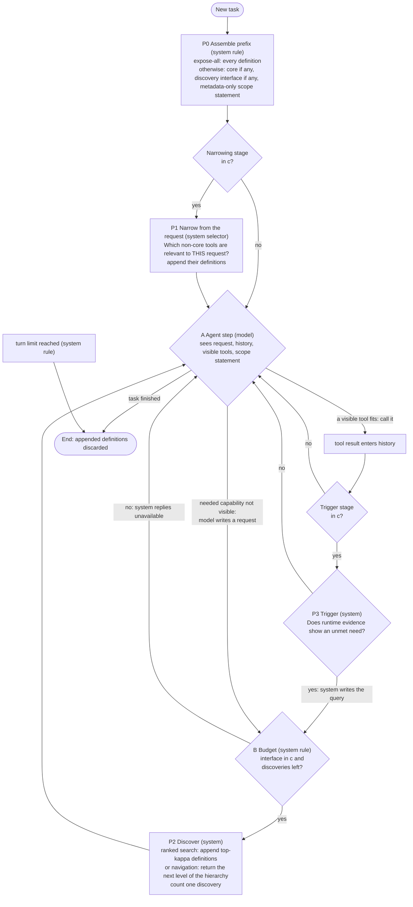

# A tool-exposure policy for LLM agents: conceptual proposal for the 21 October 2026 meeting

Written for: the student's supervisor (A.F.M. Mohimenul Joaa), as read-ahead and talking points for a 10-15 minute discussion. Prepared 2026-10-19 under AUTH-010; versioned correction of `design/package-v3/`.
**Status: conceptual proposal. Nothing has been implemented or run. Every statement about how well the policy would work is a hypothesis.** Technical specification: `02-policy-graph-and-protocol.md`; what changed since the last review and why: `03-review-adjudication.md`. Evidence labels: **read** = a source passage was read by us; **vendor** = a vendor's own claim; **derived** = our arithmetic from stated inputs; **untested** = a hypothesis with a falsifier.

## 1. The problem, with numbers
An agent connected to a large tool catalogue pays for every tool definition on **every model call**, and can only call tools it can see. Two quantities follow, and they are not the same as the number of tools: the **tokens** the model reads over a whole trajectory (definitions are re-read at each call, and every search adds a call) and **success** (a tool that is never shown can never be called).
- Scale (**derived**): the closest benchmark's repository estimates about 292k tokens for its 1,168-tool catalogue, a figure the project's own digests call "not clean" because distractor tools carry placeholder schemas (about 250 tokens per tool; second-hand, from the repository's development document); a vendor measured 405,100 tokens for 400 real MCP tools (about 1,000 per tool; **vendor**, EXT-0023). At 10,000 tools that is roughly **2.5 to 10 million tokens per call**, above any current window. So in the 10,000-tool example, showing everything is not just expensive, it is **impossible**, and the question is how to stay feasible without losing success.
- At small catalogues the answer may well be "show everything": in a vendor's table for 40 tools, a simple task cost more with progressive disclosure ($0.072) than with all tools loaded ($0.045), while the complex task at 40 tools favoured progressive ($0.051 against $0.146); the vendor calls its results "preliminary ... a handful of test runs" (**vendor**, EXT-0023). The pattern is mixed and unreplicated.
- So the research question has a regime structure: which exposure configuration is feasible and cheapest, **as a function of catalogue size, definition length, trajectory length and model behaviour**. That is the "which one works at which time" of your 14 October statement.

**Working criterion** (an instruction from the student for this task, not your wording; margin undecided): minimise cumulative model-visible input tokens over complete trajectories, all decision and discovery overhead included, subject to end-to-end success not below a reference by a margin `delta`, on the mean and within strata. Tool count, token categories, billed cost and cache behaviour are recorded separately, never merged.

## 2. The proposal in five sentences
1. Start every task with a **small stable prefix**: an optional small core of tools, a discovery interface over the rest, and a short metadata-only statement of what exists behind it.
2. Optionally, a **system selector** first adds the tools it judges relevant to this request (one or two levels).
3. The **agent works**; when it finds a needed capability is not visible it asks; the system (or a navigated hierarchy) returns the best matches, which are appended and stay until the task ends. Optionally, a **system trigger** fires such a search when the transcript shows an unmet need.
4. Which of these optional stages a deployment contains is **not fixed in advance**: it is decided per catalogue, model and provider by the measurement protocol below, and a stage is kept only if the configuration containing it is both noninferior in success and cheaper in tokens than the same configuration without it.
5. **If no stage pays, the answer is "no stage", and we will say so** instead of inventing stages.

`c` is the configuration chosen offline; the gates read `c`, not the world. With both gates "no" this is vendor-style deferral; with no interface it is a static core without recovery; with expose-all, P0 loads everything.

**Measurement protocol** (`02` Figure 2; a research design, not a run-time rule): check by measurement whether the whole catalogue fits the window; fix the list of configurations before any run; run all on one scorer with paired intervals, tokens including every overhead, overall and per stratum; where expose-all fits, require noninferiority to it; where it does not, report the (tokens, success) frontier and the gap to an oracle-pool reference instead; confirm the choice once on held-out tasks. Repeated across catalogue sizes, this yields a map of which configuration wins where.

## 3. How it answers your requirements, and where it does not
| You said (14 Oct excerpts; 2 Oct notes) | How the proposal answers | Where it falls short |
|---|---|---|
| Not a top-N cut-off; depends on context and scenario | No fixed N; stages gated by measured conditions | Context enters only through the model's own requests and, if selected, P1 (request level) and P3 (trajectory level). Adaptation to *scenario* is at deployment level (catalogue, model, provider), not per task. We do not know which meaning of "context" you intend. |
| At each stage ask a question ("is this still relevant?"), stages to be found | Every stage has a stated question and answerer (graph), and a stated test for keeping it | The stage count is an *output* (zero, one or two narrowing levels plus discovery). We can offer the model as the answerer (navigated hierarchy) or the system (selector); no source tells which is better. |
| A tool dropped at stage 4 can come back at stage 5 | Discovery re-adds; it re-adds something an earlier stage *removed* only if request-level narrowing is present | Otherwise it adds something never shown. No stored source shows a system trigger can tell when a tool is missing. |
| Same scorer for all methods; findings on which works when | One scorer; regime map across sizes | The map needs experiments that are not authorised. |
| Do not implement | Nothing implemented or run | |
| 2 Oct meeting (our record, REQ-M1 R1-R5, R10): the problem is saving input tokens while maintaining accuracy; savings judged globally across turns; the mechanism's own tokens count; a baseline giving all tools; multiple baselines including existing open-source projects; a fallback when filtering is wrong | Criterion is cumulative tokens over whole trajectories with all overhead; discovery is the fallback; baselines in section 5 | "Maintain accuracy" needs a margin you have not given; beyond the window there is no expose-all baseline to maintain against (section 6, item 3). Our record also says "each step saves tokens" (R14) next to "judged globally" (R2); a design that adds a tool back needs your reading of which one binds. |

## 4. What the evidence supports (and what it does not)
All rows are **read** from stored sources unless marked.
| Finding | Source and limits |
|---|---|
| **Reachability is a hard gate.** On tasks whose required tools the retriever never surfaced, pass^3 was 0.0% for all four models; one of 1,905 single attempts passed. Fully reachable tasks: 36.7% (k=4) to 75.3% (k=32). | DynamicMCPBench App. N, 1,168 tools, 150 tasks, four models, one retriever (EXT-0053). |
| **Retrieval-restricted exposure scored below a curated pool**: curated about 8 tools 37.3/42.7/44.0/54.0 versus rag:4 16.7/21.3/18.0/22.7 and rag:32 28.7/34.7/36.7/40.0 (four models). | Same; single attempts, 95% intervals about ±8 points. The curated pool contains the needed tools, so this is a gap to an *oracle-reachability* reference, not to expose-all. |
| **Expose-all (one model, one draw) cost 8 points against the curated pool** (44.0 to 36.0) and was **not distinguishable** from rag:32 (36.7) at this sample size. | Same. "Not distinguishable" is not "equal": a ±8 interval per cell cannot resolve differences below roughly 10 points. |
| **Also below full exposure** in two further benchmarks: ComplexMCP (e.g. Claude-opus-4 41.84 full context versus 25.52 for the best retrieval variant; the authors also report that recent strong models largely tolerate distractors while others decline beyond about 300 candidates) and ToolMenuBench (keyword top-5 22.1% versus 32.1% for all tools, synthetic). | EXT-0026, EXT-0028; two LLMs and one embedder; synthetic benchmark. |
| **A 97.5% cut in input tokens did not give a clear billed saving**: 2,196 versus 87,074 tokens, billed difference +$0.000070 per request, 95% CI [-0.000524, +0.000462]; accuracy 0.840 versus 0.787. | Toollery Table 15, one study, single-step replay, model and pricing not in the text (EXT-0061/0062). The cache multiplier implied by it is a fitted, study-specific number, not a price. |
| **Token reduction can raise billed cost**: compressing tool *outputs* cut estimated tokens 38.4% while paired cost rose 6.8% [2.8, 11.3]. | Tool outputs, not definitions (EXT-0016). |
| **Vendors ship deferral with search** and advise keeping the 3-5 most-used tools non-deferred; OpenAI notes "discovery adds a step and depends on finding the relevant tool". | **Vendor** documentation (EXT-0009, EXT-0012), unreplicated. |
| **The only trigger-like result is not comparable**: an extra turn after an *incorrect* termination moved most models by under 5 points in a planning benchmark. | PlanBench-XL (EXT-0063/0064); needs to know the answer is wrong; says nothing about detecting a missing tool. |
| **Not found in the stored sources**: any measurement of whether a model spontaneously searches when a needed tool is absent; any system-side trigger; any second filtering stage paying (the two-stage router scored 0.7-4.0 points below rag:32 on every model, inside the ±8 interval; no token or cost figure for it was found in the passages read). | "Not found in the stored sources" is not "does not exist". |

Source check (evidence steward, `findings/SUM-0004`, ten claims from the earlier working draft): the figures used above were re-read; the draft's cost-share claim (a 75% static-prefix share) is **not** used, because the steward traced it to a different paper's Table 1 with an *inferred* cache attribution and found the tool-result-dominance claim holds for only one of two ProMCP workloads.

## 5. Alternatives we compared against
| Alternative | Verdict |
|---|---|
| **Show everything** | The reference where it fits; infeasible beyond the window; may be cheapest at small sizes (the protocol can return it). Under the token criterion caching changes billing, not what the model reads. |
| **Fixed top-N retrieval** | Excluded by your requirement; scored below the curated pool for all four models. Kept as a baseline arm. |
| **Vendor deferral** (a few hand-picked tools plus search) | The strongest simple rival and the likely outcome in some regimes; picking the core needs usage knowledge a large catalogue lacks. |
| **System-run cascade with a trigger** (closest to your picture) | No stored source supports the trigger; retrieval stages scored lower than curated or full exposure. Kept as optional stages P1, P3. |
| **Model-navigated hierarchy** (the model answers each stage's question: which group, then which tool) | Added in v4 as an arm; a vendor example exists (progressive search, EXT-0023); costs one call per level. No independent measurement in the stored sources. |
| **Code-mediated or gateway access** | Not an exposure policy in the same sense; whether it must be a baseline arm is your call (question 6). |
| **Earlier candidate C-A** (a computed core by a break-even rule) | Demoted to a component: its rule needs usage statistics that a large catalogue does not supply, and its safety claim was withdrawn. |

## 6. What is not established (strongest objections first)
1. **The configuration is the output of a study that has not been run**; we cannot name it in advance. If the answer is "search only", the staged content of your request is empty for that regime.
2. **Models may not search** when a tool is missing; every discovery arm depends on that, and it is unmeasured. Failure is a lost task.
3. **No expose-all reference beyond the window.** There the strongest honest claim is a frontier and a gap to an oracle pool, not noninferiority to expose-all. Extrapolating from sizes that fit is an assumption.
4. **Power.** For margins of about five points or less, per-stratum noninferiority needs on the order of 500 to 2,300 paired tasks per contrast (**derived**, assumptions in `02` section 7); the closest benchmark has 150 tasks in its exposure subset and 750 in its evaluation slice.
5. **Request-level narrowing at large size has no legitimate labelled data** for its recall.
6. **Tokens and billed cost can disagree**, so a token win can be a billed loss.
7. **The tool block may be a small share of tokens at small sizes.** That would bound the regime where the thesis matters; it would not end it, because beyond the window the share is not small by construction.
8. **Novelty.** Every mechanism here exists (vendor deferral, retrieval, hierarchical routers). We make no novelty claim. In our bounded reading we did not find a source measuring filtering and discovery policies jointly on success and billed cost, but that is a bounded negative result.

## 7. What we would measure first (none of it authorised; each needs your approval and a budget)
1. **Token accounting** by category, catalogue size and outcome (cheap; localises the regime where a policy matters).
2. **Do models search when a needed tool is absent?** Remove one needed tool per task, scope statement on and off, several models. Falsifier: initiation rates too low for any discovery arm to be noninferior.
3. **Recall of the ranker or selector** within the search width on a held-out split.
4. **End-to-end sweep** over the pre-registered configurations, one scorer, strata, held-out confirmation.
**What would count against the proposal:** expose-all or a hand-picked core plus vendor search being feasible and cheapest everywhere we can test; models not initiating search; the tool block being a negligible share of tokens at every size that matters.

## 8. Questions for you (they change what the proposal should be)
1. **Is the staged question-per-step form binding,** or is a policy whose stages appear only where a stated test justifies them acceptable?
2. **What do "context" and "scenario" mean:** the individual request, the trajectory so far, or the deployment?
3. **Unit of the objective.** With 10,000 tools the count cannot be the criterion that decides feasibility (tokens do); is the count a reported variable and tokens the criterion? And does "as high as possible" mean a margin (what size?) or a frontier?
4. **Beyond the window**, is a frontier plus a gap to an oracle pool acceptable in place of noninferiority to expose-all?
5. Would regime-conditional findings ("a second stage does not pay in regime X"; "show everything wins at size Y") count as the findings required for the thesis?
6. Must the existing code-mediated project be a baseline arm, and is writing the evaluation script part of this deliverable?
