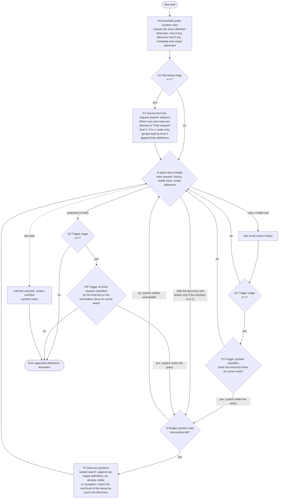
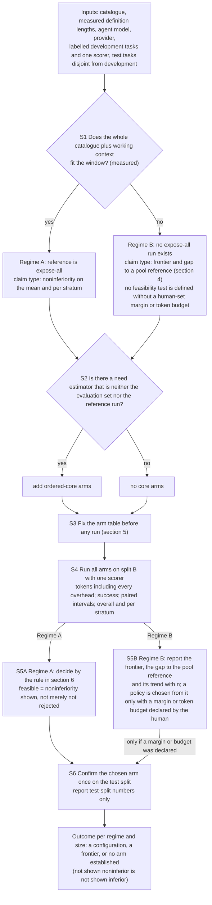

# 02. Policy graph and study protocol (v4): technical specification behind the brief

Authorization: AUTH-010 (human, 2026-10-19). Author: lead (Sonnet 5.5), a **versioned correction** of `design/package-v3/02-supervisor-decision-graph.md` (G). v3 is unchanged and remains the record of what was reviewed on 2026-10-17. Status: **provisional conceptual hypothesis**. Not validated, not final, not selected as the thesis contribution, no novelty claim. No threshold, stage count or benefit is asserted; `delta`, `alpha`, `kappa`, `B_s`, `N_dep`, `epsilon` are unset. Where this file is silent, v3 `02` section 4 (node table, signal classes R/D/X/P, recovery assumptions RA1-RA13, absent stages) still applies. Reasons for each change: `03-review-adjudication.md`. This text is the **second draft**: it incorporates the challenger's first-pass objections CH-0045..0057 (`reviews/RV-0005.md`); the dispositions are in `03` section 5.

## 1. What changed in the structure, in one paragraph
v3 drew one graph with two layers (D1-D4 offline, R1-R6 run time). Two problems follow from the actual text: (i) the run-time layer did not draw its own optional stages as optional (R2 sat on the unconditional path; expose-all and the no-recovery arm had no run-time representation; the budget check sat on the wrong edge) and (ii) putting the selection procedure in the same figure invited reading a model-selection routine as a policy node. v4 therefore has **Figure 1, the run-time policy**, with every optional stage behind an explicit configuration gate, and **Figure 2, the study protocol**, which says how the configuration is *chosen and evaluated* and is a research design, not a run-time decision. The thesis claim, if any, concerns the configurations and the evidence for them, not the protocol.

## 2. Figure 1: run-time policy for one task, under a fixed configuration `c`
`c` is chosen offline (Figure 2) and is **constant during the task**. The gates G1-G3 read `c` and nothing else, so they use no runtime information. Several nodes read run-time state by design, all class R: the budget node B (a counter of discoveries used), the triggers P3/P3f (the transcript), the visible-set test inside P2, and the limit rule X (the call counter). P0 and P2 behave differently by configuration (what is loaded; ranked search or navigation) but are not branches. Configurations Figure 1 must express: expose-all; static core with no interface (no recovery); search only (optionally with a core); search plus request-level narrowing (P1, one or two levels); search plus trigger; model-navigated hierarchy in place of ranked search.

Reading notes (each is a correction of v3 or of the first draft of v4):
1. **Optional stages are gated.** P1 and P3/P3f are reachable only through G1-G3; with all gates "no" the graph is the agent loop plus discovery, i.e. vendor-style deferral. With no interface in `c` there is **no discovery tool and so no ask edge** (the edge is labelled as existing only if the interface is in `c`), which is the static-core arm; with expose-all, P0 loads everything and nothing else is used. (In vendor implementations all definitions may still be sent in the request and merely not loaded into context; whether provider usage counts them is part of E1.)
2. **"Ask" is a call to the discovery tool, which is itself a visible tool** with its schema in the prefix (EXT-0023). "Call" and "ask" are therefore both tool calls; the figure separates them because the system treats them differently.
3. **Budget exhaustion is a system reply, not a trajectory end.** v3 sent "no, or budget spent" to End, conflating the model's judgement with a system rule. Here the agent receives "unavailable" and continues with what is visible (it may finish with a partial answer; the scorer decides success). **The call limit counts every model call, including discovery requests and denied ones**, so the "unavailable" loop is bounded. Vehicles whose budget counts only tool calls (the closest vehicle's evaluation budget is 12 tool calls per the dev document, EXT-0084) would not bound it and must be reconciled in the evaluation design; if discovery calls count against that budget, discovery arms lose steps relative to expose-all, a bias to be reported. The call limit's value belongs to the vehicle.
4. **Trigger placement.** The trigger is evaluated after tool results (G2/P3) **and when the agent proposes to finish** (G3/P3f). The second placement matters: the signals one would use for a removed tool are termination and inability text (package A line 41), and the only trigger-like result in the stored sources is a termination trigger (EXT-0063/0064: an extra turn after an *incorrect* termination). Whether a classifier can tell from the text that an unmet need exists is untested; a termination trigger that blocks finishing also costs extra turns. Not including P3f in a configuration is therefore **not** evidence that "a trigger does not pay". G2 and G3 are separate bits of `c`, so the trigger contributes at least three arms (after tool results, at finish, both) to the arm table; a trigger configuration requires the discovery interface (otherwise a fired trigger would answer "unavailable" to a request the agent never made). Classifier tokens are counted in `C_tok`; whether an LLM classifier's calls count against the call limit is a vehicle decision, unset.
5. **The agent node has three exits** (call a visible tool, ask via the discovery tool, finish), replacing v3's chained R3/R4 whose "no" edge ended the task. The two questions of v3 remain the agent's: *Does a visible tool fit the next step? Is a needed capability absent from the visible set?* Context overflow ends the task as a failure (X); a malformed call is returned to the agent as an error and counted, so repeated errors are bounded by the call limit (as in the replay vehicle, EXT-0079). All their tokens are counted.
6. **P2 returns only definitions not already visible;** a request that matches only visible tools returns "nothing new", counted as a discovery.
7. **Reintroduction.** A discovery re-adds something an earlier stage *removed* only if P1 is in `c`; otherwise it adds something never shown. Both use P2. A system-written query (P3, P3f) is a second way to fire it.
8. **Stage questions and answerers** (the supervisor's "find those questions and the stages"): P1 *Which non-core tools are relevant to this request?* (system selector, possibly an LLM whose tokens are counted); P3/P3f *Does runtime evidence show an unmet need?* (system classifier); A *Is a needed capability absent?* (agent model); P2 *Which deferred definitions match the query?* (system ranker) or *Which group or tool do you want next?* (the agent, in a navigated hierarchy). Whether the system or the model should answer the stage questions is an empirical question here, not an assumption.
9. **Information discipline unchanged:** classes R (available by construction), D (derived from separate development data), X (only after execution), P (prohibited at runtime: gold tool lists, reference trajectories, benchmark annotations); v3 `02` section 4 lists the class of each node's input.

## 3. Figure 2: study protocol (how `c` is chosen and evaluated; not a run-time rule)

The loop over catalogue sizes (the "regime map") is the empirical content: Figure 2 is run at several sizes `n`, and the result is which configuration is feasible and cheapest where. Regime A applies to S5A only; Regime B has no feasibility test unless the human supplies a margin against the pool reference or a token budget.

## 4. The reference problem in Regime B (review point 5)
v3 said: when the reference cannot run, name a substitute "from a rule that does not use the arms' results: the largest configuration that fits the window that is not itself one of the compared restricted arms". That rule is **undefined for a catalogue**: filling a window-sized configuration requires choosing which tools go in; informative choices use gold annotations, uninformative ones may omit the needed tool. v4 replaces it by a ladder of evaluation-side constructs, never policies:

| Rung | What it is | What it can support | What it cannot |
|---|---|---|---|
| R-full(n), `n <= n_fit` | expose-all on catalogues small enough to fit. `n_fit` is about window / mean definition length: **roughly 200 to 10,000 tools** across the stored per-tool figures (about 1,000, 250 or at most 100 tokens) and windows (0.2 or 1 million) [I]. At the most favourable figures the 10,000-tool example sits at the Regime A/B boundary, not clearly inside Regime B | the real reference; the **degradation curve of expose-all with `n`**; noninferiority claims of arms at these sizes | anything above `n_fit` (on the 250 and 1,000 token figures 10,000 tools is at least 2.5 times `n_fit`) |
| R-pool(m) | per task, the tools it needs plus distractors drawn by a **pre-stated rule** (distractor distribution, seed and `m` are design choices, unset here; random and near-miss distractors give different difficulty) up to `m <= n_fit` tools. Uses gold annotations: evaluation side only. **It is not the construction of DynamicMCPBench's curated pool**, which uses a fixed set of distractors, half same-name tools on other servers and the rest near-misses (EXT-0079, EXT-0081); it is an analogue | a reference with reachability guaranteed and bounded distraction | it is not expose-all; whether it is a harder or an easier success bar than expose-all is **an empirical question** (below) |
| (none) | frontier of all arms at `n > n_fit`: tokens against success, paired differences between arms, and how the arm-versus-R-pool gap changes with `n` | arm-versus-arm statements; the shape of the trade-off | any statement of the form "noninferior to expose-all at this size"; a policy choice without a human-declared margin or budget (a frontier is an input to a choice, not a policy) |

**Direction of the R-pool reference (unresolved, honestly).** One reading (v4's first draft): R-pool has full reachability and little distraction, so success against it is a harder bar than against expose-all, provided R-pool's success is at least expose-all's. The stored evidence for that proviso is one cell (curated 44.0 against flat 36.0 on one model; per-cell interval about ±8; EXT-0053), which the brief itself says cannot be resolved at that sample size. The other reading (package A line 60: "a gold-derived pool is weaker and favours restriction"): a claim relative to a gold-derived pool licenses less than one relative to expose-all, because the pool depends on information the policy never has. Both are partly right and neither is derived. **Calibration is part of the protocol**: wherever R-full and R-pool both exist (sizes up to `n_fit`), run both and report their success difference; use R-pool as a reference at `n > n_fit` only with that calibration shown and within a tolerance the human sets (no acceptance criterion is set here). The calibration cannot show the relation above `n_fit`, so even then the use of R-pool there is an extrapolation.

**Extrapolation above `n_fit`.** It is an assumption, not a bound. It would be **supported** if the gap between each arm and R-full stays roughly constant as `n` rises toward `n_fit`; it would be **undermined** if the gap widens, or if R-full itself degrades sharply near `n_fit` (then noninferiority to R-full becomes easier exactly where the extrapolation starts, and R-full stops being a good anchor). The report states the trend (the paired arm-versus-R-full gap regressed on `n`, with an interval; what counts as "roughly constant" is a human decision) as the only available indicator and makes no claim above `n_fit`.

## 5. Arm table (additions to v3 D3)
v3 D3 lists: search-only; one-level selection plus search; two-level selection plus search; search plus system trigger; static core with no interface and no recovery; expose-all when it fits; each with an ordered core when a need estimator exists. v4 adds one arm and one reading.
- **Added arm: model-navigated hierarchy** (the model asks which group, then which tool, then describes it). It is a **restoration of an alternative dropped without a recorded reason**, not a new stage: package v1 carried it as P4g (DPR-0002 F4; DPR-0003; package C), and a vendor example exists (progressive search: list, describe, execute; EXT-0023, measured to 400 tools only, so its small prefix is untested above that). It is included because it is the one arm in which the **model** answers each stage's question, not because it resembles the supervisor's picture. **Cost:** one model call per level (a re-read of the whole prompt) **plus the listing tokens at each level**, which grow with the number of groups at the root (DPR-0003: "per-turn cost growing ... with the number of groups (P4g)"). The hierarchy's source (the catalogue's own server/namespace structure or a derived grouping) and the budget unit (one level = one discovery) are design choices, unset. It **replaces** ranked search in its arm; it is not an add-on.
- **Stage-inclusion reading.** Under preference option (a) of section 6 (a human-set `epsilon`), a component (core, P1 level 1, P1 level 2, P3/P3f) is "kept" only if it is in the arm finally chosen; the others are dropped. Under option (b) (no `epsilon`) **no component is declared kept or dropped**: the report lists `S`, so an underpowered study keeps nothing by default. For a replacement (the navigated hierarchy) the comparison is with the arm it replaces. **This is a reading of the single rule in section 6, not a second rule; where a pairwise reading and section 6 disagree, section 6 governs.** The matched pairs must be in the table, so table size (and hence the multiplicity correction) counts them. Path dependence is not removed: a component that pays only in the presence of another is found only if that pair is in the table.
- Fixing the table before running (arm list, `kappa`, `B_s`, scope wording, core-size sweep points), controlling `alpha` over its size, and treating its size as a human decision are unchanged from v3; CH-0040 (a) and (b) in v3 (multiplicity enumeration) remain open.

## 6. Decision rule S5A (Regime A): corrected ties
v3 D4 chose "the lowest estimated cost among feasible arms; ties = arms whose paired cost difference to the cheapest feasible arm has an interval containing zero: choose the one with the fewest components". Problems in the actual text, in order of importance:
1. **The outcome depends on the sample size.** With few tasks every cost interval is wide, every feasible arm "ties" and the simplest wins; with many tasks the cheapest wins.
2. **"Interval contains zero" is not equivalence.** It means no difference was detected.
3. **The relation is not transitive** and is anchored on the cheapest *estimate* (the winner's-curse quantity).
4. The success side was **correct**: "feasible" means the lower confidence bound is at or above minus `delta`, i.e. noninferiority *shown*; "not feasible" means not shown, not shown inferior.

Corrected rule (a proposal; the numbers are the human's):
- **Feasible set `F`**: arms with noninferiority shown against the regime A reference on the mean and in every pre-registered stratum (strata below the minimum size reported "not assessed"). Empty `F` means "no arm shown noninferior".
- **Set `S`** (directional, defined): an arm `a` in `F` is **excluded** from `S` if some other arm `b` in `F` has a paired cost difference `cost(a) - cost(b)` whose lower confidence bound is above zero, at the stated family error rate. `S` is the set of feasible arms not shown to cost more than another feasible arm (the "confidence set of best arms" idea of the model-confidence-set literature, **general statistical background, not from the stored evidence**).
- **Post-selection caveat.** `F` and `S` are estimated on the same split B, so `S` is a post-selection set whose coverage is not the nominal one; its error rate is unknown (simulation, E6). The test split confirms **only the arm finally chosen**; `S` is descriptive.
- **Preference within `S`.** Either (a) the human pre-registers a cost tolerance `epsilon` (tokens per trajectory) and the simplest arm of `S` with estimated cost within `epsilon` of the minimum is chosen (simplest = fewest components; the order among arms with equal counts is pre-registered), **reported as a parsimony preference, not as equivalence** (a fixed `epsilon` is *not* the one-standard-error rule, whose tolerance shrinks as data grow; it is a deliberate decision to pay up to `epsilon` for simplicity); or (b) with no `epsilon`, the report gives `S` and the full table and names no winner.
- **Sensitivity.** Report how `S` changes when the development set is subsampled. This shows **instability toward smaller samples only**; whether a larger sample would change `S` cannot be seen from the data in hand, so the report states that and gives the sample size.
- `C_tok` includes `O_dev / N_dep` as in v3; the common term does not change the ranking among arms.

## 7. Why the protocol itself may be unaffordable (objection 1, quantified)
Arithmetic [I], not a plan: one-sided paired noninferiority test, alpha 0.05, power 0.80, normal approximation, **discordant-pair rate q = 0.20 assumed (unsupported; reachability alone could give about 0.10, and q = 0.30 multiplies every n by 1.5)**, no stratification, true loss as stated (zero is the best case). Reproduced independently by the challenger within rounding:

| margin `delta` | true loss | one contrast | six contrasts (Bonferroni; six is not tied to the arm table, twelve contrasts give about 970 at `delta` 0.05) |
|---|---|---|---|
| 0.10 | 0 | about 124 pairs | about 209 |
| 0.05 | 0 | about 495 | about 838 |
| 0.05 | 0.02 | about 1,371 | about 2,322 |

Further under-counting: joint power across three strata needs roughly 56% more per stratum; the test split and the cost side are not powered here. The closest vehicle (DynamicMCPBench) marks 1,578 of its 1,845 released specifications as reference-consistent and flags 104 of its 750-task evaluation slice (source lines 915-930, EXT-0082), and its exposure subset (Appendix N) has 150 tasks. **Conclusion, stated precisely:** for margins of about five points or less, per-stratum or multi-contrast noninferiority is not affordable on that vehicle; a **single mean-level contrast at delta 0.05 and no true loss (about 495 pairs) could be met by the 750-task slice**, if the discordant rate is as assumed. The earlier draft's 160 and 1,700 pairs correspond to a one-sided alpha of 0.025 (the lower bound of a two-sided 95% interval): a convention difference, not an error; this file's `alpha` is unset.

## 8. Experiment E1, restated (review point 4)
v3 `04` listed E1 (token accounting by category and size) as "could end the line: yes (if the tool block is a small share)". After the challenger's objection (CH-0054) the position is narrower than the first v4 draft's:
- E1 measures the **share and size of the tool block by catalogue size, task type and outcome, for expose-all and for each restricted configuration**. It localises where an exposure policy can matter.
- **What E1 can end:** the *token-saving* line, for the configurations and sizes where the tool block (or the saving net of overhead) is negligible. If restricted configurations also have a small tool-block share at every size that matters, there is no token problem to solve. That part of v3's statement stands.
- **What E1 cannot end:** the *feasibility* question. Ten thousand definitions are about 1 million tokens per call at the ComplexMCP authors' figure (about 30,000 tokens for 300+ tools, so at most about 100 per tool, EXT-0075), about 2.5 million at the benchmark repository's development-document estimate (about 292k tokens for 1,168 tools, second-hand: the S4F digest line 41 says whether it equals what the code renders is unknown, and the S4G digest line 23 calls it "not clean" because of placeholder schemas of unknown effect), and about 10 million at a vendor blog's measurement (405,100 tokens for 400 tools, EXT-0023). Against windows of 0.2-1 million named in the S4F digest, expose-all is **infeasible in practice** at the upper two figures and at the limit at the lowest; not "impossible" as an absolute. Expose-all's share there cannot be measured by running it, so E1 can only report it per catalogue size where it fits.
- The relevant quantity is the **absolute saving against the overhead** (break-even accounting in `package-v3/01` section 3), which E1's data feed. The cheapest first measurement, with a clear conditional meaning.
- The vendor blog's table does not support a "small share" reading: its 40-tool static cell has 43,300 initial tokens against about 1,000 task tokens yet costs less in dollars than the progressive arm on the simple task; tokens and dollars diverge there (a cache or billing effect is a possible reading [S], not established). This is an example for E1's recording of billed cost beside tokens.

## 9. Remaining weaknesses of v4 (not resolved here)
- The configuration is still an **output of a study not run**. v4 does not change that.
- R4/RA1 (models initiate search) is unmeasured and gates every discovery arm.
- Request-level narrowing at large size has no legitimate labelled data for its recall.
- Regime B has no feasibility claim against expose-all by construction; a policy there needs a human-declared margin or budget.
- The direction of the pool reference relative to expose-all is not derived (section 4).
- `S` is a post-selection set with unknown coverage; the stage-inclusion reading is path-dependent.
- Mermaid figures were not rendered.
- An independent re-check of this second draft has not been done unless `03` section 5 records it.
