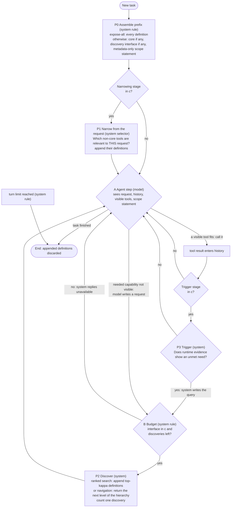
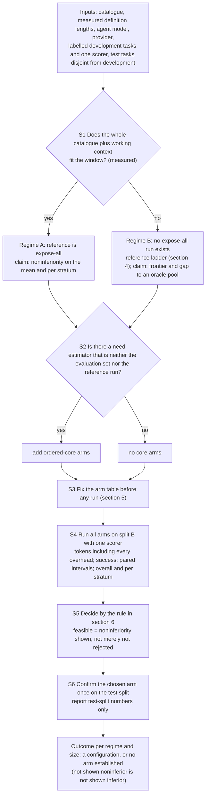

# 02. Policy graph and study protocol (v4): technical specification behind the brief

Authorization: AUTH-010 (human, 2026-10-19). Author: lead (Sonnet 5.5), a **versioned correction** of `design/package-v3/02-supervisor-decision-graph.md` (G). v3 is unchanged and remains the record of what was reviewed on 2026-10-17. Status: **provisional conceptual hypothesis**. Not validated, not final, not selected as the thesis contribution, no novelty claim. No threshold, stage count or benefit is asserted; `delta`, `alpha`, `kappa`, `B_s`, `N_dep`, `epsilon` are unset. Where this file is silent, v3 `02` section 4 (node table, signal classes R/D/X/P, recovery assumptions RA1-RA13, absent stages) still applies. Reasons for each change: `03-review-adjudication.md`.

## 1. What changed in the structure, in one paragraph
v3 drew one graph with two layers (D1-D4 offline, R1-R6 run time). Two problems follow from the actual text: (i) the run-time layer did not draw its own optional stages as optional (R2 sat on the unconditional path; expose-all and the no-recovery arm had no run-time representation; the budget check sat on the wrong edge) and (ii) putting the selection procedure in the same figure invited reading a model-selection routine as a policy node. v4 therefore has **Figure 1, the run-time policy**, with every optional stage behind an explicit configuration gate, and **Figure 2, the study protocol**, which says how the configuration is *chosen and evaluated* and is a research design, not a run-time decision. The thesis claim, if any, concerns the configurations and the evidence for them, not the protocol.

## 2. Figure 1: run-time policy for one task, under a fixed configuration `c`
`c` is chosen offline (Figure 2) and is **constant during the task**. A gate such as "narrowing stage in `c`?" reads `c`, not the world; it is a static switch, so it uses no runtime information. Configurations that Figure 1 must be able to express: expose-all; static core with no interface (no recovery); search only (optionally with a core); search plus request-level narrowing (one or two levels); search plus trigger; model-navigated hierarchy (list groups, then describe, then use) in place of ranked search.

Reading notes (each is a correction of v3):
1. **Optional stages are gated.** P1 and P3 are reachable only through their gates; with both gates "no" the graph reduces to the agent loop plus discovery, i.e. vendor-style deferral. With no interface in `c`, B always answers "no", which is the static-core arm; with expose-all, P0 loads everything and neither gate nor B is ever used.
2. **Budget exhaustion is a system reply, not a trajectory end.** v3 sent "no, or budget spent" straight to End, which conflated the model's judgement (R4) with a system rule and silently ended trajectories at a point the cost accounting did not define. Here the agent receives "unavailable" and continues with what is visible (it may finish with a partial answer; the scorer decides success). Only the task's turn limit (a system rule, with its value part of the evaluation vehicle) ends a trajectory otherwise. Denied or failed discoveries are counted as tokens like any other call.
3. **The agent node has three exits** (call, ask, finish), replacing the two chained diamonds R3/R4 whose "no" edge ended the task. The two questions of v3 stay as the agent's questions: *Does a visible tool fit the next step? Is a needed capability absent from the visible set?*
4. **Reintroduction.** A discovery re-adds something an earlier stage *removed* only if P1 is in `c`; otherwise it adds something that was never shown. Both are the same mechanism P2. A system-written query (P3) is a second way to fire it.
5. **Stage questions and answerers** (the supervisor's "find those questions and the stages"): P1 *Which non-core tools are relevant to this request?* (system selector, possibly an LLM, whose tokens are counted); P3 *Does runtime evidence show an unmet need?* (system classifier); A *Is a needed capability absent?* (agent model); P2 *Which deferred definitions match the query?* (system ranker) or *Which group or tool do you want next?* (the agent, in a navigated hierarchy: here the **model** answers each stage's question). Whether the system or the model should answer the stage questions is an empirical question in this design, not an assumption.
6. **Information discipline unchanged:** signal classes R (available by construction), D (derived from separate development data), X (exists only after execution), P (prohibited at runtime: gold tool lists, reference trajectories, benchmark annotations); v3 `02` section 4 lists the class of each node's input.

## 3. Figure 2: study protocol (how `c` is chosen and evaluated; not a run-time rule)

The loop over catalogue sizes (the "regime map") is the empirical content: Figure 2 is run at several sizes `n`, and the result is *which configuration is feasible and cheapest where*, which is the supervisor's "which one works at which time".

## 4. The reference problem in Regime B (review point 5)
v3 said: when the reference cannot run, name a substitute "from a rule that does not use the arms' results: the largest configuration that fits the window that is not itself one of the compared restricted arms". That rule is **undefined for a catalogue**: to fill a window-sized configuration one must choose *which* tools go in, and any informative choice (the tools the task needs) uses gold annotations, while an uninformative one (random tools) can leave the needed tool out and makes the reference worthless. The correction is a ladder whose rungs are evaluation-side constructs and are never policies:

| Rung | What it is | What it can support | What it cannot |
|---|---|---|---|
| R-full(n) for `n <= n_fit` | expose-all on catalogues small enough to fit (`n_fit` is roughly window / mean definition length) | the real reference; the **degradation curve of expose-all with `n`**; noninferiority claims of arms at these sizes | anything above `n_fit` |
| R-pool(m) | per task, the tools it needs plus randomly drawn distractors up to a pool of `m <= n_fit` tools (uses gold annotations: evaluation side only) | a reference with reachability guaranteed and bounded distraction; the same construction as the "curated pool" of DynamicMCPBench (EXT-0053) | it is **not** expose-all, and its pool size is a choice |
| (none) | frontier of all arms at size `n > n_fit`: tokens against success, paired differences between arms | arm-versus-arm statements; the shape of the trade-off | any statement of the form "noninferior to expose-all at this size" |

Consequences, stated plainly: (i) at `n > n_fit` **no noninferiority-to-expose-all claim is possible**; (ii) the claim v4 supports there is *a frontier plus a gap to R-pool(m)*, where R-pool is demanding for the policy (it has full reachability and a small pool), so it is not a flattering reference; (iii) extrapolating from `n <= n_fit` (where R-full exists and the arms can be compared with it) to `n > n_fit` is an assumption to be labelled as such, supported only by how the arm-versus-reference gap behaves as `n` rises toward `n_fit`; (iv) whether a frontier suffices or a margin `delta` against R-pool(m) is wanted is a decision for the human and the supervisor (it also bears on the supervisor's "as high as possible", which reads naturally as a frontier). This is **not** a new stage, threshold or benefit.

## 5. Arm table (additions to v3 D3)
v3 D3 lists: search-only; one-level selection plus search; two-level selection plus search; search plus system trigger; static core with no interface and no recovery; expose-all when it fits; each with an ordered core when a need estimator exists. v4 adds one arm and one reading rule.
- **Added arm: model-navigated hierarchy** (the model asks *which group*, then *which tool*, then describes it; Speakeasy's "progressive search" list/describe/execute is a vendor example, EXT-0023; package-v1 had it as P4g, DPR-0002 F4). v3 omitted it although it is the most direct realisation of "a question at each stage" in which the **model**, not a system selector, answers each stage's question, and it brings back anything an earlier level left out by navigating again. It costs one extra model call per level, so its token cost is exactly the kind of overhead the criterion counts.
- **Reading rule (stage inclusion).** A component (core, P1 level 1, P1 level 2, P3, navigated hierarchy) is kept in a configuration only if the arm containing it is feasible **and** cheaper, on paired data, than the same arm without it. The arm table must therefore contain the matched pairs. This restates D4 in the supervisor's terms ("a stage is present only where a stated test justifies it") and makes the test explicit; it does not add a decision.
- Everything v3 says about fixing the table before running (arm list, `kappa`, `B_s`, scope wording, core-size sweep points), controlling `alpha` over its size and treating its size as a human decision is unchanged.

## 6. Decision rule S5 (review points 1 and 2): corrected ties
v3 D4 chose "the lowest estimated cost among feasible arms; ties = arms whose paired cost difference to the cheapest feasible arm has an interval containing zero: choose the one with the fewest components". Problems with the actual text, in order of importance:
1. **The outcome depends on the sample size.** With few tasks every cost interval is wide, so every feasible arm "ties" and the rule returns the simplest one; with many tasks the rule returns the cheapest. The returned configuration is partly a function of how much data was collected. That is a power artefact, not a finding.
2. **"Interval contains zero" is not equivalence.** It means no difference was detected. Treating it as a tie, and then deciding by a different criterion, claims more than the data support.
3. **The relation is not transitive** (A ties the cheapest, B ties the cheapest, A and B can differ), and it is anchored on the cheapest *estimate*, which is the winner's-curse quantity.
4. The success side was **correct**: "feasible" means a lower confidence bound at or above minus `delta`, i.e. noninferiority *shown*; an arm that is not feasible has not been shown inferior. v3 did not always keep this wording (OUT2 read as "no arm feasible").

Corrected rule (a proposal; the numbers it needs are the human's):
- **Feasible set `F`** = arms with noninferiority shown against the regime's reference on the mean and in every pre-registered stratum (unchanged from v3; strata below the minimum size are reported "not assessed"). An empty `F` is reported as "no arm shown noninferior", never as "all arms inferior".
- **Cost-indistinguishable set `S`** = arms in `F` whose paired cost difference to *every* other arm in `F` is not separable from zero in the downward direction, equivalently the arms that cannot be excluded from the set of cheapest arms at the stated error rate (a confidence set of best arms, as in the model-confidence-set literature; **general statistical background, not from the stored evidence and not verified here**). The report names `S`, not a single winner.
- **Preference within `S`.** Either (a) a pre-registered cost tolerance `epsilon` (tokens per trajectory) is set by the human, and the simplest arm whose estimated cost is within `epsilon` of the minimum is chosen: this is an explicit *parsimony preference*, equivalent in spirit to the one-standard-error rule of model selection (**general background, not from the stored evidence**), and is **reported as a preference, not as equivalence**; or (b) with no `epsilon`, the report gives `S` and the table and names no winner.
- **Sensitivity.** Report how the returned `S` changes when the development set is subsampled (a power curve of the decision), so the reader can see whether the choice is stable or a function of sample size. This costs nothing beyond the data already collected.
- Costs: `C_tok` includes `O_dev / N_dep` as in v3; ties among arms do not change the common tournament term.

## 7. Why the protocol itself may be unaffordable (objection 1, quantified)
Arithmetic [I], not a plan: for a one-sided paired noninferiority test (alpha 0.05, power 0.80, discordant-pair rate 0.20 assumed, normal approximation, no stratification):

| margin `delta` | true loss | one contrast | six contrasts (Bonferroni) |
|---|---|---|---|
| 0.10 | 0 | about 124 pairs | about 209 |
| 0.05 | 0 | about 495 | about 838 |
| 0.05 | 0.02 | about 1,371 | about 2,322 |

Each pre-registered stratum needs this many tasks **separately** if it is to be assessed. The closest vehicle (DynamicMCPBench) marks 1,578 of its 1,845 released specifications as reference-consistent and flags 104 of its 750-task evaluation slice (source `s4c-g2-dynamicmcpbench-2607-20531` lines 915-930, read by the lead; steward check V14 pending), and its tool-exposure subset (Appendix N) has 150 tasks. So for margins of about five points or less the stratum rule is unaffordable on that vehicle, and the protocol will return "not assessed" or "no arm shown noninferior" for lack of power. (The earlier draft's 160 and 1,700 are the two-sided versions of the first and third rows; noninferiority is one-sided.) This is a reason to choose `delta` and the strata with the power in view, and a reason to treat a frontier report as the primary output when `delta` is small.

## 8. Experiment E1, restated (review point 4)
v3 `04` listed E1 (token accounting by category and size) as "could end the line: yes (if the tool block is a small share)". That over-reads a diagnostic.
- E1 measures the **share and size of the tool block by catalogue size, task type and outcome**. It localises **where** an exposure policy can matter; it does not decide **whether** the research problem exists.
- For catalogues beyond the window the share is not small by construction: ten thousand definitions at about 250 tokens each (the closest benchmark repository's development-document estimate of about 292k tokens for 1,168 tools, second-hand through the S4F digest, which calls it "not clean" because of placeholder schemas of unknown effect) are about 2.5 million tokens per call, and at about 1,000 tokens each (a vendor blog's measurement, 405,100 tokens for 400 tools, EXT-0023) about 10 million; both are above the 0.2-1 million windows named in the S4F digest. [I] arithmetic from two sources of different quality. There expose-all is infeasible, and the question becomes how to stay feasible without losing success, which E1 cannot end.
- E1 **can** show that at small catalogues the tool block is a small share of tokens and that no exposure policy saves much; that is a finding about the regime (the vendor cell where the progressive arm cost more than the static one at 40 tools is consistent with it, EXT-0023, vendor, unreplicated), and it would narrow the thesis to the regime where it matters rather than end it.
- The relevant quantity is not the share but the **absolute saving against the overhead** (the break-even accounting in `package-v3/01` section 3), which E1's data feed.
So E1 is the cheapest first measurement and has high information value; its possible outcomes are "the policy question starts at size `n*`" (bounding the regime), not "stop".

## 9. Remaining weaknesses of v4 (not resolved here)
- The configuration is still an **output of a study not run**: no run-time configuration can be named in advance. v4 does not change that.
- R4/RA1 (models initiate search) is unmeasured and gates every discovery arm.
- Request-level narrowing at large size needs a recall estimate with no legitimate labelled source (E3, E8).
- Regime B has no noninferiority claim to expose-all by construction (section 4).
- Stage-inclusion tests are path-dependent: whether a component pays may depend on which others are present. The arm table decides which pairs are tested; this is a design choice that bounds what v4 can find.
- Billed cost and cache behaviour are recorded, not in the criterion; the token winner can be a billed loser (EXT-0062 context).
- The challenger has not yet reviewed v4 (see `03`).
