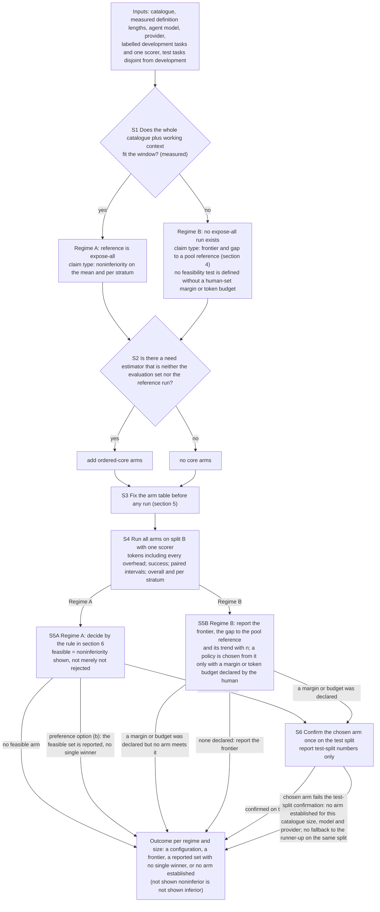

# 06. Corrections to package v4: successor note (PROPOSED, nothing applied)

Written 2026-10-20 by the lead (Sonnet 5.5) for the human's review. **Files 01 to 05 and `00-README.md` are not edited by this note.** Everything below is a proposal: each item says where the text is, what is wrong (with the evidence), and the replacement wording. Where a real choice is involved, the choice is left open and marked **DECISION**. Nothing here changes the core idea of the proposal, and nothing here is about the supervisor's 19 October messages on billing and memory (that is a separate decision, ledger N-10).

Evidence for every item: `reviews/RV-0008.md`, `RV-0009.md`, `RV-0010.md` (fresh reviewers, same model family as the earlier challenger; text checks, not challenger rounds), and the lead's own re-reading of the lines quoted here. The ledger rows are given in brackets.

## 1. Figure 2 does not show every outcome (concept defect) [C-R01/FIG2]

**What is wrong.** In `02` Figure 2 the node `O` ("a configuration, a frontier, or no arm established") has a single incoming edge, from `S6`. `S5B` (Regime B) reaches `S6` only "if a margin or budget was declared", yet `02` line 73 says that without a human-supplied margin or budget Regime B has no feasibility test, so a Regime B run with no margin can never reach `O`, although "a frontier" is a named outcome. `S5A` goes to `S6` unconditionally, although the feasible set can be empty or, under preference option (b), no single winner is named (`02` line 91). `S6` goes straight to `O`, with no branch for a chosen arm that fails the test-split confirmation, although the rule exists (v3 `02` node D4 (b): the procedure "reports OUT2 for that setting" and does not fall back to the runner-up on the same split; OUT2 is what `02` line 70 calls "no arm established").

**Proposed replacement for the Figure 2 block** (only the last three edges differ: they are replaced by two node definitions and eight edges, and the label of O gains one outcome; everything above them is copied unchanged):

**What changed, in words.** (1) `S5A` has three exits: a chosen arm goes to confirmation; an empty feasible set goes to the outcome; under preference option (b) (no single winner) the feasible set is reported and goes to the outcome. (2) `S5B` has three exits: with a declared margin or budget it goes to confirmation; declared but no arm meets it goes to the outcome; none declared goes to the outcome as a frontier. (3) `S6` has two exits: confirmed, or failed (OUT2: no arm established for this setting, no fallback on the same split). (4) The label of `O` gains one outcome, "a reported set with no single winner", so that option (b) is not filed under "no arm established". (5) `S6` and `O` are defined on their own lines instead of inline. The edges follow rules already written in `02` sections 4 to 7 and v3 `02` D4 (b); the replacement adds no new decision rule. The block is the old block with its last three edges replaced by two node definitions and eight edges; everything above is copied unchanged.

**Open points found by the fresh reviewer (`reviews/RV-0011.md`), not settled by the sources.** (a) Whether expose-all is in the feasible set by construction in Regime A: CH-0040 point 5 argues the reference is an arm and is always feasible against itself, so the "empty feasible set" exit could not occur in Regime A; `02` line 102 says an empty `F` means "no arm shown noninferior". The exit is drawn because `02` says so; its reachability in Regime A is unresolved. (b) Under option (b) no arm is chosen, so `S6` is not entered and a "configuration" is never produced in Regime A without an `epsilon`; this follows from `02` lines 104-105 but is not written there. (c) `02` gives a decision rule only for Regime A (section 6 is headed "Decision rule S5A (Regime A)"); the `S5B` exits are drawn from what `02` says (frontier without a margin or budget; confirmation with one) and the new exit "declared but no arm meets it" is a logical completion, not a written rule. (d) The loop over catalogue sizes (the regime map, `02` line 73) is still not drawn; the figure reads as a single run, as before. **Please render it in VS Code** before accepting it; the lead could not.

## 2. A trigger can fire again and again once the budget says "no" (Figure 1) [C-R01/R1TRIG]

**What is wrong.** In `02` Figure 1 a "yes" from the trigger (P3 after a tool result, P3f when the agent proposes to finish) goes to the budget node B; when B says "no" it replies "unavailable" to the agent (lines 24, 28, 33); if the agent then proposes to finish again, P3f can fire again and send it to B again. Nothing in `02` or `03` says what the trigger does once the budget is exhausted, so the loop is bounded only by the call limit. `02` line 41 says the call limit counts every model call, including discovery requests and denied ones, but also that vehicles whose budget counts only tool calls (12 in the closest vehicle's development document, EXT-0084) would not bound it; and each repeat costs a classifier call if the classifier is an LLM (`02` line 46 says only "system classifier").

**DECISION (not made by the lead).** Options, with the effect of each:
- (a) The trigger fires at most once per task at each placement (after tool results; at finish). Simplest to state; later unmet needs are not re-checked.
- (b) The trigger shares the discovery budget: when B says "no", the trigger stops firing for the rest of the task and the finish proposal goes to the end. Keeps one budget; the agent can still ask by itself while B says yes.
- (c) Leave it as drawn and state that repeated firing is stopped only by the call limit, with the wasted classifier calls counted as cost. No change to the figure; the cost is measured, not prevented.

## 3. Wording corrections (exact lines)

| # | Where | What is wrong | Proposed replacement |
|---|---|---|---|
| 3.1 | `02` line 92 [C-R01/V4-03-STALE] | Lists CH-0040 (b) among the open items, but the rule for a failed test-split confirmation exists (v3 `02` D4 (b)); only the arm table's content and size are open (a human decision). | "Fixing the table before running (arm list, `kappa`, `B_s`, scope wording, core-size sweep points) and controlling `alpha` over its size are unchanged from v3 (`02` node D4 (a), (b): the table is fixed before any split is run; a chosen arm that fails the test-split confirmation gives no arm established for that setting, with no fallback on the same split). The table's content and size are a human decision and are not set." (This reads CH-0040 (b) as answered by v3 D4 (b); `challenges/CH-0040.md` still says `open`. "No arm established" is the lead's reading of v3's OUT2.) |
| 3.2 | `03` line 19 | Still states the old pairwise stage-inclusion rule, which conflicts with `02` line 91. | "4. **'Stage present only where justified' is satisfiable by anything** (v3 itself says so). v4 turns it into a stated reading (`02` section 5): under preference option (a), a human-set `epsilon`, a component is kept only if it is in the arm finally chosen; under option (b), with no `epsilon`, no component is declared kept or dropped and the report lists the feasible set. This makes the existing decision checkable; it is path-dependent (listed as a weakness)." |
| 3.3 | `03` line 40 | "a consequence of the single rule" without the two readings. | "stage inclusion is now a consequence of the single rule in `02` section 6, which governs (option (a): a component is kept only in the chosen arm, and a replacement is compared with what it replaces; option (b): none declared kept or dropped); multiplicity: the size of the arm table is a human decision not yet set (CH-0040 (a)); the failed-confirmation rule is in v3 `02` D4 (b)" |
| 3.4 | `03` line 11, last sentences; also `02` line 136 | "the second draft has had no independent re-check" (and `02` line 136: "An independent re-check of this second draft has not been done unless `03` section 5 records it") is out of date and conflicts with `03` lines 32 and 50, which record a challenger round-2 re-check. | "the second draft was re-checked by the challenger in round 2 (`03` section 5; RV-0005); the edits made after that (R1-R9) were re-read by a fresh reviewer on 2026-10-19 (`reviews/RV-0009.md`; same model family as the earlier challenger; a text check, not a challenger round); the Mermaid syntax has not been rendered (the human will render it in VS Code)" (for `02` line 136: "The edits made after the challenger's round 2 were re-read by a fresh reviewer (`reviews/RV-0009.md`); no further challenger round has been run.") |
| 3.5 | `01` line 77, right-hand cell | The count is stale (37 is the figure in the `05` header; the manifest held 37 rows before AUTH-016, ledger N-19; the lead did not re-derive the 27 searches). | "the check was 27 searches and 37 stored sources (cumulative, as in the header of `05`), a convenience sample." |
| 3.6 | `05` line 1 (title) | "what is a real gap" states more than the check shows. | "# 05. Literature check (AUTH-011): what is already known, and what we did not find (second draft)" |
| 3.7 | `05` line 48, "Stronger:" clause | "three specific, citable gaps" is the same overstatement. | "Stronger: three questions we did not find answered in the sources read (cache and bill behaviour of appended definitions; uninstructed initiation and its dependence on the scope statement, with false-positive calling as a counted cost; discovery memory in a large catalogue)" (rest of the sentence unchanged) |
| 3.8 | `05` line 26 | "retrieve errors 50.00% of failures for two models" suggests a per-model figure. | "retrieve errors 50.00% of the failure causes counted in trajectories of two Claude models (pooled; no per-model split found in the text read)" |
| 3.9 | `05` line 40 [N-17, CH-0063] | "abstracting beats archiving full history" overstates; the cited result is cost, not completion. | "Direction (weak): in Apple, selective memory costs less than archiving full history (3.9K vs 7.7K input tokens) while completion is not distinguishable (12/12 vs 8/12, p = 0.125), and the no-memory arm fails by design because the specification is withheld from it; PREFINE's abstract says its abstracted preference memory outperforms full-history prompting on Preference Transfer (a token comparison against full history was not found in the places searched). **This does not support 'tool memory only' over conversation memory**: neither study compares those scopes (CH-0063)." (Apple figures checked by the reviewer against `arxiv-2607.09493.txt` lines 32-35, 41-44; the PREFINE sentence follows `arxiv-2604.17886.txt` lines 25-29; the first draft of this row attached Apple's figures to PREFINE and was corrected after RV-0013.) |
| 3.10 | `05` line 62 (label) [C-R03/ROUND45-W] | "first measured cost effect of persisted memory" is too strong: MemToolAgent's Table 5 (arXiv 2606.07909, 50 NESTFUL queries, Claude 3.7 Sonnet) is a token comparison of a memory-using agent. | "*Topic C, a stored measurement of cost per task with persisted skills files:*" (rest unchanged) |
| 3.11 | `05` line 69 [C-R03/ROUND45-W] | Omits that the frozen 33-API set was calibrated on the same 106 tasks it is scored on. | add at the end: "The frozen 33-API set was calibrated on the same 106 tasks it is scored on (not held out; `arxiv-2609.13548.txt` lines 338 and 511; SUM-0009 line 29)." |
| 3.12 | `05` line 75 [C-R03/ROUND45-W] | The correlation r = -0.45 may be driven by rows with zero output. | add: "(the correlation was not recomputed without the rows that look degenerate: three models have relevance 0.0, and at least two of them look like zero-output rows with irrelevance 100 (Ministral-8B and Llama-3.1-Nemotron-Ultra; Falcon3-1B is the third and is not a zero row), so [I] a 'perfect abstention' there is an artefact; with them removed the figure may differ)" |
| 3.13 | `05` line 27 (MCP-Zero row) [CH-0068] | no line cite for "instructed". | add the cite: "(EXT-0101, file lines 71-72 and 140-142: the lines of the extract file, not of the source)"; the SING row at line 29 should add SING's Default setting in the steward's wording: "Default (only the ground-truth servers are provided; no discovery step)" (SUM-0005 lines 54 and 56, quoting SING lines 953-956). It is not the analogue of expose-all: SING's Global setting is the full pool |
| 3.14 | `05` line 60 and line 56 [CH-0074] | ToolRet scope and the adaptive-retrieval prompt are not stated. | line 60: "GPT-3.5 pass rate on ToolBench-G1 of 50.60 with tools retrieved by bge-large against 62.00 with the oracle toolset"; line 56: add "(prompt in appendix A.2.5: the tool is described and its use is conditional, `arxiv-2602.07213.txt:361-373`; the paper's own word at line 79 is 'instructed')" |

## 4. Objections that no current text answers [N-17/UNANSWERED]

| Record | What is missing | Proposed treatment |
|---|---|---|
| CH-0040 (f) | the edge for a failed confirmation | done by section 1 above |
| CH-0041 (iii-a) | the provider must permit changing the visible tool set between turns | add to the recovery assumptions: "RA14. The provider API allows the set of tool definitions to change between turns; whether it does, and the cache effect, is checked per provider before any run." |
| CH-0041 (iv) | who writes the scope statement for a 10,000-tool catalogue and how long it is | **DECISION / question for the supervisor**: left open |
| CH-0062 item 1 and 5 | which cell the RA1 falsifier is evaluated in; a success in the best statement cell shows only that some statement works | add the sentence: "A success in the best statement cell shows only that some statement works for the tested models, not that a deployer can write one without knowledge of the catalogue." **DECISION**: whether the falsifier is evaluated in the tool-description-only cell, or in both cells with different conclusions |
| CH-0066 item 6 and 7 | cold-start and noise control for pilot 1; omitted assumptions next to the cost model | add to the pilot-1 description: "with a cold-start control and the variance across repeats stated"; add next to the `04` section 3 table: "the model assumes no change in output tokens, no extra rounds and a single cache write" |
| CH-0068 item 3 (and 2, 5) | SING's Default setting; the MCP-Zero cite; "by design" for the no-memory arm | see 3.13 and 3.9 |
| CH-0070 | the five members of each group are described, not named | mechanical: add the names from `findings/SUM-0006` |
| CH-0072 item 3 | "irrelevant core + nonexistent target" cell | add: "With a search tool in the prefix, irrelevant tools being visible is the default state; the cell this adds is irrelevant core plus nonexistent target." **DECISION**: whether that cell is wanted |
| CH-0074 items 2, 4, 5 | ToolRet scope; CacheRouter fixed prefix; adaptive-retrieval prompt | items 2 and 5 in 3.14; item 4 optional: "its hit rate is dominated by a fixed prefix" |

## 5. What this note leaves out on purpose

- The supervisor's billing and memory points (his three token classes, cache pricing, memory across sessions): not in this note; ledger N-10 holds the choice between adding only the two questions to the brief or reworking it.
- RV-0002's successor wording, and the FitText section 4.2 sentences in DPR-0001 line 158 and HYP-0006 lines 8 and 14 (they are in older proposal records, not in the package): ledger C-R03/C23.
- Any parameter, margin, threshold or arm choice: none is made here.
