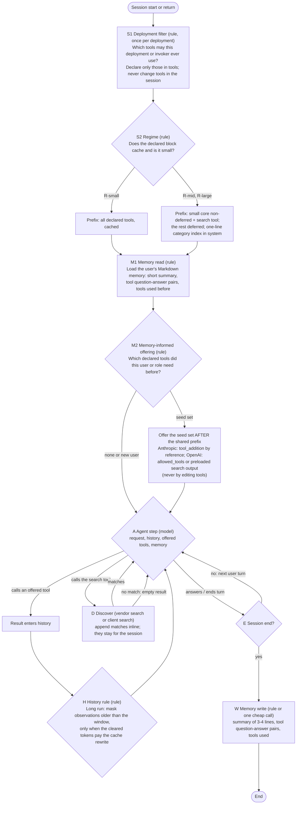

# 04. Design: the combined staged-and-memory policy, built from established parts (V5, AUTH-020)

Status: provisional, lead, 2026-10-22; the simplest rival is written separately by the design-proposer (DPR-0008, `design/proposals/`); both are challenged in `07`. **Nothing here is validated, approved, selected or final. No parameter is given a value.** Every mechanism below is taken from `03`; what is untested in our setting is marked OURS and goes to `05`.

## 1. What V5 concludes, in five sentences
1. In bill terms the decision is mostly settled by arithmetic, not by experiment: with the stored prices, deferring tools and searching beats exposing every tool from about 10 to 75 tools upward, whatever the cache read price (D-01), so above a few dozen tools the open question is **accuracy**, not cost.
2. Two providers now let a policy change what is **offered** per turn without touching the cached definitions (`03` section 2: Anthropic mid-conversation tool changes, beta; OpenAI `allowed_tools`), so the supervisor's stages can act at session start and per turn without the cache breaks that sank per-step tool swapping.
3. The established parts (cached prefix, vendor deferral and search, append-only discovery, observation masking, a plain Markdown memory file) are adopted as they are; V5 adds only what the requirements demand and no source has measured: **memory deciding which tools are offered to a returning user** (REQ-U21-04) and the **session-gap economics** of returning users.
4. Against V4 the verdict is **V4 substantially revised**: the criterion becomes the bill (DPR-0006), memory and sessions enter, the request-level system selector and the system trigger leave the default (no evidence for either, and each costs a request), and the staged form is kept as two session-level stages plus on-demand discovery.
5. The strongest rival is the vendor's own design (a small core plus native tool search, no memory); V5-R beats it only if memory-informed offering reaches the break-even hit rate of D-02 on returning users, which is the first thing `05` tests.

## 2. Regimes (derived, D-01; `calc/regime_bill.stdout.txt`)
| Regime | Condition | Cheapest in bill terms | Accuracy question |
|---|---|---|---|
| R-small | Tool block below the model's minimum cacheable length (512-4,096 tokens, `03` section 1), or fewer than about 10-25 tools | Expose all (the block is small; deferral's extra request costs more than it saves) | None beyond the baseline |
| R-mid | Tool block caches and fits the window; roughly 25 to a few hundred tools | Deferral with a small core, by a factor of about 2-30 (D-01 table, T = 10) | Does search find the tool? Vendor results not established (`03` section 3); first-stage retrieval is weak (ToolRet) |
| R-large | Tool block exceeds the window (about 200 to 10,000 tools by definition length, V4 `01` section 1) | Deferral is the only option | Same, more so |
| R-return | Any size, gap between sessions longer than the cache lifetime | Every session pays the prefix write again: expose-all pays P_all·(w − r) per return (115,000 fresh-token equivalents at 400 tools, d = 250), deferral pays only its core | Does memory shorten the first turns? (D-02) |

Break-even barely moves with the read price because both designs pay the same read rate on what they keep (D-01). It moves with the number of discoveries per session D (n* = 10-13 at D = 1, 40-74 at D = 10): **the more often the model must search, the larger the catalogue at which deferral starts to pay.** Memory acts on exactly that term.

## 3. The policy V5-R (run-time graph)

Stage questions and answerers (the supervisor's "one question per stage", REQ-O14F-06):
| Stage | Question | Answerer | Established part | What is OURS |
|---|---|---|---|---|
| S1 | Which tools may this deployment or invoker ever use? | rule (deployment configuration) | static allow-lists (`03` section 4) | its saving in our setting |
| S2 | Does the declared block cache and is it small? | rule (minimum length per model, D-01) | provider minimums, DPR-0006 | the regime boundary for our catalogue |
| M2 | Which declared tools did this user or role need before? | rule over the memory file | memory carrier (`03` section 5); offering at a fixed prefix (`03` section 2) | **hit rate h against h* (D-02)**; accuracy effect of seeded tools |
| D | Which tool do I need now? | model plus the provider's or a client ranker | vendor tool search (`03` section 3) | uninstructed initiation; recall on our catalogue |
| H | Is the old history worth clearing now? | rule (`clear_at_least` logic) | observation masking, context editing (`03` section 6) | the cache interaction on our provider |
| W | What should the next session know? | rule or one cheap call | plain Markdown memory (REQ-O21-09), memory tool (`03` section 5) | what to keep |

How the requirements are met: a filtered tool comes back through D (REQ-O14F-06, REQ-O02-09); the number of stages is open and each is kept only if `05` shows it pays (REQ-O14F-06); every stage's own cost is in the bill (REQ-O02-02); memory is in service of tool calls (REQ-O21-01); staged offering and memory are one policy (REQ-U21-04); likelihood of who asks enters only through S1 and M2 (REQ-U21-09). Withdrawing tools per turn (`tool_removal`) is **not** in the default: at a fixed prefix it saves no tokens (the definitions are still read at the cache price) and its accuracy benefit is untested; it is an arm in `05`.

## 4. Candidates compared (same criteria)
| Candidate | Parts | Bill (relative, from D-01 and D-02) | Accuracy risk | Evidence status |
|---|---|---|---|---|
| K0 expose-all with caching and a summary | all tools cached; summary memory | lowest in R-small; 2-30x the tool-block cost of deferral in R-mid; infeasible in R-large; pays the full prefix on every return | none from exposure itself; selection among many tools degrades with size on some models (`03` section 3, vendor 30-50 tools note, scout-reported) | all parts established |
| K1 vendor deferral (core plus native search), no memory | P0b, D | low in R-mid and R-large; every session rediscovers its tools (D searches) | search misses; uninstructed initiation unknown | mechanism established; performance not |
| V4 unchanged | P0, optional request selector P1, discovery P2, system trigger P3, token criterion | P1 and P3 each add requests; no session terms | no source supports P3; P1 recall unlabelled at size | V4 `01` section 6 |
| **V5-R (recommended)** | S1, S2, P0a/P0b, M1-M3, D, H, W | as K1 minus the searches memory avoids, plus the seeded definitions carried (D-02) | as K1, plus wrong or stale memory (`03` section 5: memory frameworks fail at grounding parameters) | mechanisms established; M2 effect OURS |
| DPR-0008 simplest rival (proposer) | see `design/proposals/DPR-0008.md` | | | written independently of the lead |
| Executor baseline (REQ-O02-06) | one shared catalogue with intent search and per-tool policy (`03` section 4) | to be read from its own MCP surface before the arm is defined | | required baseline |

## 5. When each part fails, is unnecessary, or is dominated
| Part | Fails when | Unnecessary when | Dominated by |
|---|---|---|---|
| S1 deployment filter | the invoker crosses roles in one session (D recovers only if the tool is declared) | the catalogue is small or every role needs everything | K0 in R-small |
| S2 regime switch | the minimum or window is misread for the model | one regime covers all deployments | a fixed choice |
| P0b deferral | search misses; the model never searches uninstructed; the provider lacks deferral (then a client search must keep the prefix and append, `03` section 3) | R-small | K0 in R-small |
| M2 memory-informed offering | hit rate below h* (D-02: about 0.22-0.30 for 3-10 requests, up to 0.69 for 100); stale tools; per-user seeds placed inside the prefix would split a shared cache (placed after it here) | single long runs; new users | K1 when returning users rarely reuse tools |
| D discovery | ranker recall is poor (ToolRet); injected tool documents (ToolHijacker) | R-small | K0 in R-small |
| H masking | the cleared tokens do not pay the rewrite (context editing's own warning, `03` section 6); a masked observation was needed later | short runs | no clearing |
| W memory write | the summary drops what the next task needs (Mem2ActBench, blind B) | no returning users | no memory |

## 6. Recommendations (V5-Rnn) and derivations (D-nn)
- **V5-R01.** Use DPR-0006 as the only cost criterion and report its components; do not add a token criterion beside it.
- **V5-R02.** Never change the `tools` array within a session; change what is offered only through the providers' offering mechanisms (`03` section 2) or appended discoveries (`03` section 3).
- **V5-R03.** Choose expose-all or deferral per deployment by D-01 (minimum cacheable length, window, catalogue size), not per request.
- **V5-R04.** Adopt vendor tool search where the model supports it; where it does not, a client search that returns definitions appended at the end, never inserted.
- **V5-R05.** Keep memory a plain Markdown file in the first loop (REQ-O21-09): summary, tool question-answer pairs, tools used.
- **V5-R06.** Seed memory-chosen tools after the shared prefix, never inside it, so users with the same deployment share one cached prefix.
- **V5-R07.** Drop the request-level system selector and the system trigger from the default; keep them as `05` arms only if the loop shows a reason.
- **V5-R08.** For long single runs, mask old observations by the established rule and clear only when it pays the rewrite.
- **V5-R09.** Measure first what is OURS (`05`), in the order: university API cache fields; memory hit rate against h*; offering accuracy at a fixed prefix; uninstructed recovery.
- **D-01.** Tool-block bill, deferral against expose-all: `calc/regime_bill.py` and its stdout (inputs cited in the script header).
- **D-02.** Break-even hit rate of memory-seeded tools, and the cost of keeping tokens cached: `calc/memory_seed.py` and its stdout.

## 7. Symbols left as decisions (never valued here)
The core size; the search width; the memory seed size m; the masking window; `clear_at_least`; the cache lifetime per deployment; the call cap; the primary averaging (ratio of sums against mean of per-session ratios, DPR-0006 section 4); the price table and provider (REQ-U21-08).

## 8. What is not claimed
No saving is claimed for any candidate; D-01 and D-02 are first-order arithmetic under stated assumptions, not results. No novelty is claimed (REQ-O14F-03 frames the novelty as the combination; V5 found no source measuring this combination, which is a bounded negative). Vendor performance numbers are not relied on. The mid-conversation offering mechanism is beta and provider-specific.
