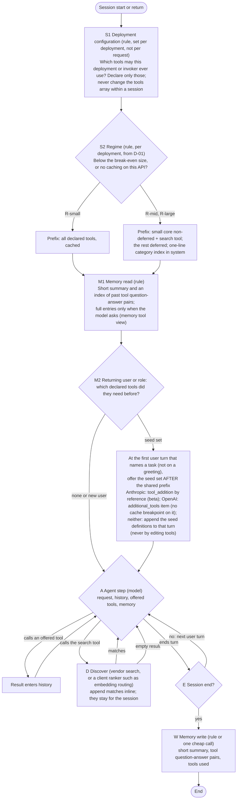

# 04. Design: the combined staged-and-memory policy, built from established parts (V5, AUTH-020)

Status: provisional, lead, revision 2 of 2026-10-22 after the independent review (RV-0021, RV-0022; adjudication in `07`). The simplest rival was written separately by the design-proposer (DPR-0008). **Nothing here is validated, approved, selected or final. No parameter is given a value.** Every mechanism is taken from `03`; what is untested in our setting is marked OURS and goes to `05`.

## 1. What V5 concludes, in five sentences
1. In bill terms, deferral with a small core and search is cheaper than exposing every tool above a break-even catalogue size that lies between about 10 and 230 tools under the stored prices, depending mainly on how often the model must search per session, on definition length and on whether the small core prefix itself caches (it often does not with short definitions, because the core falls below the model's minimum cacheable length) (D-01, `calc/regime_bill.stdout.txt` tables A-C); **above a few hundred tools deferral is cheaper under every variant computed**, so there the open question is accuracy, not cost.
2. Two providers document ways to change what is **offered** per turn without touching the cached definitions (Anthropic mid-conversation tool changes, beta, listed models; OpenAI `allowed_tools` and the developer-role `additional_tools` item, `03` section 2), so session-level stages can act without the cache breaks that sank per-step tool swapping, where the API passes them through. **On the student's university API they are not available as such** (`05` P0 result: it serves open-weight models through an OpenAI-style endpoint, not Anthropic or OpenAI models), so V5-R runs on the client-side route of section 5: a client ranker over the deferred catalogue, appended definitions, and seeds appended to the first task turn.
3. Whether memory-informed offering (REQ-U21-04) pays is **not settled by arithmetic**: the share of seeded tools that must actually be called ranges from about a fifth to a half, and up to "never" in long sessions, depending on how many matches a search returns, session length, read price and whether search runs client- or server-side (D-02 revision 3, `calc/memory_seed.stdout.txt`); it is therefore **part of the tested policy** for returning users (REQ-U21-04; the human's answer for the supervisor, REQ-J22-01: memory must not stay off, it must be tested properly in the right place), and the threshold computed from the observed values is the yardstick for reading `05` P1, not a switch that keeps it off.
4. The **recommended default is the rival's core** (DPR-0008: the regime switch, a small core plus vendor deferral and search, a short memory file, recovery by search), with the deployment filter and memory-informed offering for returning users on top; against V4 the verdict is **V4 substantially revised** (bill criterion, memory and sessions in, request-level system selector and system trigger out of the default).
5. On present evidence the V5-specific addition (memory-informed offering) is **not established**; "no improvement established over DPR-0008" is the honest current reading for it, and `05` P1 is the test that can change that.

## 2. Regimes (derived, D-01; inputs and assumptions in the script header)
| Regime | Condition | Cheapest in bill terms | Accuracy question |
|---|---|---|---|
| R-small | Below the break-even n* (about 10-60 tools with a cached core and few searches per session; up to about 230 when the core prefix falls below the cache minimum, as it does with short definitions, and searches are frequent) | Expose all | None beyond the baseline |
| R-mid | Above n*, tool block within the window (window limits: 200-2,000 tools at 200k tokens and 1,000-10,000 at 1M, by definition length, table D) | Deferral; the margin grows with size (table A) and shrinks with frequent searches (at D = 10, 100 tools, d = 250 the ratio is 0.45-0.57, not 0.1) | Does search find the tool (ToolRet: first-stage retrieval is weak; HYP-0019)? |
| R-large | Tool block exceeds the window | Deferral is the only option | Same, more so |

**Cold and warm starts.** Every session in D-01 starts with a write. Whether a session's first request is warm depends on whether another request of the same deployment wrote the identical prefix within the lifetime: **the request rate across users, not the gap of one user, decides it** (DPR-0006 section 3; table E gives the saving of a warm start as a difference, never to be added to the rows). A shared prefix (V5-R06) is what makes warm starts across users possible; per-user content inside the prefix would prevent it.

**Discovery mode matters.** A client-side search adds a request; Anthropic's server-side tool search runs inside one request (L/v5-anthropic-tool-search-20261022.md:601-652; DPR-0006 section 1). Both are computed; the break-even moves by a few tools, not by an order of magnitude. Both variants are one-sided: how server-side search iterations are billed is not stated in the stored pages (the server variant is optimistic for deferral), and the uncached-core variant is pessimistic for deferral (D-01 table C labels).

## 3. The policy V5-R (run-time graph)

Stage questions and answerers (REQ-O14F-06):
| Stage | Kind | Question | Answerer | Established part | What is OURS |
|---|---|---|---|---|---|
| S1 | deployment configuration | Which tools may this deployment or invoker ever use? | rule | static allow-lists, Copilot's usage-based core (EXT-0228) | its effect in our setting |
| S2 | deployment configuration | Below the break-even size, or no caching? | rule | provider minimums and prices; Claude Code ships an equivalent threshold (`03` section 3) | where n* lies for our catalogue (`05` P5) |
| M2 | run-time, first task turn of a returning session | Which declared tools did this user or role need before? | rule over the memory file | memory carrier (`03` section 5); offering mechanisms (`03` section 2) | **seed precision h against h*, and accuracy (`05` P1)** |
| D | run-time, each request | Which tool do I need now? | model plus vendor search or a client ranker | vendor tool search; embedding routing (EXT-0228, vendor figures); hierarchical retrieval in research (AnyTool, Tool-to-Agent Retrieval, `03` section 4) | uninstructed initiation (HYP-0019); recall on our catalogue |
| W | run-time, session end | What should the next session know? | rule or one cheap call | plain Markdown memory (REQ-O21-09), memory tool | what to keep |

Only S1, M2 and D decide which tools the model sees; S2 chooses a prefix layout and W writes memory. M2 acts only for returning users with a memory file (new users and single long runs have nothing to seed), and in R-small there is no D (everything is exposed), so a small deployment serving new users has S1 alone. Seeding waits for the first user turn that names a task because the supervisor objects to loading everything "just by saying hi" (INT-T-002 L219-L220); the shared prefix itself stays task-independent. **REQ-O14F-06 is met in reduced form**: one question per stage, the number of stages open, and a tool held back by M2 or by deferral comes back through D; a tool excluded by S1 does not come back, because S1 is the deployment's permission set (that is its purpose). Multi-step narrowing (1,000 to 800 to 500 to 10, REQ-O14F-05) is not in the default: hierarchical retrieval exists in research (`03` section 4), but in our setting each extra model-answered level is a request and, without the offering mechanisms, a cache break; it is a candidate for D's ranker, not a separate stage.

**History management for long single runs** (observation masking with the `clear_at_least` rule, `03` section 6) is **not in the default**: its evidence is one coding-agent study, tool outputs were a small share of cost in coding agents, clearing invalidates the cached prefix, and context editing is beta; it is a `05` arm (P4) for deployments with large tool results.

## 4. Candidates compared (same criteria)
| Candidate | Parts | Bill (relative, D-01 and D-02) | Accuracy risk | Evidence status |
|---|---|---|---|---|
| K0 expose-all with caching and a summary | all tools cached; summary memory | lowest below n*; above n* the ratio deferral/expose-all falls from about 0.5-0.9 near n* to below 0.1 at 400+ tools (table A); infeasible above the window | none from hiding tools; a large visible toolset may lower accuracy (Copilot reports 2-5 points, vendor benchmark, not relied on) | all parts established |
| DPR-0008 S-min (proposer) | byte-stable prefix, regime switch, core plus deferral and search, capped discovery, summary memory | as K1 | as K1 | written independently of the lead; parts established |
| K1 vendor deferral, no memory | core plus native search | as DPR-0008 without the regime switch (pays more below n*) | search misses; uninstructed initiation unknown | mechanism established, performance not |
| V4 unchanged | prefix, optional request selector P1, discovery P2, system trigger P3, token criterion | P1 (if model-answered) and P3 each add requests; no session terms | no source supports P3 | V4 `01` section 6 |
| **V5-R (working draft, REQ-U22-02; = DPR-0008 + S1 + M2 for returning users)** | `04` section 3 | DPR-0008's, plus or minus the M2 term: a saving only where the seed precision exceeds h* (about 0.16 to "never", D-02 revision 3) | as DPR-0008, plus stale or wrong memory | M2 not established (not found for large catalogues with a bill in a limited search; personalized tool memory exists over small tool sets, `03` section 5) |
| DPR-0009 blind alternative | static core plus native search, role filter, summary memory | as DPR-0008 | as DPR-0008 | model output recorded as a candidate |
| Executor (REQ-O02-06, narrowed by REQ-J22-04: a source of parts, an optional baseline) | one MCP endpoint with six fixed meta-tools (`skills`, `search`, `describe`, `call`, `execute`, `resume`), tiered search results, scoped connections (`03` section 4a) | a constant tool block, but up to three model requests (search, describe, call) before a first call | lexical search can miss tools; no memory across sessions | parts reused in V5-R on the university route (fixed surface, tiered results, closest-path recovery, scoped connections); running it as shipped is optional |

## 5. When each part fails, is unnecessary, or is dominated
| Part | Fails when | Unnecessary when | Dominated by |
|---|---|---|---|
| S1 | the invoker crosses roles in one session | small catalogue or every role needs everything | K0 in R-small |
| S2 | the minimum or window is misread; n* is mis-set because searches per session (D) are unknown | one regime covers all deployments | a fixed choice |
| P0b deferral | search misses; the model never searches uninstructed; the provider lacks deferral (then a client search must keep the prefix and append); **deferred definitions are re-read on every request in some clients (one user report, L/lit-ccissue-59650-deferred-cache-reads.txt:21-41; the vendor says deferred tools are stripped from the prefix, `03` section 3) [U]** | R-small | K0 in R-small |
| M2 | seed precision h below h*; stale tools; memory biasing tool parameters (Mem2ActBench; a memory-induced tool-drift paper is stored, L/arxiv-2605.24941.txt, not read here) | single long runs; new users; long sessions with one match per search at a 0.1 read price (D-02 "never") | DPR-0008 |
| D | ranker recall is poor (ToolRet); injected tool documents (ToolHijacker, EXT-0227) | R-small | K0 in R-small |
| W | the summary drops what the next task needs | no returning users | no memory |

**Provider routes (CH-0086), and the route that applies.** `05` P0 read the university API's public status data (L/v5-scads-llm-state-20261022.json, 2026-10-22): seven open-weight chat models report tool support (DeepSeek-V4.1-Flash, Gemma-4-26B-A4B, Llama-3.3-70B, MiniMax-M3, gpt-oss-120b, Qwen3.8-27B, GLM-5.3 and GLM-5.3-Flash, context limits from 65,536 to 1,048,576 tokens), plus embedding models (Qwen3-Embedding-4B, embeddinggemma-2) and a reranker (Qwen3-Reranker-4B); the endpoint is `https://llm.scads.ai/v1/` (L/v5-tud-selfservice-scads-llm-20261022.txt:46), an OpenAI-style path [I]. No Anthropic or OpenAI model is served, so their server-side tool search, `tool_addition` and hosted tool search do not apply; **read with the human's key on 2026-10-27 (`10-p0-university-api-reading.md`, six models):** the server (a LiteLLM proxy) reports `cached_tokens`, `created_cache_tokens` and `reasoning_tokens` on every response; prefix caching works but is partial and block-wise (59% to 99.7% of a repeated prompt) and survived an appended turn; `allowed_tools` is rejected with HTTP 400; no prices are reported; tool calling was shown on three models in the second probe: `auto`, `required` and a named tool all produced the right call (nine of nine), and on GLM-5.3 a changed tools array rewrote 65% to 99% of the prompt, supporting V5-R02 on this route (on gpt-oss and MiniMax-M3 it did not, unexplained; `05` P0 part 4). **The route is therefore the client-side one:** D is a client ranker (the API's own embedding and rerank models can serve it) that appends definitions at the end; M3 appends seeds to the first task turn; and the bill is computed from the usage token counts with a named price table (DPR-0006 section 1), because a free API sends no bill. The general cases: if the student's API passes Anthropic's offering mechanism, M3 uses `tool_addition`; if it is OpenAI-compatible with tool search, `additional_tools`; if it passes neither, M3 appends seed definitions to the first user turn (cache-safe, but a write on every session); if it applies no caching, S2 chooses deferral at every size where the core is smaller than the catalogue, and M2's carry cost becomes a fresh-token cost (h* rises). P0 decides which route applies.

## 6. Recommendations (V5-Rnn) and derivations (D-nn)
- **V5-R01.** Use DPR-0006 as the only cost criterion and report its components.
- **V5-R02.** Never change the `tools` array within a session; change what is offered only through the providers' offering mechanisms or appended discoveries.
- **V5-R03.** Choose expose-all or deferral per deployment by D-01, using the measured searches per session and checking that the chosen prefix caches; not per request.
- **V5-R04.** Adopt vendor tool search where the model and API support it; otherwise a client search (an embedding ranker costs an embedding call, not a model request [I]) that appends definitions at the end.
- **V5-R05.** Keep memory a plain Markdown file in the first loop (REQ-O21-09): a short summary, an index of tool question-answer pairs (full entries on request), tools used.
- **V5-R06.** Keep the prefix identical across users of a deployment; put anything per user after it.
- **V5-R07.** Leave the system trigger out of the default (no source supports it) and use a ranker inside D (vendor search, or an embedding ranker) rather than a separate model-answered selector stage. Reason [I]: a model-answered stage adds a model request; an embedding ranker adds an embedding call instead, whose cost DPR-0006 does not yet carry as a term (to be added as a per-call tool charge if used). Copilot's coverage figures are vendor figures and are not the basis of this choice. Memory-informed offering is in the tested policy because REQ-U21-04 requires the combination and REQ-J22-01 asks for it to be tested in the right place; it is removed only if `05` P1 falsifies it (HYP-0017).
- **V5-R08.** Use observation masking only as a `05` arm for deployments with large tool results.
- **V5-R09.** Measure first what is OURS, in this order: P0 (university API: models read from the status page; cache fields still to read with one keyed request; Executor's MCP surface), P5 (where n* lies, and whether deferred definitions are billed), P3 (uninstructed recovery), P1 (memory hit rate), P2 (offering accuracy), P4 (masking, only if needed).
- **V5-R10.** Append discovered tools as tiered entries: name and one description line first, the full schema only on request (the vendors' and Executor's tiers, `03` sections 3 and 4a); the exposé's fixed levels L0-L3 are the candidate definition of the tiers (`09` EX-2). Bill effect: roughly a fifth to a third off the deferral tool-block bill at an assumed 0.4 compact size (D-03); the accuracy effect is untested (`05` P2/P3).
- **V5-R11.** In the loop, log the churn of the visible tool set (each change is a cache rewrite) and the recall of the offered set, and run an oracle-registry ablation (the needed tool guaranteed present) to separate selection failures from later ones (`09` EX-9, BR-8); eviction of appended tools is an optional long-session step gated by the rewrite arithmetic (`09` BR-1).
- **D-01.** Tool-block bill, deferral against expose-all, in two discovery modes and with an uncached-core variant: `calc/regime_bill.py` (revision 2) and its stdout.
- **D-03.** Bill effect of tiered (compact) appended entries, with an assumed compact fraction: `calc/compact_tiers.py` and its stdout.
- **D-02.** Break-even seed precision of memory-seeded tools (revision 3: needed seeds carry their longer read; both discovery modes; K = 1 and K = 3 matches per search), and the cost of keeping tokens cached: `calc/memory_seed.py` and its stdout.

## 7. Symbols left as decisions (never valued here)
Core size; search width; memory seed size m; searches per session D (to be measured); cache lifetime per deployment; call cap; the length of the memory summary; the primary averaging of the bill (decided: total bill over total turns, with the mean of per-session rates reported beside it, REQ-U22-08); price table and provider (REQ-U21-08).

## 8. What is not claimed
No saving is claimed for any candidate; D-01 and D-02 are first-order arithmetic under stated assumptions, with no empirical source for D, H, q or the core size. No novelty is claimed (REQ-O14F-03 frames the novelty as the combination; personalized tool memory exists in research over small tool sets, and no source measuring memory-informed offering over a large catalogue with a bill was found in the targeted searches logged in `inputs/search-log-20261022.md` section 2). Vendor performance numbers are not relied on for any decision. Beta features: Anthropic mid-conversation tool changes and context editing.
