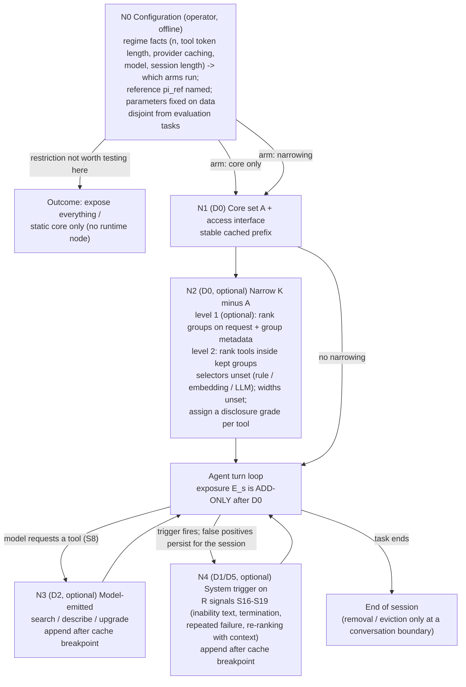

# C. Conceptual policy proposal (provisional)

**Status: a hypothesis class with a decision flow, not a finished or validated policy and not a recommendation to build.** Source records: DPR-0003 (template, nodes, decision cards), DPR-0002 (families and complete comparators P0-P8, P2h, P4g), HYP-0001..0006, after challenges CH-0001..0019. Sections marked **[lead]** are the lead's synthesis, not agent output. Everything is subject to D (challenge) and E (validation). No number, threshold, width or stage count is set: `m`, `g_1`, `J`, `G` and the selector types are symbols.

## C1. What the policy decides, in plain words
The policy decides **what the model can see and reach, and when that may grow**. Its decisions are placed where the information exists:
1. **Before the run (configuration, N0).** Which arms apply to this deployment (catalogue size and token length, provider caching, model, expected session length), using facts measured on data disjoint from any evaluation. This is *operator configuration*, not a per-task decision. "Expose everything" and "change nothing" are valid outcomes.
2. **At the first turn (N1, N2).** Always-present core `A` and an access interface (N1); optionally, a narrowing of the remaining catalogue from the request text and the catalogue metadata alone (N2), at one level (a single selector) or two (group, then tool). Each candidate also gets a disclosure grade.
3. **During the run, only by adding (N3, N4).** The model may ask for a tool to be searched, described or upgraded (N3). Optionally, the system may add tools on a trigger built only from runtime-observable signals (N4). **Exposure is add-only after the first turn** (rule R-cache): removal happens only at conversation boundaries, so the cached prefix is never rewritten mid-session.
Nothing at runtime uses gold tools, reference trajectories or benchmark annotations (class P); the cost of every decider (embedding, LLM, classifier) is counted.

## C2. Decision flow

Edge conditions: N2 is skipped in P1 (static core), P3 (deferred loading) and P4/P4g (graded disclosure with no system selector). N3 and N4 are independent options; **one path suffices for the 2026-10-02 fallback wording (REQ-S2)**; N4 is only tested against N3 and against an extra-turn-without-tools control.

## C3. Node table: determinant, information, cost, failure, test
| Node | What determines the decision | Information (class) | Cost | If its assumption fails | How it is tested |
|---|---|---|---|---|---|
| N0 | Operator choice from regime facts | R as configuration; regime facts from offline data (D), never from evaluation tasks | offline measurement | regime facts tuned on test tasks; no runtime determinant exists (HYP-0001) | stratify every result by regime variables |
| N1 | The core `A` and the interface | offline usage (D, disjoint data), catalogue metadata and sizes, provider facts | prefix tokens every turn (cached read price on supporting providers) | `A` misses needed tools; core built on evaluation data | P1 vs P0; leakage audit of how `A` was built |
| N2 | Selector(s) over request text and catalogue metadata; no gold | R (request, metadata); selector may be a derived judge (error is a cost) | `D = sum_j (b_j + a_j n_{j-1})`; selector tokens counted | recall loss, especially on "latent" intermediate tools (EXT-0026); stage-1 losses not offset; correlated errors | P2 and P2h vs P0, P1, P3, P4, P4g; recall measured scorer-side against U1 |
| N3 | The model's own request | R (transcript, the request itself) | one step (EXT-0012) plus appended definitions; standing interface cost in the prefix | the model does not initiate when a tool is absent [U]; poor search results | initiation rate with the needed tool absent vs present |
| N4 | Trigger over S16-S19; S17 (termination) fires on every termination unless a named runtime verifier exists | R inputs; classifier is class D if tuned on labels | classifier/retrieval per trigger, extra turn, appended tokens | false positive = waste (100% on no-miss tasks if S17 always fires); false negative = no recovery; a re-opened attempt mixes tool value with a second attempt | N4 vs N3 vs none vs extra-turn control; trigger precision and recall scorer-side |

## C4. The simpler policies the template reduces to (complete comparators)
P0 expose all (or `pi_ref`) · P1 static core · P2 single-stage top-`m` + core · P2h system-run two-level cascade · P3 deferred loading with a search tool · P4 two-grade exposure (moderate `n` only) · P4g group-then-tool disclosure, model-driven (large `n`) · P5 stable meta-tool / code-mediated · P6 learned selector · P7 append-only per-turn re-ranking · P8 session working set. Each is specified in DPR-0002 section C with its D-points, signals, failure handling and win conditions. **The template collapses to P3 or P4g if N2 does not pay, to P2 if N3/N4 do not pay, and to P0/P1 if neither does.** The record does **not** discriminate among P0, P1, P2 plus recovery, P3, P4g and P2h.

## C5. How the supervisor's staged graph fits **[lead, interpretation]**
REQ-O14-12/13/15 describe steps, each asking "is this still relevant in this scenario?", filtering the remaining tools, with a later stage able to "go back and add the tool". Their binding force is open (REGISTER Q2). In this template:
- **The staged graph is form P2h** (system-run levels over groups then tools), with stage count `J` and per-stage selector unset. Each stage's question and answerer (rule, embedding, LLM) is a design parameter the supervisor's excerpt does not give. `J = 1` is P2, which REQ-O14-08 itself says is not by itself "a policy"; context-sensitivity then enters through N3/N4.
- **"Go back and add" has two readings with different information.** (i) *Before the first model turn:* a later stage re-admits a candidate an earlier stage cut. New information exists only if the later stage reads finer metadata or uses a different selector, so this is a second opinion at extra cost; no cached prefix exists yet, so there is no cache penalty. (ii) *During the run:* a tool is added after the trajectory shows a need. The new information is the trajectory (S5-S7), which requires a trigger (N3/N4), and the addition must be append-only. For a removed tool "this tool turned out relevant" is never directly observable (no call or error can occur for it), which is why the policy needs a named trigger.
- The supervisor's examples (10,000 tools, four or five stages) are not specifications and are not used.

## C6. Two candidate committed forms for discussion **[lead]**
The human asked for a policy that is "interpretable and testable", and the 2026-10-21 deliverable is "the policy". The template is deliberately not a single form because the record cannot choose. If one form must be carried into the meeting, these two are the ones the record leaves non-excluded and that differ in who decides:
| | Form S (system-run, matches the supervisor's staged-graph reading) | Form M (model-driven graded deferral, the shipped vendor pattern) |
|---|---|---|
| Pipeline | N1 + N2 as P2h (groups -> tools, selectors unset) + N3 (+ optional N4) | N1 + group headers + N3 (P4g; P3 when `n` is small) |
| Who decides relevance | system selectors | the model, from catalogue-owner-written group descriptions |
| Main strength | explicit, inspectable "question per stage" logic; matches REQ-O14-12 | no system relevance model; vendor documents a cache-preserving append design (EXT-0008/0010, vendor claims) |
| Main risk | recall loss at the selector(s), stage losses compound or not (HYP-0002); selector cost | model non-initiation (HYP-0004, unmeasured for discovery); group-description quality; many groups overflow context |
| Evidence status | `hier` indistinguishable from single-stage in success (EXT-0053); no token data | vendor-shipped; no controlled comparison on tools |
Choosing between them, or neither (P0/P1/P2 plus recovery), is a human/supervisor decision and depends on the "pays" reading and the decision rule, which must be fixed before any run (E).

## C7. What this proposal does not claim
That it is optimal, minimal, novel or approved; that restriction, staging, grading or recovery is justified in any regime; that any hypothesis is true; that vendor cache statements hold; that any number, threshold or stage count is appropriate; that the supervisor's staged graph is correct or the contribution (REQ-O14-07/16 are assertions, unchecked).
