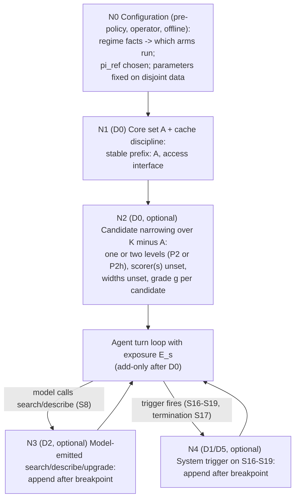

<!-- Thread T-20261016-93, AUTH-004. A PROVISIONAL conceptual hypothesis class and validation strategy. Not a decision, not selected, not validated, not claimed novel. Builds on DPR-0001 rev. 2 and DPR-0002 (consolidated after CH-0017). No numbers: m, g_1, k, tau, delta, G are unset. -->
# DPR-0003: Provisional policy template, decision flow, decision cards, validation strategy

**Proposal.** A *template* for a policy, stated so that every node can be removed and tested; a hypothesis class, not a finished policy and not a recommendation to build it. Selector type, widths `m` and `g_1`, grade set `G`, group size, trigger classifiers and their provenance are unset. The record does **not** discriminate among P0, P1, P2 plus recovery, P3, P4g and P2h (DPR-0002); the forms vendors ship are P3 and P4g-like deferred/namespace disclosure (EXT-0008, EXT-0010), but they are model-initiated and initiation is the unmeasured risk (HYP-0004; EXT-0047 concerns visible tools; EXT-0053 shows pass^3 0.0% on tasks the retriever never surfaced and flat 36.0 vs rag:32 36.7 on one model). No form is recommended; the experiments that would discriminate are in section 3. The stage count is unset; whether any runtime node earns its place is what the validation is for. REQ-O14-12 (steps, each asking a question) is of unclear binding (G.3 Q2) and is not decided here.

**Requirements it answers.** REQ-S1 (EXT-0002 s1.1): save input tokens while maintaining accuracy relative to all tools; selector cost must not cancel savings; judged globally. REQ-S2 (EXT-0002 s1.2): "policy, not only retrieval"; "A fallback"; graded exposure "as a lens" (earlier reading; Q2/Q4 open). REQ-S4: all-tools and multiple baselines. REQ-O14-03: one scorer and one evaluation code path. REQ-O14-08: a fixed top-N is "not a policy". REQ-O14-01: count-of-tools restatement (Q1 open). REQ-O14-18: no implementation. AUTH-004: no numeric thresholds; no future/gold signals at runtime; "Avoid selecting a method merely because it appears ... in the earlier research."

## 1. Decision flow (a template; node set not claimed minimal)

Rule R-cache (design constraint, not a fact): during a session the prefix is never rewritten; tools are added only by appending after the cache breakpoint. Consequences, stated (CH-0010 item 4): exposure is **monotone (add-only) after D0**; there is **no removal node** during a session (removal at conversation boundaries only); false-positive re-adds therefore persist for the rest of the session and add to later turns' context (cached after first read on supporting providers; unmeasured); the rewrite arm and the withdraw-without-rewrite route reported for one vendor (ledger C3-27, per CH-0015, not re-read) are tested against it, not excluded. Provider-specific; vendor documentation only (EXT-0008, EXT-0014).

| Node | What determines it | Information (class) | Cost | Failure of its assumption | How tested |
|---|---|---|---|---|---|
| N0 | Operator choices from regime facts (n, L(t), caching, model, session length) | R as configuration; regime facts from offline data (D) never from evaluation tasks | Offline measurement | Regime facts tuned on evaluation tasks; no runtime determinant (HYP-0001) | Stratify by regime variables |
| N1 | Always-present core `A` and access interface | S10 (D, disjoint data), S2, S3, S4 | Prefix tokens each turn (cached read price on supporting providers) | `A` misses needed tools; core built on evaluation data | P1 vs P0; leakage audit |
| N2 | One selector (P2) or two levels (P2h) over non-core tools | S1, S2; selector lexical/embedding/LLM (S11); no S12 | `D = sum_j (b_j + a_j n_{j-1})` (DPR-0002 s.D) | Recall loss (ComplexMCP "latent" tools EXT-0026); stage-1 loss not offset | P2, P2h vs P0, P1, P3, P4, P4g; recall scorer-side vs U1 |
| N3 | The model's own call (search / describe / upgrade-grade) | S5, S8 | One step (EXT-0012) plus appended definitions; standing interface cost | Model does not initiate [U]; poor search results | Initiation rate with needed tool absent vs present |
| N4 | Trigger over R signals: S16 inability text, S17 end-of-attempt (the model's own termination event; fires at every termination unless a runtime verifier, not using S14 or scorer inputs, is named), S18 repeated failure, S19 re-ranking with context | S5, S6, S7, S1, S2 (derived; classifier error). A classifier is class R only if zero-shot and fed runtime text only; one tuned on labels is class D with U1 leakage and must state training data. Contamination rule extends to S16-S19 (S2/S7 vehicle contamination, DPR-0001 R5) | Classifier/retrieval per trigger; extra turn; appended tokens | FP: waste (100% on the no-miss stratum if S17 fires always); FN: no recovery; D5 re-opens a finished attempt, so its gain mixes tool value with a second attempt | N4 vs N3 vs none vs an extra-turn-without-tools control |

**Node-set statement [I].** Every policy has a baseline exposure (N1). N2, N3 and N4 are optional and each can be ablated: without them the template reduces to P1, P3 or P0. N2 alone is P2, which REQ-O14-08 says is not by itself "a policy"; adaptation to context enters through N3/N4 or through a group-level form (P2h, P4g). N3 and N4 are not both required: one path may meet the REQ-S2 fallback wording. N4 is an optional arm. I do not claim these are the minimum nodes the logic could need.

## 2. Decision cards
Parts: E (EXT ids; "(map)" = not re-read by me), T, J, H (falsifier in HYP), C. No FND records exist in this thread.

### Card A. Restrict at all, or expose everything (N0/N2)
- **E.** Reduced exposure lowered success: EXT-0026 (RAG below full-context for tested retrievers), EXT-0028 (keyword top-5 22.1 vs all-tools 32.1; read), EXT-0030 (map). More tools hurt elsewhere: EXT-0033, EXT-0034, EXT-0032 (map). EXT-0053 (read): curated to rag:8 costs 20.0 points (retrieval loss), curated to flat 8.0 points (distraction), rag:32 36.7 vs flat 36.0 on one model; reachability is a hard gate. Strong models mitigate: EXT-0026. Cost: visible-token savings may overstate billed savings (EXT-0016/0018 map; EXT-0008, EXT-0014 vendor, read). Toollery (S4I erratum Q-1, as cited by the challenger, not re-read): selection hit rate .989 full vs .144 top-10, input tokens -97.5%, billed-input-cost difference inconclusive; single step, hit rate not task success, authors' own. No source measures billed cost together with success for catalogue filtering (bounded negative, EXT-0007..0054).
- **T.** Restriction pays when avoided visible/billed cost exceeds decide + discover + miss costs. Assumes separable costs.
- **J.** Keep P0 (or `pi_ref`) as an arm; decide nothing about restriction before regime facts are known.
- **H.** HYP-0001, HYP-0005.
- **C.** CMTF 85.7% with ~1 visible tool (EXT-0028) depends on contracts and fixed gold trajectories (class P/D); not usable at runtime. Exposing everything may win in many regimes.

### Card B. One selection step vs a cascade (N2 levels)
- **E.** EXT-0053 (read): `hier` (two-stage router) indistinguishable from rag:16/rag:32 in success (about +-8 point intervals; no token data). EXT-0045/0046 (read): JIT schema loading (P3/P4 pattern, not a filtering cascade) shifts toward precision, lower recall; authors say it is most helpful with many tools that could not otherwise be supported. EXT-0041 (read): net saving depends on load probability and reloads (skills). EXT-0054 (weak source, lead): a re-ranker +3 pp at +0 tokens per step. ER-R 0.56x0.70, MCP-Zero: cited by the challenger from governing records, unread at the original.
- **T.** DPR-0002 section D: end-to-end effect `r_1*r_2(n_1) - r_2(n_0)`, decide cost `sum_j (b_j + a_j n_{j-1})`, group-level stage-1 reads; the model gives conditions, not a sign. Assumes separable costs; errors may be correlated.
- **J.** Test P2h and P4g against the best single-stage comparator of the same driver type; stage count unset.
- **H.** HYP-0002.
- **C.** A cascade may win at very large `n` where even a cheap single selector over `n` is costly or `n` exceeds context (S4G line 28); no data here for that regime. Supervisor's staged graph (REQ-O14-12/16) is an assertion, not evidence.

### Card C. Graded exposure instead of binary removal (grade `g`)
- **E.** OpenAI: name and description visible, schema deferred; namespaces/MCP servers recommended (EXT-0010, read); Speakeasy list->describe->execute (EXT-0023, vendor, preliminary, map); Skill Blocks: no universal winner, static pruning "can still be cheaper when reduced coverage is acceptable" (EXT-0039/0040).
- **T.** A cheap grade keeps awareness at lower token price and lowers the cost of a selector miss. Assumes descriptions much shorter than schemas.
- **J.** Treat grade as a lens (REQ-S2); test P4 (moderate `n`) and P4g (large `n`) against P2.
- **H.** The cheap-grade list for all `n` tools costs more than it saves when descriptions are long: falsified if P4 is not dominated by P0 in cumulative cost in some stated regime (see HYP-0005 for the general cost claim).
- **C.** The list is a per-turn cost growing with `n` (P4) or with the number of groups (P4g); EXT-0010: "mostly deferring the parameter schema" for individual functions.

### Card D. Include a recovery path, and who initiates it (N3, N4)
- **E.** For: EXT-0035/0036 (re-retrieval over the evolving context raised pass rate and top-5 availability; initiator mechanism [U]: EXT-0050/0051 show an agent-emitted pseudo-tool description with system-executed retrieval, EXT-0052 (challenger) a system-side novelty condition; section 4.2 unread); EXT-0045/0046 (removal without recovery loses recall, read). Unknown: EXT-0037/0047 (under-invocation of the task's own visible tools; silent on discovery initiation); EXT-0012 ("Discovery adds a step"). Cache: append-only preserves prefix (EXT-0008, vendor).
- **T.** Value `= P(miss) * P(recover | miss) * V`; price `= standing + P(trigger FP) * step cost`. Included iff value > price. Assumes a measurable trigger.
- **J.** REQ-S2's "Required" fallback is an input and a reason to make a re-add path an *arm*, which a single model-emitted path (N3) can meet; it is not a reason for N4. N4 is optional and tested against N3 and against an extra-turn control.
- **H.** HYP-0003, HYP-0004, HYP-0006.
- **C.** If models do not initiate and triggers are noisy, recovery has price and no value; then P0/P1/P4 (no removal of what could be needed) is better. Replay-vehicle bias may inflate recovery's value (S4G L21).

### Card E. Cache discipline (R-cache)
- **E.** EXT-0008, EXT-0014 (read), EXT-0011 (map): vendor statements that modifying tool definitions invalidates the cache and discovered tools can be appended. EXT-0009 (read): every deferred definition is still sent in `tools` each request.
- **T.** Appending after the breakpoint keeps the prefix stable. Assumes providers behave as documented.
- **J.** Adopt add-only as a constraint on all arms for comparability; also run a rewrite arm and (if the provider offers it) a withdraw-without-rewrite arm.
- **H.** HYP-0005 (cost direction). Cache claim: on a supporting provider an add-only arm's cache-read share is not below that of the static arm (stated by the experiment).
- **C.** Documentation only; no measurement in the corpus; closest vehicle records no cache fields.

### Card F. Objective and accounting (not decided here)
- **E.** REQ-S1 (EXT-0002); REQ-O14-01; EXT-0041 (read): effective input with `d = 0.1` and output-token sensitivity `lambda` as a convention.
- **T.** DPR-0001 section 6 (F1-F7).
- **J.** Report the vector `(success, c_tools, c_vis, c_cum by category, c_bill under named conventions, turns)` for every arm under one scorer; the decision rule and the "pays" reading are chosen by the human/supervisor before any run.
- **H.** none.
- **C.** Conclusions may flip with convention (CAVEATS row 5): a result to report.

## 3. Validation strategy (conceptual; not authorized to run)
**Pre-registration (CH-0013).** Before any run the human/supervisor fixes: the reading of "pays" (five admissible readings, none chosen; CAVEATS row 5), the decision rule (one of F1-F7; if the rule is Pareto reporting (F4), the definition of dominance and of ties is fixed too, because non-dominance is a weak criterion under F4 and "survives only where it is non-dominated" is meaningful only under a stated scalar rule or stated dominance definition), the cost convention, the strata, and the regimes in which each component is *claimed* to pay. A component is **justified only in a stated regime** where it is non-dominated on the pre-registered rule after correction for the number of regimes, models and conventions examined. A component is **not justified** if it fails that test in every regime in which it was claimed. Post-hoc readings invalidate the claim (S4D addendum 2.1, S4G L82, per CH-0013). Factors: model strength, repeats (seeds), provider, catalogue size, accounting convention.
- **Baselines (REQ-S4, REQ-O14-03).** P0 (or `pi_ref`), P1, P2, P3, P4, P5 (as the named code-mediated project if the human requires it, S4I section 5), P7, and published methods/named projects as REQ-S4 requires. One scorer, one code path.
- **Policy arms.** Template with each node ablated: N2 off, one level (P2), two levels (P2h); P4g; N3 only; N4 only; N3+N4; with/without cheap-grade list; add-only vs rewrite vs withdraw-without-rewrite.
- **Added controls (CH-0011, CH-0014).** Oracle-exposure arm (scorer-side only, U1) bounding the best case; extra-turn-without-tools control for N4 at D5 (enforced extra exploration added under 5 points in PlanBench-XL, S4F-PA L32 per CH-0011, not re-read: same order as effects to detect). Strata "miss/no-miss" are treatment-dependent and, on the replay vehicle, single-reference-defined: use a task-level oracle stratum (tasks needing a tool outside `A` by U1) where possible.
- **Outcomes.** Success (by stratum), cumulative tokens by category (tool metadata, selector, reasoning, tool outputs, discovery, recovery; cached vs uncached), billed cost under stated conventions, turns, decision-mechanism overhead, recovery value and unused price, initiation rate (needed tool absent vs present), trigger precision/recall, cache fields where returned.
- **Falsifiers (written as the negation of the claim of each component, each in a stated regime after multiplicity correction):** N2 (either level count) is not justified if some of P0, P1, P3, P4 or P4g dominates it on the pre-registered rule in every regime in which it was claimed to pay. The second level of N2 (P2h) is not justified if the single-level P2 with the same scorer type dominates it in every such regime. N3/N4 are not justified if their no-miss-stratum overhead exceeds their measured value in every such regime. The cheap-grade list is not justified if P2 dominates P4 in every such regime. The whole proposal is not justified if, in every regime in which it is claimed to pay, some comparator among P0, P1, P2, P3, P4, P4g, P7 dominates it. Conversely each claim survives only where it is non-dominated, not where it merely ties inside noise.
- **Dependencies fixing numbers (unset):** margin `delta` and sample size depend on discordance and on the replay-usable task count (CAVEATS row 4: 1,578 of 1,845 specs reference-consistent; S4G sample-size figures are illustrations); `T_max`; catalogue sizes; models.
- **Threats to validity (S4G s2, CAVEATS rows 3, 4, 9):** single-reference replay scoring (bias direction unknown; may inflate recovery); forced absence is failure by construction; stub schemas as cues (CH-0004); no cache fields, no sessions (HYP-0001 untestable on the closest vehicle); fixed tool list per run (recovery arm needs an identical loop change); 12-turn budget handicaps discovery, and EXT-0042 (budget-30 control, exploratory, one model, n=50: no task reached the budget) is a threat to inference from budget effects; evaluator error (18.5% disagreement in one audit); experiments on `dev`, code on `main`; vendor figures unreplicated (row 8).
- **Parameters and data split.** All parameters, index, regime facts and `A` fixed on data disjoint from evaluation tasks; split recorded (DPR-0001 R5).
- **Unauthorized now.** Any run, smoke execution, implementation.

## 4. Hypotheses (records in `hypotheses/`)
HYP-0001 regime gate determinant; HYP-0002 a single-step policy is not dominated by a cascade (P2h, P4g); HYP-0003 unused price of an add-only recovery path is small; HYP-0004 models initiate discovery when a needed tool is absent; HYP-0005 exposure count does not order cumulative or billed cost monotonically; HYP-0006 a system-side trigger recovers at lower unused price than model initiation.

## Alternatives considered
The comparators P0-P8, P2h, P4g (DPR-0002 section C). A fully staged cascade (REQ-O14-12 form) is written as P2h and kept as an arm, not adopted and not excluded: the extracts read do not show a second stage paying or failing to pay (EXT-0053 success only). A recovery-free policy is an arm.

## Falsifier and assumptions
Falsifier of the proposal as a whole: see section 3 (last clause of Falsifiers). Assumptions: providers behave as documented; S16-S19 can be implemented from R information alone; the replay or substitute vehicle scores recovery without large unexercised-route bias.

## Objections received (CH ids) and responses
CH-0001..CH-0006 (on DPR-0001): conceded, DPR-0001 rev. 2. CH-0007..CH-0016 (round 1) and CH-0017..CH-0019 (round 2): positions in my messages to the challenger and in the revisions above (cascade model and comparators, FitText initiator [U], pre-registration and falsifier form, Toollery, EXT-0053, unresolved: whether P4g/P3 may be named as candidate forms; I now state the record does not discriminate). One residual open point: the challenger's CH-0019 item 1 asks for the experiment that would discriminate; section 3 is that experiment design.

## Not claimed
That the template is optimal, minimal, novel or approved; that restriction, staging, grading or recovery is justified; that any hypothesis is true; that vendor cache statements hold; that any number or threshold is appropriate.
