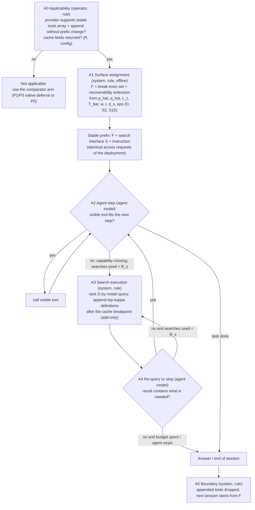

<!-- Thread T-20261016-94, authority AUTH-005. A PROVISIONAL conceptual policy candidate and the space it was chosen from. Not a decision, not selected as the thesis contribution, not validated, not claimed novel. Symbols only: no thresholds, widths, stage counts, margins or targets are set. Corrects DPR-0003 where stated; DPR-0001..0003 are unchanged. -->
# DPR-0004: Candidate space and one provisional policy candidate (decision questions, actors, inputs, transitions)

**Proposal.** From a space of four materially different complete candidates (section 2) I put forward **one**, C-A, as the provisional candidate to investigate *against* the strongest simple comparators, and I say what would make me prefer another. C-A is: a deployment-level surface `F` chosen by an explicit cost-break-even rule with a recoverability constraint, the remainder of the catalogue reachable only through a prompted search interface, with exposure add-only inside a session. It is the smallest candidate that has a non-trivial, fully specified decision logic, passes the runtime-information test (section 5), and keeps the cache prefix stable by design. I do **not** claim it is better than expose-all, a static core or vendor deferred loading; I claim it is a coherent, testable policy whose special cases *are* those rivals (section 3), so one experiment tests all of them. Status: proposed.

**Requirements it answers (by id, as quoted in DPR-0003 and not paraphrased here).** REQ-S1 (net of selector cost, judged globally), REQ-S2 (a policy, a fallback, graded exposure as a lens), REQ-S4 (all-tools and multiple baselines), REQ-O14-03 (one scorer, one code path), REQ-O14-08 (a fixed top-N is "not a policy"), REQ-O14-01 (count-of-tools restatement; Q1 open), REQ-O14-18 (no implementation). Working objective sentence (AUTH-004, quoted, not narrowed): "reducing unnecessary tool exposure to LLM agents while preserving task performance and accounting for the costs of deciding, discovering and using tools."

## 0. The eight corrections: where each is answered
| # | AUTH-005 correction | Answer | Where |
|---|---|---|---|
| 1 | family vs policy | The candidate fills every node with a question, actor, inputs, rule form, transitions; the open slots that remain are listed as human decisions (3.4), not as design freedom | 4, 3.4 |
| 2 | what is N0 | Withdrawn as a node. Replaced by A0 (a factual applicability predicate) and A1 (an explicit rule with named inputs that exist before deployment). No runtime adaptivity is claimed. The "arm selector" is evaluation design, outside the policy | 4.1 |
| 3 | decision questions | Written per node, with who answers; grade choice and in-session surface change specified | 4.2, 4.3 |
| 4 | add-only is a hypothesis | HYP-0009; analysis and alternatives in DPR-0005 section 4 | DPR-0005 |
| 5 | validation logic | HYP-0008, 0011, 0012 supersede HYP-0005, 0003, 0006; outline in DPR-0005 section 6 | DPR-0005 |
| 6 | objective vs diagnostics | Section 6 | 6 |
| 7 | runtime-information test | Table in section 5, every decision | 5 |
| 8 | pivotal passages | Steward results (FND-0001, `findings/SUM-0003-pivotal-claims-verification.md`) enter the claim ledger with their verdicts | 7 |

## 1. Vocabulary
`K` catalogue, `n=|K|`; `L_t` model-visible tokens of tool `t`'s full definition; `F` the **surface** (tools whose full definitions sit in the stable prefix); `D=K\F` deferred tools (reachable only via search); `S` the search interface (a tool in `F`); `T̄` expected turns per session (a declared regime variable, or estimated on dev sessions); `T̄_rem` expected turns remaining after a discovery; `w, r` provider cache write and read multipliers relative to base input price (provider values, estimated, not assumed; EXT-0021 lists the vendor's); `Λ` cache lifetime (EXT-0057); `p̂_t` estimated probability that a session needs `t`; `q̂_t` estimated probability that, when `t` is needed and deferred, the session does not reach it (search miss or non-initiation); `d_s` tokens of one search round trip excluding the returned definitions; `κ` search result width; `B_s` maximum searches per session (`≤ T_max`); `ε` tolerance on expected unrecoverable-miss mass. Signal classes R, D, X, P and S-numbers as in DPR-0001.

## 2. Candidate space (four complete candidates; each stated so it can be run and fail)
Each is a *policy*: a map from information state to action with named actors. Rivals that are baselines in every case: P0 expose-all (or `pi_ref`), P1 static core, P3 vendor deferred loading with a hand-picked non-deferred set (EXT-0009), P4 listed grade (EXT-0010).

### C-0. Expose everything, engineered for the cache (the null policy as a candidate)
- *Nodes.* (0.1) System rule, offline: "does `sum L_t` plus the working context fit the model's context window?" Inputs S2, S3, S4 (R). Yes -> expose `K` in a deterministic order inside one stable cached prefix, no runtime node; transitions: none. No -> not applicable; the arm is replaced by `pi_ref`'s named substitute (DPR-0001 R2).
- *Cost/failure.* Cost `r*sum(L_t)` per turn (cached read) plus distraction; fails where `n` is large (EXT-0053: flat cost 8 points on one model; EXT-0026/0033/0034 map) or the context overflows.
- *Needs to be true.* Distraction small enough and read price low enough for the cached full library to be cheap. *Test.* It is the reference arm.

### C-A. Deployment-level surface by a break-even rule, prompted search, add-only (**put forward**)
Detailed in section 4.

### C-B. System-run, query-conditioned surface with a system recovery trigger; the model never asks
- *Nodes.* (B0) applicability: does the provider allow a per-task surface without changing the prefix (by-reference additions, EXT-0058)? If not, the per-task surface varies the prefix (cache-hostile, DPR-0005 section 3). (B1) System selector, per task, at D0: *for each `t`, is the calibrated `P̂(t needed | q)` above the same break-even as A1?* Inputs S1, S2, a calibration fitted on dev data (D). Rule: surface `t` iff `π̂_t(q)·[d_s + (w + r T̄_rem) L_t] ≥ r L_t T̄`; the width is therefore adaptive per task, not a fixed top-`N` (REQ-O14-08). (B2) Agent acts on the surface; no search tool. (B3) System trigger, between turns: *has evidence of unmet need appeared?* Inputs S16-S18 (a text classifier fed runtime text only, class R if zero-shot, class D if tuned on labels) and repeated-failure counts; rule: fire iff the classifier score exceeds a trigger parameter `θ_trig` chosen on dev data to meet a false-positive budget (symbols; the human sets the budget). (B4) On firing, the system re-ranks `K` with the transcript (S19) and appends the tools passing the B1 break-even with `π̂_t(h_s)`; add-only. (B5) boundary reset.
- *Cost/failure.* Selector cost per task; unrecoverable misses when the trigger is a false negative (the removed tool can neither be called nor error, DPR-0001 R3); correlated selector and trigger errors.
- *Needs to be true.* `π̂_t(q)` is informative beyond the marginal `p̂_t` (HYP-0014 alternative); the trigger has acceptable precision and recall (unmeasured anywhere in the corpus). *This is the candidate closest to the supervisor's staged graph (REQ-O14-12/15); that resemblance is not a reason for or against it.*

### C-C. Stable meta-tool interface; the model does everything through three fixed tools
- *Nodes.* (C0) applicability: the model can invoke tools through a generic dispatcher with argument validation at comparable accuracy [U]. (C1) Agent: *is there a capability I lack? -> search_tools(query)*; *which result do I need? -> describe_tool(name)*; *call -> call_tool(name, args)* (EXT-0014 names "a single stable `call_tool({name, args})` meta-tool so the array never changes"). (C2) System: ranker returns names and descriptions; `describe` returns the schema as transcript text; (C3) dispatcher validates args against the schema (rule) and executes; errors return as results. The tools array never changes, so there is nothing to withdraw or re-add; the transcript only grows.
- *Cost/failure.* The three interface schemas in the prefix; every tool use costs a describe step; the model loses native schema-constrained calling [U effect on accuracy]; the catalogue is hidden entirely, so awareness depends on the model's prior or on a listing.
- *Needs to be true.* Dispatcher calls are as accurate as native ones; discovery steps are cheap relative to carrying schemas. *Evidence.* A guidance statement only (EXT-0014); no measurement in the corpus.

### Why these four differ materially
They differ in **who decides relevance** (offline rule + model, system selector + system trigger, model alone, nobody), in **what information** that decision uses (marginal usage, the query, the model's own text, none), and in **how the surface changes** (appends to a stable prefix; per-task by-reference or varying prefix; never; never). They are not reductions of one template.

## 3. Choice, and why it deserves investigation against the rivals

### 3.1 What I choose and the reasoning (labels in section 7)
**C-A**, as the provisional candidate, for these reasons, each of which can be wrong:
1. **Agent-recoverable failures (reworded after CH-0026).** A deferred tool stays reachable by the *model's* own further action (a re-query to `S`), whereas in C-B a trigger false negative leaves the model with no way to ask. EXT-0053 shows an unreachable tool is close to a certain failure (pass^3 0.0% on unreachable tasks, rag:8, steward V6 PARTLY; exactly one pass in 1,905 attempts on tasks marked unreachable) — but that benchmark is a one-shot retriever, so the gate transfers only as a statement that unreachability is costly. I no longer claim the failures are *observable at runtime*: a model that does not search when it should is a non-event in C-A just as a trigger false negative is in C-B; in both, `q̂` and the miss rate are estimable only offline (dev pilot, scorer side). The difference that survives is who can still recover (the model, in C-A) — itself conditional on initiation (HYP-0010).
2. **Cache-compatibility by construction.** `F` is the same across requests of a deployment and changes in-session only by appending, so the differential hit rate that explains the Toollery natural-replay result (if my inference holds, HYP-0007) is avoided by design. C-B avoids it only on a provider with by-reference changes (EXT-0058, one provider's beta); C-C avoids it entirely but untested.
3. **It contains some rivals as specified special cases** (corrected after CH-0020: my first wording, "the comparison isolates A1", was false). `F=K` is P0; the same `F` with no `S` is P1-same-F (isolates the search interface); `D` listed by name and description is P4. P3-vendor differs from C-A in the size, the ranking and the data of its core, so it does **not** isolate A1. Arms that do isolate the rule are added (DPR-0005 6.5): **P1f/P3f**, a frequency core (by dev `p̂`) with `|F|` equal to A1's, with and without `S`; and **P-sweep**, a frequency core whose `|F|` is chosen by a dev sweep on the measured criterion (success and cost together), which needs no price model. A1 earns a place only if it is not dominated by P-sweep; if P-sweep matches it, the price model adds nothing and the finding is that the empirical sweep suffices.
4. **Every input passes the runtime-information test** (section 5) with a named legitimate source.
5. **Smallest sufficient logic.** I do not say the node set is minimal in any proven sense.

### 3.2 What C-A does not have, said plainly
It is closer to a *parameterised combination of known comparators* (static core + deferred search) than to a new architecture; the contribution, if any, is a decision rule with stated inputs and an evaluation that accounts for cache and population effects. I do not claim novelty, and whether this is a thesis contribution is the human's decision (out of scope). It exhibits **no per-task adaptivity** in the policy: the only in-session adaptation is the model's own search.

### 3.2a Regime in which C-A can beat cached expose-all (CH-0033, partly conceded)
With `ρ = N_C-A/N_full`, the most C-A can save on the tool block per request is `(1−ρ)·r_eff·N_f·p_u` when the full library is warm (DPR-0005 3.1-3.3), with `r_eff` between `r` and `w` depending on `π_c`. At the `r` implied by Table 15 (about 0.009, derived) the entire warm 87k-token library costs about 770 uncached-token equivalents per request (challenger's figure, consistent with my fit), so **on that price C-A cannot win on billed tool-block cost by a margin that matters**; it can win only where (i) `r` is high (vendor-page multipliers, EXT-0021), (ii) caches are cold or sparse (`g>Λ`, saving up to `(1−ρ)·w·N_f`), (iii) distraction costs success at catalogue sizes where `pi_ref` or a named substitute still runs (at context overflow `p̂` is censored and no claim is made, CH-0024) (EXT-0053: flat −8 points, one model/one draw, V6; the success gain needed is of the order of the margin `δ` of the primary rule, not computed), or (iv) the criterion is exposure (count or visible tokens) rather than billed cost (section 6). The numeric region in `(r, n·L, T̄, g/Λ)` is **not known** and is the output of the cost-mechanics experiment (DPR-0005 6.7 step 1); until then "a regime where C-A beats C-0" is a hypothesis with four named candidate regimes, not a finding. If none of (i)-(iv) holds on the tested providers, C-0 is the answer.

### 3.3 Evidence against C-A that stays on the table
- OpenAI: mixing eager and deferred functions in a session is "supported but generally not recommended" (EXT-0012, read), while Anthropic recommends keeping "3-5 most frequently used tools non-deferred" (EXT-0009, read): vendor guidance differs about the shape C-A has (OpenAI's statement is scoped "in an Agents API session"); vendor statements, not measurements.
- Model initiation of search when a needed tool is absent is unmeasured; the one retrieval-by-emission source (FitText) prescribes it by prompt with no alternative path (EXT-0065, V5), and the non-use source (MCP-Atlas No Tool Use) does not say whether the needed tools were visible (V8 PARTLY). HYP-0010.
- Toollery measured per-query restriction with no billed-input-cost advantage; C-A's stable surface is untested there (HYP-0007).
- Curated (about 8 tools) beat every retrieval condition in one benchmark (EXT-0053), but a retriever in a given benchmark is not a usage-derived core; and flat lost only 8 points on one model/draw (V6).
- If usage is flat (no core exists), C-A reduces to P3 with a poor core or to P0 (HYP-0014).

### 3.4 What I would prefer instead, and the minimal decisions that are missing
- **Prefer C-B** if the initiation experiment (HYP-0010) shows models do not search when prompted, *and* the trigger experiment (HYP-0012) shows a usable trigger. **Prefer C-0** if no restriction pays in billed cost with success non-inferior in any regime (HYP-0008, 0013). **Prefer C-C** if dispatcher calls are as accurate as native ones and A-type cores are not concentrated (HYP-0014 false). This is a decision procedure by evidence, not hedging.
- **Missing decisions that make C-A a family if left open** (human, before any run): (i) [revised] none separate for `ε`: `ε := δ` (conservative only if `p̂`, `q̂` are unbiased, CH-0023); a tighter `ε` is OPEN; (ii) the non-inferiority margin `delta` and the reference `pi_ref` where expose-all is infeasible; (iii) the cost convention (billed under named prices, or tokens; Q1 count versus tokens, section 6); (iv) `T̄` (declared per regime, not tuned on evaluation tasks); (v) the search ranker type and the instruction text, to be fixed on dev data.
- **Not defensible now:** a claim that C-A *beats* anything; a stage count; a value of `ε`, `κ`, `B_s`.

## 4. The candidate C-A, fully specified

### 4.1 Graph

### 4.2 Decision table (question, actor, inputs and class, rule form, transitions, cost, failure of its assumption, test)
| Node | Decision question | Actor | Inputs (class) | Rule form (parameters as symbols; how estimated on separate data) | Transitions | Cost | If its assumption fails | Test |
|---|---|---|---|---|---|---|---|---|
| A0 | Can the stable-prefix-plus-append pattern be used on this provider/model, and what does a deferred definition cost per turn? | operator, applying a predicate and a measurement | provider documentation (S4, R), probe requests returning cache and usage fields (S9, R) | conjunction of booleans: append without prefix change documented; second identical request reports cache read; prefix length is cacheable [U]. **Plus a measurement (CH-0021):** billed/reported input tokens of a request with the full set declared but the candidate deferred set withheld, against the same request without the deferred definitions, giving `c_def` (per-turn cost of a deferred tool as billed/visible: about 0 if free, `ℓ_t` if listed by name and description as in EXT-0010, `L_t` if billed in full as EXT-0009 says they are still sent) | all true -> A1 with the measured `c_def`; else not applicable (comparator arm) | a few probes | docs differ from behaviour; deferred definitions billed in full (then A1 returns `F=K` on cost grounds) | probe on the real endpoint; report cache and usage fields |
| A1 | For each tool, is it cheaper (and safe enough) to keep its full definition in the prefix than to defer it? | system rule, offline | `L_t, n` (S2, S3, R); `p̂_t` (defined below; D, disjoint data); `q̂_t` (defined below; D); `T̄, T̄_rem`, `π_c` = probability the prefix is cold at session start (from cadence `g` against `Λ`, declared or from dev traffic); `w, r, d_s, c_def` (S15, provider, measured); `ε` (mapped from `δ`, below) | Step 1: let `keep_t = (L_t − c_def,t)·[π_c·w + r·(T̄ − π_c)]` (extra cost per session of keeping `t` visible rather than deferred: a write when the prefix is cold, reads otherwise) and `disc_t = p̂_t·[d_s + (w + r·T̄_rem)·(L_t + (κ−1)·L̄_D)]` (expected cost of discovering it: the round trip and the appended result of width `κ`, including the `κ−1` other definitions the search returns, one write and reads thereafter). `t∈F_0` iff `keep_t ≤ disc_t`. Step 2: let `M(F)=Σ_{t∈D} p̂_t·q̂_t`; while `M(F)>ε`, move to `F` the tool in `D` with the largest `p̂_t·q̂_t/keep_t`. | `F` = result of steps 1-2, then the prefix is fixed | dev runs and pilot (offline; accounted, section 6 item 7) | `p̂` unstable or biased; `q̂` depends on `F` (assumed not) | held-out coverage vs size-matched controls (HYP-0014); `M(F)` predicted vs observed unreached needs; A1 vs the empirical sweep arm |
| A2 | Does a visible tool fit the next step; if not, is a capability missing? | agent model (its own policy; we control only the interface and the **interface contract**) | S1, S5, S7, surface `E_s` (R) | none specified for the model (its behaviour is the measured variable, HYP-0010). The **interface contract** fixed on dev data (wording not written here) must: state that the visible tools are a subset; give a short scope statement of the deferred catalogue written from catalogue metadata only (its tokens `ς` are counted as exposure); instruct to call `S` when no visible tool fits before answering without tools; state the search budget `B_s` | fits -> call; missing -> A3 | one step per search; `ς` per turn | model does not search (HYP-0010) | initiation rate with the tool deferred, prompted vs unprompted |
| A3 | Which deferred definitions best match the model's query? | system rule | the model's query (S8, R); `S2` metadata for `D` (R); ranker tuned on dev (D) | rank `D` by a ranker (lexical, embedding or both: a symbol) over name, description, argument names (the field set of EXT-0009's search variants), return top-`κ`; `κ` and the ranker chosen on dev for recall@`κ` | append definitions after the breakpoint; -> A4 | ranker cost; `κ·L` appended tokens, written once then read | miss; noise appended | recall@`κ` on scripted queries (separates search quality from initiation) |
| A4 | Does the result contain what is needed? | agent model | S5, S7 incl. empty results, count of searches used (S9) (R) | none for the model; system caps searches at `B_s` | yes -> A2; no and budget left -> A3; no and spent -> end | step | gives up early (EXT-0042 reports self-stopping at far below the budget, exploratory, one model) | re-query rate, give-up rate |
| A5 | When is the surface reset? | system rule | conversation-end event (R) | drop appended definitions; next conversation starts from `F`. Withdrawal inside a session is **not** part of C-A (arm in DPR-0005 section 4) | -> A1's `F` | none | accumulated appended tools cost more than expected | HYP-0009 arms |

**Definitions used by A1 (CH-0024, CH-0023).** *Need* is operational: tool `t` is needed in a dev session iff it is called by the agent in a **successful** dev run of `pi_ref` (calls in failed runs are not counted; the agent's own calls, never the annotated required set, class P). `p̂_t` = share of dev sessions in which `t` is needed. `q̂_t` = among those sessions, the share in which a pilot run of the search path with `F_0` does not reach `t` (never calls it); it is a property of the ranker, the model and the contract, assumed independent of `F` (checked by repeating the pilot at two surfaces). Calls are not need (a model may call unnecessarily or fail to call), so `p̂` is a proxy and the held-out test (HYP-0014) measures whether it works. **Where `pi_ref` cannot run** (flat catalogue beyond context), `p̂` is censored; the substitute pool is named, and the claim is restricted to catalogues where `pi_ref` or a named substitute runs — which is also where the rival C-0 is feasible, a limit I accept. **Mapping of `ε`:** the expected success loss from deferral is at most `M(F)·ȳ_need` with `ȳ_need ≤ 1`, so `ε := δ` is a sufficient (conservative) setting that makes the primary rule's margin the only dial; a tighter `ε` needs an estimate of `ȳ_need` (OPEN).

### 4.3 How the grade is chosen and how the surface changes in session
- **Grades.** Two: *full* (in `F`) and *deferred* (not listed). A *listed* grade (name and description visible, schema deferred; the OpenAI default, EXT-0010: "mostly deferring the parameter schema") is **not** in C-A; it is the comparator P4/"listed variant" in HYP-0013, because a listing costs `r·ℓ_t·T̄` per deferred tool and grows with `n`. The grade of each tool is the output of A1; there is no per-task grade.
- **In-session change.** Only by A3: append, after the cache breakpoint, the top-`κ` definitions for a model query; never reorder or remove. At A5 the appended set is discarded. Mid-session removal is excluded from the candidate because of the break-even in DPR-0005 section 4 and kept as a tested arm (HYP-0009).

### 4.4 N0 answer (correction 2)
DPR-0003's N0 ("operator choice from regime facts -> which arms run") is **withdrawn as policy content**. Its two parts are: (i) *which arms are evaluated* is an experimental design decision (option (c) of the checklist), outside the policy; (ii) *whether to restrict at all* is answered inside the policy by A1, because when the break-even rule yields `F=K` the candidate **is** P0; this is option (a), an explicit rule with named inputs available before deployment. No learned selection rule is proposed (option (b)); a rule re-estimated from deployment logs at conversation boundaries is a possible extension I do not specify, because the closest vehicle has no sessions (CAVEATS row 3) and the evidence for session-level adaptivity is absent. I claim **no adaptivity** beyond the model's own search.

## 5. Runtime-information test: every decision, every input (challenger audits each row)
Class: R available by construction; D from separate offline data; X after execution; P prohibited. "Vehicle" = information that only a benchmark vehicle supplies.
| Decision | Inputs | Class | Exists when the actor must act? | Leakage route | Test |
|---|---|---|---|---|---|
| A0 applicability | provider docs, probe cache fields | R (config) | yes, before deployment | docs claim vs behaviour (vendor claim, V1/V2 are documentation) | probe returns cache-read tokens on the second call |
| A1 `L_t, n, w, r, d_s` | catalogue metadata, price table, measured round trip | R | yes | vehicle: stub schemas for distractors make `L_t` unrepresentative (S4G L23, DPR-0001 R5); `r` taken from the vendor page instead of the tested provider | state `L_t` source; estimate `r` from the provider's own cache fields |
| A1 `p̂_t` | the agent's calls in **successful** dev runs of `pi_ref`; denominator = **all** dev sessions | D | yes, if dev runs precede the deployment | (i) dev tasks overlap evaluation tasks; (ii) computed from the reference trajectory or annotated required tools (class P) rather than the agent's own calls; (iii) `pi_ref` cannot run (context overflow): **no claim is made there** (CH-0024); a substitute (e.g. models whose context fits) must be named before the run and is a different, weaker claim; (iv) **survivorship bias**: conditioning on success under-counts tools needed by tasks `pi_ref` fails, biasing `F` toward tools of easy tasks | split recorded; permute annotation fields and check `F` unchanged; sensitivity: recompute `p̂` from all sessions' calls and compare `F` |
| A1 `c_def`, `π_c` | probe usage fields; request cadence `g` vs `Λ` | R (config/measured) | yes | `c_def` from a different provider's billing; `π_c` from the benchmark's replay cadence rather than deployment traffic (vehicle) | probe on the tested endpoint; sweep `π_c` |
| A2 contract scope statement `ς` | catalogue metadata only | R | yes | statement written with knowledge of evaluation tasks or gold tools | write from metadata; audit; count `ς` tokens as exposure |
| Accounting `O_dev`, `N_dep` | dev-run costs; declared deployed-session count | config | yes | `N_dep` chosen to make the policy look net-positive | `N_dep` pre-registered by the human |
| A1 `q̂_t` | pilot of the search path on dev | D | yes | pilot run on evaluation tasks; tool names in benchmark task text make search trivially easy (S1 contamination) | strip names from task text variants; split audit |
| A1 `T̄, T̄_rem` | dev sessions or a declared regime value | D or config | yes | taking the evaluation benchmark's horizon (vehicle: single-step or fixed budget) as the deployment horizon | report as regime variable, sweep it |
| A1 `ε` | human decision | config | yes | tuned after seeing evaluation results | pre-registration |
| A2 agent step | request, transcript, surface, instruction | R | yes | vehicle: unknown-tool errors that list the exposed surface and steer toward the reference route (S4G L21/L26); tool names in the task text | run with names removed; compare |
| A3 search | the model's query, `S2` for `D`, ranker | R + D | yes | ranker tuned or indexed on evaluation tasks; stub schemas as cues (richer schema = right tool) | tune on dev only; ablate schema fields |
| A4 re-query/stop | transcript, empty-result messages, search count | R | yes | vehicle: empty-result messages steering toward the reference | message audit on the vehicle |
| A5 boundary | conversation-end event | R | yes | none | none |
| (optional arm) free-rewrite window | time since the last request vs `Λ`, cache fields | R | yes (system clock, provider fields) | another session's traffic keeping the entry warm so the rewrite is not free [U] | read cache fields before and after |

**Not used at runtime:** gold tool lists, reference trajectories, benchmark annotations, task category labels, U1-U3 (class P), final success (X).

## 6. Objective, outcomes, strata, diagnostics (correction 6)
1. **Primary research objective (a choice that needs justification).** The AUTH-004 sentence, formalised as a **non-inferiority-constrained cost comparison on the task population** (formulation F1 of DPR-0001): among policies whose population task success is not below `pi_ref` by more than `delta`, prefer the lower population **cost**, where cost counts deciding, discovering and using (all categories). *Justification:* the sentence states "preserving task performance" as a constraint and "reducing ... exposure" and "accounting for the costs" as the thing minimised; F1 needs only `delta` and `pi_ref`, whereas F3 needs an exchange rate `lambda` with no external anchor and F2 a budget `B` that exists only given a deployment. F1's weakness is `delta`, which is unjustified here and must be set by the human; where no `pi_ref` is feasible, F1 is undefined and only F2/F4 apply (DPR-0001 R2).
2. **Measured outcomes (optimization criteria).** Population success `Ȳ`; population cost under the named convention (billed, `c_bill`, and `c_cum` by category); exposure `c_tools` and `c_vis`. Which cost quantity is the criterion is the Q1/convention decision below.
3. **Reporting requirements (not optimised).** The full vector for every arm (F4 Pareto report), stratified by (a) catalogue size and provider/cache regime, (b) model, (c) the **reference-miss stratum** (defined scorer-side by a partition `A_ref` fixed before the run and applied identically to all arms; never by the arm's own exposure), (d) horizon; cache fields; initiation rate; search recall; decision-mechanism overhead; turns.
4. **Optional diagnostics.** U1-U3 (DPR-0001 R1): U1 requires the required set (scorer-side only), U2 is policy-dependent, U3 needs a "sufficient set"; reported if the human chooses one, never an optimization target and never a runtime input.
5a. **Cost quantity versus exposure (CH-0032, partly conceded).** The AUTH-004 sentence names *exposure* as what is reduced and *costs* as what is accounted, so F1-as-cost-minimisation is one reading (O1), not the only one. A second reading (O2): minimise exposure (count or visible tokens, Q1) subject to success non-inferiority (`δ`) and to total cost (all categories, billed) not exceeding the reference by more than a margin `γ`. At low cache-read price the two readings can give opposite headlines (a restriction may reduce exposure strongly and billed cost barely, or not at all). I do not settle this: rule A1 as written is the O1 form (it minimises cost); under O2 the program becomes "minimise `Σ_F L_t` subject to `C(F) ≤ C(P0)+γ` and `M(F) ≤ ε`", a different `F`. The reading is a human decision; the evaluation reports both exposure and cost for every arm, so the choice changes the criterion, not the data. My justification above covers F1 versus F2/F3, not O1 versus O2.
5b. **Offline cost of the policy (CH-0025).** The dev runs for `p̂`, the pilot for `q̂`, the ranker tuning and the contract tuning are costs of deciding. They are reported as `O_dev` (tokens and billed) and amortised over a declared number of deployed sessions `N_dep`; the per-session net saving must exceed `O_dev/N_dep` for the policy to "not cancel the savings" (REQ-S1 as quoted in DPR-0003). `N_dep` is a human/regime declaration, not estimated here.
5. **What the human must decide:** `delta` (`epsilon := delta` unless a tighter mapping is justified), O1 versus O2 and the margin `γ` (5a), `N_dep` (5b), the cost convention, `pi_ref` or its substitute, which of U1-U3 (if any), the inference type (e.g. one-sided non-inferiority) and the repeats.
6. **Q1 (count versus tokens) stays open; behaviour under each.** *Tokens/billed reading:* the criterion is `c_bill` or `c_cum`; A1 uses `L_t` and the cache terms; the cache analysis (DPR-0005) is decisive. *Count reading (REQ-O14-01):* the criterion is `c_tools = |E_s|` averaged over turns; the exposure cost term in A1 becomes a per-tool constant, so Step 1 reduces to a threshold on `p̂_t` alone and `F` is ranked by `p̂_t`, not `p̂_t/L_t` — a different `F` in general; cache effects leave the criterion but stay in the report. The evaluation records both quantities for every arm, so either reading can be applied after the fact **only for reporting, never for choosing the primary criterion** (the criterion is fixed before the run).

## 7. Claim ledger (decisive arguments -> sources -> label)
Labels: **SV** = verified by the evidence-steward against the original passage (FND-0001, `findings/SUM-0003-pivotal-claims-verification.md`), with its verdict; **RP** = read by me in the extract this thread, not checked against the original; **MAP** = lead's evidence map (SUM-0002), not re-read here; **2H** = second-hand; **DERIVED** = my arithmetic or inference [I]; **UNSUPPORTED** = hypothesis or unknown.
| # | Decisive argument | Source | Label |
|---|---|---|---|
| 1 | Default cache lifetime is 5 minutes, refreshed on use at no extra cost, measured from the start of the request | EXT-0057 | SV (V1 SUPPORTED; Anthropic documentation only; 1-hour option exists at extra cost) |
| 2 | Cache write 1.25x (5 min), read 0.1x (0.025x or 0.05x on named models) of base input price | EXT-0021 | RP (vendor price page; not in V list) |
| 3 | Editing the tools array invalidates the cache for the entire conversation; mid-conversation tool changes by reference or by value leave the tools array and earlier messages intact | EXT-0058, EXT-0059 | SV (V2 PARTLY: quotes hold; beta; one provider) |
| 4 | Keep at least one non-deferred tool, else the first by-value definition costs one full cache miss; a search tool counts as non-deferred | EXT-0066 | SV (steward's finding under V2; not in EXT-0060) |
| 5 | Whether withheld or withdrawn definitions count toward billed or model-visible tokens | EXT-0058..0060, EXT-0066 | UNSUPPORTED (V2 CANNOT DETERMINE; "not stated") |
| 6 | Anthropic deferred tools: every definition still sent in `tools` each request; deferred ones excluded from the prefix; appended `tool_reference` preserves cache | EXT-0009 | RP (vendor claim) |
| 7 | OpenAI deferred function still shows name and description; mixing eager and deferred "is supported but generally not recommended"; "Discovery adds a step" | EXT-0010, EXT-0012 | RP (vendor) |
| 8 | Adding or removing definitions mid-conversation invalidates the cache; stable `call_tool` meta-tool keeps the array unchanged | EXT-0014 | RP (guidance) |
| 9 | Toollery natural replay: full library $0.000749, 87,074 tokens, hit 0.989, AST 0.787; Toollery $0.000819, 2,196 tokens, hit 0.144, AST 0.840; difference "inconclusive" with CI [-0.000524, 0.000462] | EXT-0061, EXT-0062 | SV (V3 PARTLY: numbers match; "no advantage" is not "costs more"; model, pricing, per-query construction not in the extracts) |
| 10 | The low Toollery hit rate is caused by the per-query varying list | EXT-0062 + inference | UNSUPPORTED (my inference [I]; V3 states the cause is not in the extracts) |
| 11 | A linear price model with `r≈0.009` fits all six Table 15 cells | EXT-0062 | DERIVED (my arithmetic; DPR-0005 section 2; not steward-verified) |
| 12 | Enforced extra exploration after incorrect termination: "most models improve by less than 5 percentage points" | EXT-0063, EXT-0064 | SV (V4 SUPPORTED; planning benchmark, not a tool setting) |
| 13 | FitText instructs the agent by prompt to use the `{BEGIN}...{END}` protocol, the only starting function being "Finish" | EXT-0065 (+ EXT-0050/0051/0055) | SV (V5 SUPPORTED; "may emit" vs "must") |
| 14 | Curated (~8) vs rag:k vs hier vs flat numbers; retrieval loss and distraction separable; pass^3 0.0% on unreachable tasks; flat costs 8 points | EXT-0053 | SV (V6: numbers SUPPORTED, claims PARTLY: one model for the decomposition, pass^3 for rag:8 only, interval about +-8) |
| 15 | Budget-30 control 20.0% vs 18.0%; 5/50 vs 0/50 reaching the budget; exploratory | EXT-0042 | SV (V7 SUPPORTED; one model, one cell) |
| 16 | No Tool Use shares of diagnosed failures (Haiku 4.5 25.7%, Opus 4.7 9.1%, ...) | EXT-0047..0049 | SV (V8 PARTLY: shares of failures, not tasks; "even though tools were required"; does not say the tools were visible) |
| 17 | Removing a tool without recovery lowers recall ("If the required tool is not selected in the first stage, its full schema is unavailable") | EXT-0045 | RP (small on-device paper) |
| 18 | Break-even accounting form for loading optional material | EXT-0041 | RP (skills, not tools; transfer assumed [U]) |
| 19 | Retrieval lowered success in several settings; more tools hurt in some | EXT-0026, 0028, 0033, 0034 | MAP |
| 20 | The record does not show a second stage paying | EXT-0053 `hier`, EXT-0054 | MAP/RP (EXT-0053 SV as row 14) |
| 21 | Vendor guidance differs on mixing eager and deferred tools (Anthropic: keep 3-5 non-deferred; OpenAI: mixing "in an Agents API session" is "supported but generally not recommended"; scopes differ) | rows 6, 7 | RP |
| 22 | Usage is concentrated enough for a core to exist | none | UNSUPPORTED (HYP-0014) |
| 23 | Models search when told to and a tool is absent | none | UNSUPPORTED (HYP-0010) |
| 24 | A stable restricted surface keeps its hit rate | none | UNSUPPORTED (HYP-0007) |

## 8. Candid assessment of what stays unsupported
No stored source measures billed cost together with success for catalogue restriction; prompted initiation with a mixed surface; usage concentration; the cause of Toollery's low hit rate; whether withheld definitions are billed; multi-stage value. The replay vehicle's limits (single reference, stub schemas, no sessions, no cache fields) apply to every result. The candidate is a hypothesis about a rule, evaluated against rivals that may win.

## Alternatives considered
C-0, C-B, C-C (section 2) and the comparators P0, P1, P3, P4 (DPR-0002); the supervisor's staged graph is C-B/P2h in this vocabulary and is kept as an arm, not adopted and not excluded.

## Falsifier and assumptions
Falsifier of the proposal: HYP-0013 (in every claimed regime some comparator dominates). Component falsifiers: HYP-0007..0012, 0014. Assumptions: provider behaves as documented (A0 checks it); dev data are available and disjoint; `q̂` does not depend on `F`.

## Objections received (CH ids) and responses (round 1; challenger's grades D decisive, S serious, m minor)
| CH | Gr. | Label | Response |
|---|---|---|---|
| CH-0020 | D | CONCEDE | "isolates A1" was false (evidence: P3-vendor differs in size, ranking and data). Arms P1f/P3f and P-sweep added; A1 must not be dominated by P-sweep (3.1 item 3; DPR-0005 6.5) |
| CH-0033 | S | PARTIAL | Conceded that no regime was named and that at the Table 15 `r` the tool-block saving is tiny (3.2a). Not conceded that no regime exists: four candidate regimes named; numeric region OPEN (cost-mechanics experiment) |
| CH-0026 | S | PARTIAL | Conceded: runtime observability is not a difference (both estimable offline only); reason 1 reworded to agent-recoverability. Rebut the claim that reason 1 does not separate C-A from C-B at all: the model can re-query in C-A, not in C-B; whether it does is HYP-0010 (OPEN) |
| CH-0023 | S | PARTIAL | `ε := δ` (sufficient, conservative) via expected loss `≤ M(F)·ȳ_need`, `ȳ_need≤1` (4.2 definitions). Tighter mapping needs `ȳ_need`: OPEN |
| CH-0022 | S | CONCEDE | `κ−1` extra definitions and cadence `π_c` (from `g` vs `Λ`) added to A1 (evidence: DPR-0005 s3.3 and s4 vs the old A1) |
| CH-0024 | S | PARTIAL | Operational definitions of need, `p̂`, `q̂` added; call-frequency-as-proxy and censoring where `pi_ref` cannot run conceded and stated as a limit; the label source for `q̂` is the pilot's own reach, not gold. Whether the proxy works: HYP-0014 (OPEN) |
| CH-0025 | S | CONCEDE | Offline cost `O_dev` amortised over `N_dep` (section 6 item 5b); `N_dep` is a human/regime declaration |
| CH-0021 | S | CONCEDE | `c_def` (per-turn cost of a deferred tool) is now an A1 input and an A0 measurement; if deferred definitions are billed in full A1 returns `F=K` (evidence: EXT-0009, EXT-0010, V2 CANNOT DETERMINE) |
| CH-0028 | S | CONCEDE | Algebra: `T*=(ρ+s)(w−r)/(r(1−ρ))` (DPR-0005 3.2); `w` from the same provider as `r` |
| CH-0029 | S | PARTIAL | Concede imprecision and linearity-by-construction; fixes in HYP-0008 (equivalence margin, separate calibration). Keep (a) only as the lead's verified-instance criterion |
| CH-0030 | S | CONCEDE | Vacuity at `w=1`; test moved to estimated `ŵ` with interval (HYP-0011 revision; DPR-0005 6.2). Transportability reported separately |
| CH-0031 | m | CONCEDE | `A_ref` is a dev-frequency core of a named size, not an arm's output |
| CH-0027 | S | PARTIAL | Interface contract specified (content, not wording); scope statement `ς` counted as exposure. Rebut the demand for a rule at A2/A4: the actor is the model and its behaviour is the measured variable (HYP-0010); the unmeasured-actor objection applies to "operator chooses" nodes, which A1 is not |
| CH-0032 | S | PARTIAL | Conceded: justification covered F1 vs F2/F3 only. O1 (min cost) and O2 (min exposure subject to success and total-cost constraints) stated with consequences (section 6 item 5a). The choice is a human decision: OPEN |
| CH-0034 | m | CONCEDE | EXT-0012's scope is "in an Agents API session"; "vendors disagree" is reworded to "vendor guidance differs, with scope"; the symbol `r` here (cache read multiplier) is not EXT-0041's `r` (reloads); row 3 is one provider's beta |

## Not claimed
That C-A is optimal, minimal, novel, or approved; that any hypothesis is true; that restriction pays; that any symbol has a value; that the break-even form is validated (it is an accounting model, transfer from EXT-0041 assumed); that the supervisor's staged graph is wrong.
