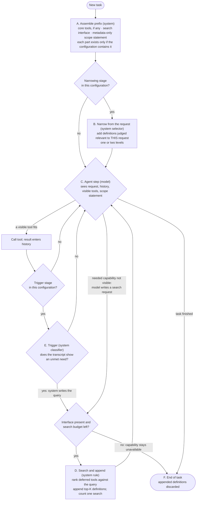
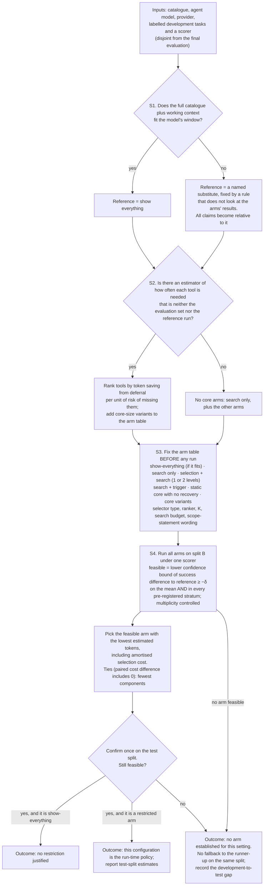

<!-- STATUS BANNER added by the lead on 2026-10-19 (AUTH-010). Provenance of this file: UNKNOWN; it was untracked, dated 2026-10-19, with no authorization record. It is an INPUT DRAFT, not a workspace record. Known defects: the 292k-token figure is attributed to the benchmark's authors but comes from the benchmark repository's development document via the project's S4F digest (see package-v4/03 section 2); the power figures are two-sided versions of a one-sided problem; section 6 numbers other than those re-read in package-v4/01 are unverified until findings/SUM-0004. The supervisor-facing document is design/package-v4/01-supervisor-brief.md. -->

# A tool-exposure policy for LLM agents: proposal for discussion

**Draft of 19 October 2026, prepared for the meeting of 21 October.**
**Status: a conceptual proposal. Nothing has been implemented or run.** Every statement about how well the policy would work is a hypothesis; the evidence section says which statements rest on published results and which do not.

---

## 1. Orientation (one page)

**Problem.** An agent connected to a very large tool catalogue (your example: 10,000 tools) cannot, or should not, have every tool definition in its context on every call. Showing everything costs input tokens on every model call and may degrade tool choice. Showing too little makes the needed tool unreachable, and a tool that is never shown can never be called.

**What we propose.** A *discovery-based exposure policy*, and an offline procedure that decides which optional stages it contains for a given setting. In one paragraph:

> At run time the agent starts with a small, stable prefix: optionally a small core of tools, a *search interface* over the rest of the catalogue, and a short, metadata-only statement of what exists behind the interface. Optionally, a system selector first adds the tools it judges relevant to the request. The agent works; when it finds that a needed capability is not visible, it asks the search interface, the system ranks the deferred tools against the query, and the best matches are appended to the context. Optionally, a system-side trigger can launch such a search when the transcript suggests an unmet need. Which of the optional stages exist is **not fixed**: an offline procedure, run once per catalogue, model and provider on labelled development tasks, builds a small table of candidate configurations (including "show everything" and "search only") and picks the cheapest one that does not lose more success than a stated margin.

**Three things to know before reading further.**

1. **This is a family of run-time configurations plus a selection procedure, not a single fixed pipeline.** We cannot name the final run-time configuration in advance; the evidence available to us does not discriminate between the candidates. If the procedure returns "search only", the realised policy is essentially what vendors already ship. In that regime the "staged, context-dependent" content of your request is empty, and we say so rather than inventing stages.
2. **The staged form you described is represented only partially.** Stages are optional and there are at most two narrowing levels plus in-run discovery. "Re-adding a tool that an earlier stage removed" happens only if the optional request-level narrowing stage is present; otherwise discovery adds a tool that was never shown. Whether this is an acceptable reading of your intent is the main thing we would like you to judge (Section 7).
3. **The central claims are untested.** In particular: that models actually issue a search when a needed tool is absent, that a system-side trigger can tell when a tool is missing, that a second narrowing level pays, and that the offline selection procedure picks well with realistic amounts of data.

---

## 2. What was asked, and what we assumed

**Your statements (2026-10-14 meeting, automatic transcript; we have nine selected excerpts, not the whole meeting).**

| Said | Our reading |
|---|---|
| "most optimal way to reduce the count of tools while keeping the accuracy as high as possible… We don't need to change it." | The research question stays. The excerpt begins mid-sentence, so its full wording is not established. The unit ("count of tools") differs from the token-based wording of 2 October (below). |
| "the policy is not… take the top five tool… take the top eight tool. This is not a policy… it will be based on the context and based on the scenario." | A fixed top-N cut-off is excluded. The policy should depend on context and scenario. *Context* and *scenario* are not defined in the excerpt. |
| "At each step you have to ask yourself one question. Is all these 10,000 [tools] relevant in this current scenario?… stage one, stage two… I don't know how many stage you have but you have to find those questions and the stages." | A staged filter, each stage with its own question. We cannot tell whether this is a required form or an illustration; the stage count is explicitly open. Who answers each question (model, rule, score) is not stated. |
| "filtered out a tool at stage four but at stage five you found like this tool is relevant then you can go back and then again add the tool." | Re-adding is described permissively ("can"). |
| Five methods "using the same scorer… the same code for evaluation"; "which one works at which time we have to figure it out"; "some kind of findings otherwise it's not a master's thesis". | All compared methods share one scorer. A contribution is findings about *which method works when*. |
| "I don't want you to implement anything." | This deliverable is a policy and its evaluation plan, not code. |

**Earlier requirements (2 October meeting, as recorded in our meeting notes).** Save *input tokens* while maintaining accuracy relative to giving the model all tools ("your idea was never to filter out tools"); the selection mechanism's own token cost counts; savings are judged globally across a trajectory, not per turn; there must be a fallback by which the model can query tools that were filtered out; multiple baselines.

**Where these two meetings do not obviously agree** (we have not resolved them): *count of tools* versus *tokens*; "accuracy as high as possible" versus "maintaining accuracy"; "each step saves tokens" versus a later stage that adds a tool back; and "filter" versus "never filter out tools".

**Working assumptions we adopted for this draft (ours, not yours; please overrule):**

- *Primary cost* is **cumulative model-visible input tokens over complete trajectories**, including every model call made by the selection and discovery machinery, failed trajectories included, and the amortised cost of the offline selection. Output tokens are not in the criterion.
- *Primary constraint* is **end-to-end task success not below a reference by a margin δ** (undecided), on the mean *and* within pre-registered strata (rare-capability tasks; long trajectories).
- Reported separately, never merged: tools visible per call, tokens by category, provider-billed cost, cache behaviour.

The distinctions matter. **Tool exposure** (how many tools are visible at a call) is not **cumulative token consumption** (definitions are re-read at every call, and discovery adds calls). **Task success** is not **tool reachability** (a reachable tool can still be misused; an unreachable one guarantees failure). **Tokens** are not **billed cost**: in the one direct cache measurement we found, a 97.5 % reduction in input tokens came with an inconclusive billed-cost difference (Section 6).

---

## 3. The policy

### 3.1 Run-time behaviour (per task)

How to read it. Every box is a stage that exists only if the configuration chosen offline (3.2) contains it:

- **Show-everything configuration:** A places the whole catalogue in the prefix; B, D, E do not exist.
- **Static core without recovery:** A places a core and nothing else; the agent can never reach anything outside it.
- **Search only:** A places an interface and scope statement (and perhaps a few hand-picked tools); B and E do not exist.
- **Fuller configurations:** B (one or two levels) and/or E are added to search.

**Who decides, with what information.**

| Stage | Question it answers | Decided by | Information available at that moment | Present when |
|---|---|---|---|---|
| A Prefix | none (assembly) | system rule | configuration from the offline step | always |
| B Narrowing | Which non-core tools are relevant to *this request*? | system selector (rule, embedding model, or LLM; type undecided; LLM tokens are counted) | request text; tool metadata; a scorer calibrated on development data | only if selected offline. Level 2 reads only the metadata of tools in groups that survived level 1 |
| C Agent step | Does a visible tool fit the next step? Is a needed capability missing? | the agent model | request, history, tool results, visible tools, scope statement | always |
| D Search and append | Which deferred definitions best match the query? | system rule (ranking over name, description, argument names) | the query (from the model, or from E); metadata of deferred tools | whenever anything is deferred |
| E Trigger | Does runtime evidence (failures, termination, text) show an unmet need? | system classifier | the transcript only | only if selected offline; **default absent** |
| F End | none | system | end-of-task event | always |

The run-time system never uses gold tool lists, reference trajectories or benchmark annotations. Anything derived from data (rankers, selector calibration, tool-need estimates) comes from development tasks kept disjoint from the final evaluation.

### 3.2 Offline selection procedure (once per catalogue, model and provider)

This is **not** a run-time decision and not a rule that generalises across settings unless we test that. It is model selection over a small, pre-declared set of configurations.

Design points that matter for assessing it:

- **Three disjoint task splits.** A builds estimators, selectors and rankers; B compares arms; the test split confirms the winner once. The development estimate of a winner is biased upward by the selection itself, so only test-split figures are reported.
- **Strata guard.** A mean margin can be met by silently dropping exactly the rare capability that recovery exists for, or by failing the most expensive tasks. Hence feasibility is also required within each pre-registered stratum. A thin stratum widens the confidence bound and can make every restricted arm infeasible; the procedure would then return "show everything" *for lack of power, not because it is cheaper*. Such an outcome must be labelled as under-powered, and strata below a minimum size are reported as "not assessed".
- **Selection cost is charged.** The tokens spent comparing arms are divided over a declared number of deployed trajectories and added to every restricted arm's cost.
- **Illustration of scale.** With a 10-point margin and 20 % discordant pairs, roughly 160 paired tasks per contrast are needed; with a 5-point margin and a 2-point true loss, roughly 1,700, which exceeds the 1,578 reference-consistent tasks in the closest benchmark we examined (parametric illustrations, not a plan).

### 3.3 An illustrative trace (invented catalogue, search-only configuration with a three-tool core)

*Task:* "Schedule the review meeting and email the agenda to the attendees." Core visible: `calendar_create`, `contacts_lookup`, `read_file`. Deferred: about 9,997 other tools. The scope statement lists group names only ("email, calendar, tickets, billing, …").

1. **C** → calls `contacts_lookup` and `calendar_create` (visible tools fit).
2. **C** → the model notices that sending mail is needed and no visible tool does it. It emits `search("send email with attachment")`.
3. **D** → the ranker returns the top K=3 definitions, including `email_send`; they are appended to the context. This cost one extra model call that re-reads the whole prompt, and the three definitions will be re-read at every later call.
4. **C** → calls `email_send`; finishes → **F** (appended definitions discarded).

*Failure paths that the policy does not prevent:* the ranker returns three irrelevant tools because the query vocabulary does not match the tool's description (the model may re-query until the search budget is spent, at one more call each); the model never searches and apologises that it cannot send mail (task lost, not degraded); or an appended false positive distracts later steps. If narrowing stage B had been selected, `email_send` might already have been added from the request text; if B missed it, step 2 is a genuine *re-add*.

---

## 4. How the intended mechanisms work, and their limits

**Context sensitivity.** Under the default configuration nothing in the system conditions on the scenario; context enters only through the model's own search queries. Request-level context enters through stage B, and only if the offline step selected it. The offline procedure adapts the policy to the *deployment* (catalogue, model, provider), not to individual tasks. If "context and scenario" means per-task adaptation, only B and E provide it, and neither has direct supporting evidence (Section 6).

**Conditional (staged) narrowing.** Order: core (optional) → request-level narrowing (optional, one or two levels) → in-run discovery. The number of stages is an *output* of the offline procedure and can be zero, one or two. A weakness is that "a stage is present only if a stated test justifies it" is satisfiable by any design, including show-everything; the content of the proposal is that each stage has a stated reason, a skip condition and a test, *not* that stages appear.

**Tool discovery.** Discovery is a ranker (lexical, embedding, or both) over tool name, description and argument names, returning the top K definitions, add-only within a task, bounded by a search budget. This follows the mechanism vendors document (Anthropic's `defer_loading` with regex/BM25 search; OpenAI's tool search). Appended definitions stay until the end of the task, so a false positive costs tokens at every later call. Removal inside a task is excluded because we have no evidence for a removal rule; removal is a testable alternative arm.

**Recovery.** Recovery is the model's search for a capability absent from the visible set (optionally, the trigger E). It is **not guaranteed**. It requires that: (R1) the model emits a search when a needed tool is absent; (R2) the needed tool falls within the top K; (R3) its query vocabulary matches the tool's description; (R4) the search and turn budgets allow the extra calls; (R5) appended results do not degrade later steps; (R6) the scope statement tells the model enough to search without leaking task-specific information; (R7) tool names and arguments obtained this way are valid at call time; (R8, trigger only) the trigger is precise and sensitive enough. If R1–R4 fail the task is **lost, not degraded**. None of these is assumed true; the success constraint in the offline procedure tests their joint effect end to end.

**When deferral pays at all.** Let *T* be the number of agent calls in a trajectory. Keeping tool *t* visible costs its definition length times *T*. Deferring it costs, only in trajectories that need it: one extra model call that re-reads the whole prompt, plus re-reading the appended definitions in the remaining calls, plus the cost of failed searches. Deferral also adds a common overhead (interface schema and scope statement, at every call). Deferring a set of tools therefore pays only if the summed saving exceeds that overhead; otherwise the right configuration is show-everything or a static core. This is accounting, not a result: it says what must be measured, and it can reverse for tools with short definitions in long contexts. The same expressions with provider prices and cache multipliers give billed cost.

**Core ordering heuristic (where a need estimator exists).** Tools are ordered by saving per unit of *risk of being missed* (probability the tool is needed times probability it is not reached). This is a greedy heuristic for a knapsack-type problem. It has no optimality or safety property here, because the independence it assumes fails (reach probabilities depend on the deferred set and the model; co-needed tools are retrieved by one search). The missed-tool probability bounds only *coverage*; success loss also contains a residual (interference, distraction, argument errors, route divergence) that nothing we have bounds. The size of the core is therefore chosen by the end-to-end sweep, not by the heuristic.

---

## 5. Why this form

| Alternative | Why it is not the default | Where it stays |
|---|---|---|
| Fixed top-N retrieval | Excluded by your requirement; and in the benchmark with a controlled pool, retrieval-restricted exposure scored below the curated pool for all four models | an arm (system selector only), as a baseline |
| Show everything | Pays the whole tool block at every call; infeasible where the catalogue exceeds the window (about 292k tokens for the 1,168-tool benchmark by its authors' estimate, with stub schemas understating it; above the window of 2 of 4 models tested) | the reference, where it fits; the winner if it is cheapest |
| Vendor-style deferral (hand-picked core of 3–5 tools plus search) | Needs usage knowledge to pick the core; unmeasured by the sources we hold | the strongest simple rival, and the likely outcome in some regimes |
| System-only staged cascade with a trigger (closest to your picture) | No source we examined supports a system trigger that detects a missing tool; retrieval stages scored lower than curated or full exposure | component E and the two-level B, each as an optional arm |
| Learned selector trained on labelled need | We know of no legitimate source of labelled need at large scale | included if one is obtained and kept disjoint from evaluation |
| Static core with no recovery | Fails silently on rare tools; caught only by the strata guard | arm, to show what recovery buys |

The reasoning in one line: restricting exposure saves tokens but creates unreachable-tool failures; recovery restores reachability at the price of extra calls and reliance on model initiative; system-side narrowing needs a signal of need that a large catalogue does not obviously provide; and because the sources do not say which combination pays, we propose to measure, with a procedure that charges its own cost.

---

## 6. What is established, what is hypothesis, what is unknown

Citations are to the stored copies of the sources (titles, arXiv numbers as retrieved in October 2026); we did not re-fetch them for this draft. Vendor documents are vendor claims.

**Reported by a source (with its limits).**

- *Retrieval-restricted exposure lost accuracy against curated or full exposure in several benchmarks.* DynamicMCPBench (Kamiński, Galyukshev et al., arXiv 2607.20531, Appendix N; 1,168-tool catalogue, 150 tasks, four models, 95 % intervals about ±8 points, single attempts for most cells): curated pool of about 8 tools 37.3 / 42.7 / 44.0 / 54.0 versus `rag:4` 16.7 / 21.3 / 18.0 / 22.7 (the four models in table order). ComplexMCP (Li et al., arXiv 2605.10787v2; 47 tasks, two models, one embedder): every retrieval variant scored below full-context exposure (gaps of 16.3 and 18.4 points for the best retrieval), although the authors also report that strong models largely tolerate distractors up to 300+ tools. ToolMenuBench (Suresh Babu and Ganesh Iyer, arXiv 2606.15508; synthetic): keyword top-5 22.1 % versus 32.1 % for all tools. Interpretation is limited by the few models, one retriever per study, and small samples.
- *Reachability is a hard gate.* In DynamicMCPBench, on tasks whose required tools the retriever never surfaced, success at `pass^3` was 0.0 % for all four models (`rag:8`), and one attempt in 1,905 passed. Fully reachable tasks: 36.7 % (k=4) to 75.3 % (k=32). On the one model that ran full exposure, showing all 1,168 schemas cost 8 points relative to the curated pool, and `rag:32` (36.7) was about equal to full exposure (36.0). One model, one draw.
- *No evidence that a second narrowing stage pays.* In the same benchmark a two-stage router (servers, then tools) matched single-stage retrieval within noise; no token data.
- *Fewer visible tokens need not mean lower billed cost.* Toollery (Tian and Guan, Huawei, arXiv 2609.22218, Table 15; single-step replay on BFCL, per-request means): 2,196 versus 87,074 input tokens (−97.5 %), billed cost $0.000819 versus $0.000749 (inconclusive difference), accuracy 0.840 versus 0.787. The model, pricing and candidate-list construction are not in the text we have. In "Token Reduction Is Not Cost Reduction" (arXiv 2607.12161v5), compressing tool *output* cut estimated tokens by 38.4 % while paired billed cost rose 6.8 %; this concerns output compression, not tool definitions.
- *The tool block's share of cost is workload-specific.* ComplexMCP's full-context prompt averages about 30k tokens for 300+ tools; in one Claude Code corpus the static prefix (system prompt plus tool definitions, not separable) carried about 75 % of reconstructed cost, mostly as cache traffic; other workloads are dominated by tool results (ProMCP, ACL Findings 2026).
- *Search is documented as a shipped mechanism.* Anthropic's tool search tool (regex and BM25 variants over names, descriptions, argument names; every definition is still sent in the request but deferred ones are not loaded into context until discovered; appended inline; guidance to keep the 3–5 most-used tools non-deferred) and OpenAI's tool search (documentation notes that "discovery adds a step and depends on finding the relevant tool"). Vendor-reported savings are unreplicated and in one case internally inconsistent (a stated 85 % reduction versus 77K→8.7K tokens, about 89 %).
- *Model-initiated search is prescribed, not observed.* FitText (Zheng et al., arXiv 2605.02411v4) makes the agent retrieve tools by a prompt that leaves only a "Finish" function available at the start; its gains from multi-turn re-retrieval come from a confounded comparison. We found no source measuring whether a model spontaneously searches when a needed tool is absent.
- *The only trigger-like result is not comparable.* PlanBench-XL (Liu et al., arXiv 2606.22388): inserting an extra turn after an *incorrect* termination improved most models by under 5 points in a blocked-action planning benchmark. It requires knowing the answer is wrong, concerns planning rather than tool exposure, and says nothing about whether a runtime trigger can detect a missing capability.
- *An oracle shows the ceiling of staged visibility, not a method.* ToolMenuBench's own filter that reveals the next causally necessary tool scored 85.7 % at about 1,125 tokens, but it uses hand-specified contracts and known state, i.e. information a deployed policy would not have.

**Our reasoning (derivations or design choices, not findings).** The cost accounting in Section 4; the strata guard and its power consequences; the claim that the mean margin can hide tail loss; the structure of the selection procedure.

**Hypotheses (each has a falsifier in Section 8).** Models initiate search when needed; the needed tool is within the top K at realistic vocabulary mismatch; appended definitions do not degrade later steps; tool definitions are a large enough share of tokens that exposure policy matters; a need estimator for a large catalogue can be obtained legitimately; request-level narrowing improves cost at noninferior success; the selection procedure's error rates are acceptable.

**Novelty.** You described the staged graph as the novelty. In our (bounded) reading of the sources, each mechanism already exists (vendor deferral, model-driven retrieval, hierarchical routers). We did not find a source measuring filtering or discovery policies jointly on task success and billed cost per successful task, but that is a bounded negative result (few queries per gap), not an established gap. The defensible contribution, on present evidence, is *regime-conditional findings about which mechanism pays when* (your "which one works at which time"), with the selection procedure as the vehicle, rather than a new mechanism.

---

## 7. Weaknesses and open tensions

1. **It is a template, not yet a policy.** The run-time configuration is an output of a procedure we have not run. If a single policy is required, the best statement we can make is "the configuration the procedure returns for a given regime".
2. **Context sensitivity is thin.** At best one request-level stage and the model's own queries; adaptation to scenario is at deployment level. Your picture of several stages, each posing a question, is realised as at most two narrowing levels plus discovery.
3. **Reintroduction is mostly discovery.** It re-adds a removed tool only with stage B present; there is no evidence that any system trigger can tell when a tool is missing.
4. **The large-catalogue case is the weakest.** Where the catalogue does not fit the window, no reference run exists, so noninferiority is shown only relative to a substitute that cannot itself be shown noninferior to the true reference. The same absence removes the need statistics the core ordering uses. This is exactly the regime of your 10,000-tool example.
5. **Recovery rests on unmeasured model behaviour.** If models do not search, every deferred-tool arm loses tasks.
6. **Discovery may cost more than it saves.** Each discovery adds a model call that re-reads the whole prompt, and if the tool block is a small share of tokens, no exposure policy saves much.
7. **The selection procedure is itself unvalidated.** With modest labelled data, a multi-arm tournament with mean-and-strata feasibility may return show-everything for lack of power, or a winner that fails on the test split. Its error rates are unknown. It also needs labelled tasks and a scorer; without them there is no evidence-based selection.
8. **Margins and strata are undecided.** δ, the strata and their minimum size, the number of arms (which sets the multiplicity correction), and the declared deployment horizon are all human decisions that change which arm wins.
9. **Token and billed-cost orderings can diverge.** A token win could be a billed-cost loss, and provider usage fields may or may not count deferred definitions (Anthropic documents that they are sent each request but not loaded into context).
10. **Formulation.** "Accuracy as high as possible" read literally is a trade-off frontier, not a constrained minimisation. Our constrained form needs a margin you have not given. An alternative is to report the (tokens, success) frontier per regime and let the margin be applied afterwards.
11. **Evaluation vehicle.** The closest existing benchmark scores replays against a single reference trajectory (success on unexercised alternative routes is unscored; the direction of the bias is unknown, and it may inflate the measured value of recovery), uses a default 12-turn budget that penalises discovery-heavy arms, and gives distractor tools stub schemas that understate token load. Results from it need care.

---

## 8. What would establish or refute it

None of these has been run; each would need your approval and an explicit budget. In dependency order:

| # | Question | Observation | Could end the line? |
|---|---|---|---|
| 1 | How large is the tool block as a share of input tokens, by catalogue size, task type, and outcome? Does provider usage count deferred definitions? | Provider-reported input tokens per call, split by category (tool block, history, tool outputs, discovery overhead), successes and failures separately | **Yes**, if the share is small |
| 2 | Do models search when a needed tool is absent? | Remove one needed tool per task; with and without the scope statement; several models; initiation rate and success | Yes, for every model-initiated arm |
| 3 | Does a ranker or selector find the needed tool within K? | Recall at fixed K on a disjoint labelled split, with and without vocabulary mismatch | For request-level narrowing |
| 4 | Is a substitute reference trustworthy? | Where the true reference runs, compare noninferiority conclusions against the substitute rule | No |
| 5 | Which arms are noninferior and cheapest? | End-to-end sweep over the arm table with strata, three disjoint splits, one scorer, including show-everything and search-only baselines | No (a conditional "no restriction pays here" is itself a finding) |
| 6 | How reliable is the selection procedure? | Simulation of its error rates; a cross-setting test of whether the arm chosen in one setting stays feasible in another | For any claim that the procedure generalises |
| 7 | Do token and billed-cost orderings agree? | Same trajectories, per provider, with cache reads and writes | No |
| 8 | Is a need estimator valid at scale? | Compare group-level, unseen-mass or exploration-log estimators against held-out true need on catalogues where the reference runs | For the core stage at scale |

**What would count as support for the proposal.** On the test split, a restricted configuration with success noninferior to the reference (on the mean and in each stratum) at lower total tokens, *including* selection and discovery overhead, in at least one regime, with the arm table and margin fixed beforehand. **What would count against it:** show-everything or a hand-picked core plus vendor search being feasible and cheapest everywhere we can test; models failing to initiate search; or the tool block being too small a share of tokens to matter.

---

## 9. Where your steer matters most

1. **Is the staged question-per-step form binding,** or is a policy whose stages appear only where a stated test justifies them acceptable?
2. **What do "context" and "scenario" mean:** the individual request, the trajectory so far, or the deployment (catalogue, model, provider)?
3. **Unit of the objective:** count of tools, input tokens, or billed cost; and does "keep accuracy as high as possible" mean a margin (and what size), or a frontier?
4. **Would regime-conditional findings** ("a second stage does not pay in regime X"; "show-everything wins on provider Y") count as the required findings and as the contribution, given that the mechanisms themselves are not new?
5. **How should the large-catalogue case be evaluated,** given that no reference run exists there? Is a named substitute acceptable?
6. **Does a code-mediated existing project you named earlier need to be a baseline arm?** (Our client-side arms cannot include it.)
7. **Priority:** may we start with experiment 1 (token accounting), which is cheap and could end the line?

---

## References

Sources are cited as stored in our research collection (retrieval dates 11–13 October 2026). arXiv numbers and titles are as printed on the stored copies; we did not re-fetch them for this draft.

- Kamiński, J., Galyukshev, I., et al. *DynamicMCPBench: A Trace-Grounded, Effect-Scored Benchmark for LLM Agents over Live MCP Servers.* arXiv:2607.20531 (Appendix N, Table 7).
- Li, Y., Yang, X., Wang, L., Luo, W., Chen, H. *ComplexMCP: Evaluation of LLM Agents in Dynamic, Interdependent, and Large-Scale Tool Sandbox.* arXiv:2605.10787v2.
- Suresh Babu, R., Ganesh Iyer, L. *ToolMenuBench: Benchmarking Tool-Menu Filtering Strategies for Reliable and Efficient LLM Agents.* arXiv:2606.15508.
- Tian, X., Guan, R. *Toollery: Scaling LLM Agents to Thousands of Skills and Tools.* Huawei. arXiv:2609.22218 (Table 15).
- Zheng, K., Zhang, H., Sun, R., Ye, C., Wang, W. *FitText: Evolving Agent Tool Ecologies via Memetic Retrieval.* arXiv:2605.02411v4.
- Liu, J., Lin, Q., Qian, C., et al. *PlanBench-XL: Evaluating Long-Horizon Planning of LLM Tool-Use Agents in Large-Scale Tool Ecosystems.* arXiv:2606.22388.
- *Token Reduction Is Not Cost Reduction.* arXiv:2607.12161v5.
- ProMCP. ACL Findings 2026, aclanthology.org/2026.findings-acl.1967.
- Anthropic. *Tool search tool* documentation, platform.claude.com/docs/en/agents-and-tools/tool-use/tool-search-tool (retrieved 2026-10-11). Vendor documentation.
- OpenAI. *Tool search* guide, developers.openai.com/api/docs/guides/tools-tool-search (retrieved 2026-10-11). Vendor documentation.
